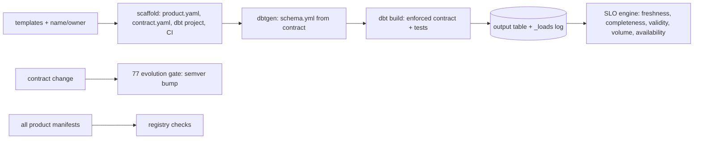

# POC 050: Data-mesh data product template with contract and SLOs

**Category:** Data Engineering | **Stack:** dbt (real), DuckDB, Jinja2 sandbox, YAML contracts (reuses POC 077)

## Problem
Domain teams in a data mesh publish datasets with no shared standard for ownership, schema guarantees or reliability, so consumers cannot trust them. This template scaffolds a data product (manifest, contract, dbt project, CI workflow), generates the dbt enforced contract and tests from the single contract file, evaluates five SLOs with an error budget, and gates contract changes and registry-wide governance rules.

## Approach

- Scaffolding uses a Jinja2 sandbox with StrictUndefined; names/owners are validated and existing products are never overwritten.
- dbt `schema.yml` and singular range/pattern tests are generated from `contract.yaml`, so contract and tests cannot drift; `dbt-schema --check` fails CI on drift.
- Manifest parser is strict (unknown keys, tier/availability rules, classification vs roles, deprecation needs a sunset date).
- SLO engine runs on DuckDB; validity reuses POC 077's validator; empty table or no loads fails closed.
- Contract change gating reuses POC 077's semver evolution check; registry checks cover duplicate outputs, unknown or draft dependencies and consumers of sunset products.

## Run it
```bash
make demo PY=python  # requires dbt-core + dbt-duckdb (heavy requirements)
make test
```

## Evidence status
| Claim | Status |
|---|---|
| Scaffold, generated dbt schema, manifest/contract validation, CLI | Tested (real) |
| Real `dbt build` passes on clean data and fails on negative amounts and bad enum values | Tested (real dbt-duckdb, heavy job) |
| SLO engine: each of five SLIs breaches in its scenario; fail-closed on empty | Tested (synthetic load history) |
| Contract evolution gate and registry rules | Tested (reuses 077) |
| Real warehouses, schedulers, catalog tools (DataHub, OpenMetadata), data-mesh platform | Not used / out of scope |

## Results
<!-- RESULTS:START -->

**Results (measured by `python -m data_product_template.main`)**
- dbt build of scaffolded product (clean seed): ok=True
- dbt build with defective seeds (must fail): {'negative_amount': False, 'bad_status': False}
- generated schema.yml out of date after a contract edit is detected: True

#### SLO scenarios

| scenario | all SLOs met | violated | error budget left |
|---|---|---|---|
| healthy | True | - | 1.500 |
| stale (no load for 3 days) | False | freshness_hours | 1.400 |
| volume drop (-70%) | False | volume_deviation_pct | 1.500 |
| availability burn (4 failed loads) | False | availability | -2.500 |
| incomplete (20 null amounts) | False | completeness, validity | 1.500 |
| invalid (20 bad statuses) | False | validity | 1.500 |

#### Contract change gate

| change | required bump | actual bump | verdict |
|---|---|---|---|
| drop column + patch bump | major | patch | REJECT |
| tighten amount max + minor bump | major | minor | REJECT |
| tighten amount max + major bump | major | major | accept |
| doc-only change + patch bump | patch | patch | accept |

<!-- RESULTS:END -->

## Limitations
- SLO inputs are a local `_loads` table, not a real orchestrator or observability stack; load history is synthetic.
- Validity is approximated as 1 - error-violation count / rows (violations can overlap on one row).
- The manifest format is this repo's own, not a standard (not Data Product Descriptor / ODPS compliant).
- dbt model contracts enforce column names and types; ranges and patterns are enforced by generated tests, not by the contract itself.
- Whole POC runs in the heavy CI job (needs dbt), not the fast job.

## Data and security
Synthetic orders generated with a seeded RNG; no external data.
