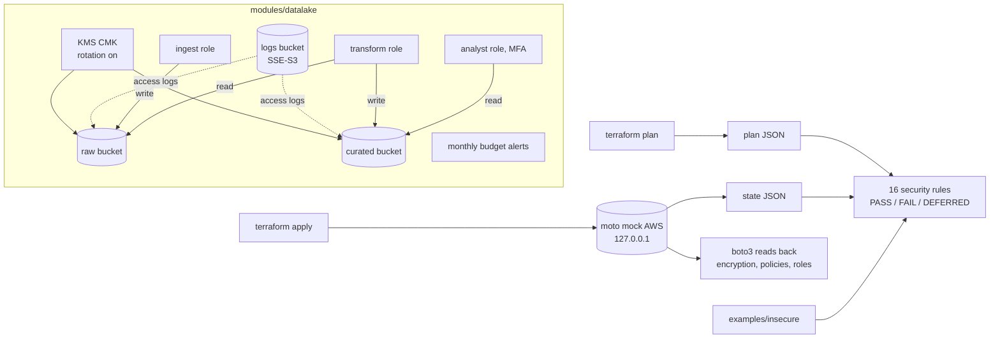

# POC 051: Secure data-lake foundation (S3/KMS/IAM), checked locally with Terraform and a mock AWS

**Category:** AWS & Cloud | **Stack:** Terraform, AWS provider (plan-only), JSON-plan policy tests

## Problem
Data lakes leak through defaults: a bucket without a public-access block, an upload without
encryption, an ETL role with `s3:*`, a key that never rotates, a bill nobody watches. This POC is a
reusable Terraform module that makes the secure setup the only setup, plus an automated way to
*prove* it without an AWS account: policy-as-code rules over the Terraform plan, and a real
`apply` against a local mock of the AWS APIs.

## Approach

- **Buckets** (raw, curated, logs): all four public-access-block flags, ACLs disabled (`BucketOwnerEnforced`), versioning, access logging, lifecycle cleanup (incomplete uploads, old versions; raw tiers to IA then Glacier). Data buckets use SSE-KMS with the module's key and bucket keys; their policy denies non-TLS access, uploads without `aws:kms`, and uploads with any other key. The log bucket uses SSE-S3 because S3 access-log delivery cannot write to a CMK-encrypted bucket (a documented exception in the rules).
- **KMS**: one customer-managed key, annual rotation, 30-day deletion window; the key policy only delegates to IAM (the standard root statement), so access is granted per role.
- **IAM**: `ingest` (write raw), `transform` (read raw, write curated), `analyst` (read curated, MFA required to assume). Allow statements name exact actions and resources (no wildcards); explicit denies block deletes, bucket-policy/encryption/versioning changes and key lifecycle actions for all three roles. Tests assert each role's granted actions equal an exact golden set.
- **Cost guard**: a monthly budget with 80% forecast and 100% actual alerts (a Budget itself is free). Nothing else in the stack is billed per hour.
- **Inputs are validated** (`account_id` is 12 digits, principal ARNs required, key window 7-30 days, ...) and `account_id` is passed in rather than looked up so plans need no AWS calls.
- **Rules run in two places.** On the *plan*, attributes known before apply are judged; policy documents that embed the key ARN are "known after apply", so those findings are `DEFERRED` (never counted as a pass). After a mock `apply`, the same rules re-run on the *state*, where nothing may remain deferred.
- `examples/insecure` is deliberately wrong (public bucket, no encryption, wildcard IAM, no rotation). The checker must fail it; that is the proof the rules can fail.

## Run it (no credentials, no AWS account)
```bash
# needs Terraform >= 1.5 on PATH (tested with 1.9.8)
pip install -r ../../requirements-dev.txt -r ../../requirements-infra.txt
make demo   # fmt, validate, plan + rules, apply to mock, re-check state, drift check, destroy
make test   # 34 tests (about 5 minutes; terraform/mock tests skip if the tools are missing)
```
`infra/envs/local-mock` points every AWS endpoint at `127.0.0.1` with the literal credentials
`mock`. `infra/envs/dev` is the real-AWS entry point and is **never applied by anything in this
repository**: there is no make target, and a test asserts the Makefile contains no `terraform apply`.

## Evidence status
| Claim | Status |
|---|---|
| `terraform fmt`, `validate`, input validation errors | Tested (Terraform 1.9.8, AWS provider 5.82.2) |
| 16 rules on the plan; insecure example fails the expected rules; mutated plans fail | Tested |
| Real `apply` of 40+ resources against moto, state re-checked, boto3 read-back, no drift on re-plan, destroy | Tested against the **mock** |
| Budget resource applied | **Not applied**: moto lacks `describe_subscribers_for_notification`, so the provider hangs; judged at plan level only |
| Enforcement of bucket/IAM/KMS policies (does AWS really reject the unencrypted upload?) | **Not tested**: moto stores policies but does not enforce their conditions |
| Behaviour on real AWS, cost, `tflint`/`checkov` | Not run |

## Results
<!-- RESULTS:START -->

**Results: Terraform checks against a local AWS mock (generated by `make demo`)**
Terraform 1.9.8, AWS provider ~> 5.82, moto mock server. No real AWS account was contacted; credentials are the literal string `mock`.

- `terraform fmt -check`: clean; `validate`: envs/dev, envs/local-mock, examples/insecure ok.
- Plan of the module: {'PASS': 31, 'FAIL': 0, 'DEFERRED': 7}. After apply to the mock, the same rules on the applied state: {'PASS': 43, 'FAIL': 0, 'DEFERRED': 0}.
- Deliberately insecure example (must fail): {'PASS': 0, 'FAIL': 17, 'DEFERRED': 0}.
- Re-plan after apply exit code: 0 (0 = no drift). Buckets left after `destroy`: 0.
- Wall-clock (seconds, one machine): {'fmt_init_validate_s': 24.1, 'plan_s': 24.9, 'apply_s': 49.8}.

| rule | plan pass | plan deferred | plan fail | applied pass | applied fail | insecure example fail |
|---|---|---|---|---|---|---|
| s3-public-access-blocked | 3 | 0 | 0 | 3 | 0 | 1 |
| s3-encrypted-with-cmk | 3 | 0 | 0 | 3 | 0 | 1 |
| s3-versioning-enabled | 3 | 0 | 0 | 3 | 0 | 1 |
| s3-acls-disabled | 3 | 0 | 0 | 3 | 0 | 1 |
| s3-access-logging | 2 | 0 | 0 | 2 | 0 | 1 |
| s3-lifecycle-cleanup | 3 | 0 | 0 | 3 | 0 | 1 |
| s3-tls-only | 1 | 2 | 0 | 3 | 0 | 1 |
| s3-deny-unencrypted-put | 0 | 2 | 0 | 2 | 0 | 1 |
| kms-rotation-enabled | 1 | 0 | 0 | 1 | 0 | 1 |
| kms-deletion-window | 1 | 0 | 0 | 1 | 0 | 1 |
| iam-trust-not-open | 3 | 0 | 0 | 3 | 0 | 1 |
| iam-no-wildcards | 0 | 3 | 0 | 3 | 0 | 1 |
| required-tags | 7 | 0 | 0 | 7 | 0 | 3 |
| budget-guard | 1 | 0 | 0 | 0 | 0 | 1 |

`deferred` = value is "known after apply" at plan time (policy documents that embed the KMS key ARN), so only the applied-state check can judge it.

<!-- RESULTS:END -->

## Limitations
- A mock verifies configuration, not enforcement. Treat a green run as "the intended policy is what Terraform created", not "AWS will block the attack".
- Rules match sibling resources by naming convention (`aws_s3_bucket.data["raw"]` with `aws_s3_bucket_versioning.data["raw"]`); other layouts would need the matcher adapted.
- No provider lock file is committed (a lock generated here would only carry hashes for one platform); run `terraform providers lock` for yours before real use.
- `force_destroy = false` is deliberate: `destroy` needs the buckets emptied (the demo does this on the mock).
- Not included: VPC endpoints, Lake Formation, Glue/Athena, cross-region replication, Object Lock, Macie.
- Real deployment cost is small but not zero (a KMS key is about USD 1 per month plus S3 usage); nothing here was provisioned.

## Data and security
No data, no secrets. The only credentials are the literal string `mock` against `127.0.0.1`; the runner strips `AWS_PROFILE` and session tokens from the environment so real credentials can never be picked up by these runs.
