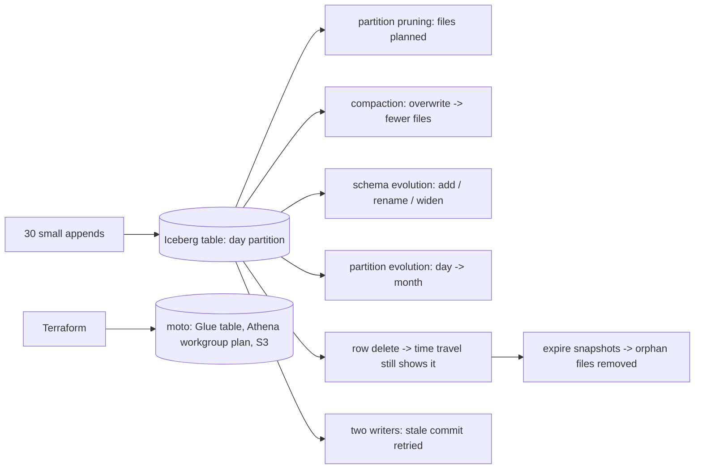

# POC 052: Iceberg lakehouse: evolution, time travel and maintenance (PyIceberg local; Glue/Athena configured on a mock)

**Category:** Data Engineering | **Stack:** PyIceberg 0.12 (real Iceberg tables, SQLite catalog, local files), Terraform + moto for Glue/Athena/S3 configuration; Athena and Spark NOT used

## Problem
Teams adopt Iceberg for schema evolution, time travel and safe deletes, but the behaviours that matter (what an evolution does to old files, why a delete is not a physical delete until snapshots expire, what compaction preserves) are rarely demonstrated. This POC runs genuine Iceberg tables with PyIceberg and measures each behaviour, then declares the AWS side (Glue catalog entry, Athena workgroup with enforced configuration, encrypted result bucket, blocked public access) with Terraform applied to a local mock.

## Approach

- Real Iceberg: field ids make a renamed column and an added column readable over files written before the change; mixed partition specs scan correctly.
- A delete is copy-on-write: current reads lose the rows, an earlier snapshot still returns them, and the data files stay on disk until snapshots are expired and unreferenced files removed (in PyIceberg 0.12 `expire_snapshots` drops metadata only, so orphan cleanup is an explicit step here).
- Strict schema enforcement: appends with missing columns or a nullable column where the table says required are rejected.
- Two writers with stale metadata both commit: the second refreshes and retries.
- Terraform: a Glue table using `open_table_format_input`, an Athena workgroup with enforced configuration, a scan-bytes cutoff and SSE-S3 result encryption (inspected from the plan, because moto cannot complete workgroup creation), and S3 hardening. A first draft used a `table_type` parameter and produced a permanent plan diff; the provider's native Iceberg input removed it.

## Run it
```bash
make demo PY=python   # needs terraform + moto for the AWS part (heavy job); the Iceberg part needs only requirements.txt
make test
```

## Evidence status
| Claim | Status |
|---|---|
| Iceberg schema/partition evolution, pruning, compaction, delete/time travel/expiry, enforcement, concurrent commits, upsert | Tested (real PyIceberg 0.12, local files) |
| Terraform apply of Glue database/table, S3 hardening; clean re-plan | Tested against a LOCAL moto account, not real AWS |
| Athena workgroup | Plan inspected only (moto cannot create it); never applied |
| The Glue table and the PyIceberg table | NOT the same table: the mock does not read Iceberg metadata, so Glue does not know the PyIceberg files |
| Athena/Spark queries, Glue Data Catalog integration for PyIceberg, concurrent writers across processes, scale | NOT verified |

## Results
<!-- RESULTS:START -->

**Results (measured by `python -m glue_athena_iceberg.main`; real PyIceberg 0.12 on a local SQLite catalog; no Athena/Spark engine)**
- **small_appends**: {'snapshots': 30, 'data_files': 30, 'rows': 1200}
- **partition_pruning**: {'files_planned_for_one_day': 3, 'files_total': 30, 'rows_returned': 120}
- **compaction**: {'data_files_after': 10, 'same_checksum': True, 'old_snapshot_rows': 1200}
- **schema_evolution**: {'columns': ['order_id', 'customer_id', 'ts', 'total_amount', 'quantity', 'currency'], 'old_rows_currency_null': 1200, 'new_rows_currency_eur': 5, 'old_rows_total_amount_non_null': True}
- **partition_evolution**: {'specs': 2, 'default_spec_fields': ['ts_month']}
- **delete**: {'rows_for_customer_before': 60, 'rows_after': 0, 'still_visible_in_old_snapshot': 60}
- **expire_snapshots**: {'snapshots_left': 1, 'files_on_disk_before': 51, 'unreferenced_files_on_disk_after': 40, 'deleted_data_removed_physically': True}
- **schema_enforcement**: {'nullable column given nulls-allowed schema': 'ValueError', 'missing required column': 'ValueError'}
- **concurrent_writers**: both commits succeeded
- **final_rows**: 1151
- **glue_athena_on_mock**: {'status': 'RAN against local moto, not real AWS', 'planned_workgroup': {'enforced': True, 'scan_cutoff_bytes': 10737418240, 'result_encryption': 'SSE_S3', 'engine': 'Athena engine version 3'}, 'replan_exit_code': 0, 'glue_table_params': {'table_type': 'ICEBERG'}, 'glue_table_location': 's3://demo-iceberg-lake/warehouse/lake/orders', 'results_bucket_encrypted': True, 'lake_public_access_blocked': True}

<!-- RESULTS:END -->

## Limitations
- PyIceberg's pure-Python engine is fine for demonstrating semantics but is not a performance proxy for Athena or Spark.
- Compaction here rewrites the whole table with one overwrite; real compaction is per-partition with bin-packing and runs as a separate job.
- SQLite catalog is not safe for many concurrent writers; production uses Glue, REST or JDBC catalogs with proper locking.
- The Terraform stack is applied to a mock; IAM roles, Lake Formation permissions and encryption keys (KMS) are not part of it.
- Whole POC runs in the heavy CI job (Terraform + moto).

## Data and security
Synthetic orders generated deterministically by the demo; fictional bucket names in the mock.
