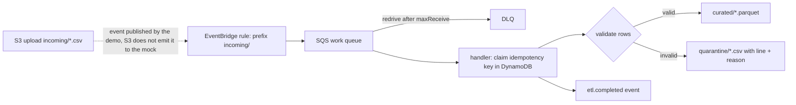

# POC 053: Event-driven ETL with EventBridge, SQS and a Lambda-style handler (local mock; Lambda/LocalStack not used)

**Category:** AWS & Cloud | **Stack:** moto server (via POC 63 harness), boto3, pyarrow; AWS SAM, LocalStack and the Lambda service NOT used

## Problem
File-drop ETL on AWS fails in quiet ways: duplicate event deliveries reprocess data, one bad row kills a batch, poison messages loop forever, and nobody can prove every row was either loaded or rejected. This POC implements the pattern (S3 object event -> EventBridge rule with prefix filter -> SQS with DLQ -> handler) with idempotency via a DynamoDB conditional write, row-level validation into Parquet vs a quarantine CSV, partial-batch failure reporting, claim release on failure, and an end-to-end reconciliation (input rows = curated + rejected).

## Approach

- The handler accepts only `Object Created` events whose key matches `incoming/<safe>.csv`; path traversal, wrong source and malformed JSON are poison messages.
- Idempotency key is `bucket/key#etag`: duplicate deliveries are skipped, a changed object under the same key is reprocessed.
- Any failure after the claim (transient or poison) releases the claim: a test found that without this a retry was skipped as 'duplicate' and the failure was silently acknowledged.
- Returns the SQS partial-batch response: only failed records are retried; poison messages reach the DLQ after `maxReceiveCount` while good messages in the same batch succeed.
- Unexpected exceptions fail only their own item. Non-UTF-8 files and oversized objects are poison, not crashes.

## Run it
```bash
make demo PY=python   # needs moto[server] (requirements-infra.txt) and POC 63
make test
```

## Evidence status
| Claim | Status |
|---|---|
| Handler logic, validation, idempotency, partial batch failure, DLQ redrive, reconciliation | Tested against a local moto account (S3, SQS, DynamoDB, EventBridge) |
| EventBridge prefix-pattern routing to SQS | Tested on moto |
| Lambda invocation / event source mapping | SIMULATED by `poll_once` (the Lambda service is not used) |
| S3 -> EventBridge notification emission | SIMULATED (the demo publishes the event S3 would publish) |
| Real AWS: IAM permissions, concurrency limits, cold starts, event ordering/duplication rates | NOT verified |
| IaC (SAM/Terraform) for this stack | Not included; resources are created by `provision` in the mock |

## Results
<!-- RESULTS:START -->

**Results (measured by `python -m eventbridge_lambda_etl.main`; local moto account; Lambda invocation and S3->EventBridge emission SIMULATED)**
- **messages_processed**: 2
- **curated_keys**: ['curated/day1.parquet', 'curated/day2.parquet']
- **quarantine_keys**: ['quarantine/day2.csv']
- **day2_rows_curated**: 10
- **day2_schema**: {'order_id': 'int64', 'customer_id': 'int64', 'amount': 'double', 'currency': 'string', 'order_date': 'date32[day]'}
- **day2_quarantine_reasons**: ['negative amount', 'unknown currency', 'unparseable value']
- **duplicate_results**: ['duplicate']
- **transient_statuses**: ['retry', 'ok']
- **poison_attempts**: 6
- **dlq_messages**: 2
- **main_queue_empty_at_end**: True
- **curated_keys_final**: ['curated/day1.parquet', 'curated/day2.parquet', 'curated/flaky.parquet']
- **reconciliation**: {'in': 37, 'ok': 33, 'rejected': 4, 'balanced': True}

<!-- RESULTS:END -->

## Limitations
- Everything runs against a mock account; retry timing uses a visibility timeout of 0 to keep tests fast, which real queues would not.
- The idempotency claim is released on failure and there is no lease, so two concurrent consumers could both process a file during the window between claim and release.
- Processing is whole-file in memory with a 5 MB cap; large files need streaming and multipart handling.
- Quarantine files carry raw rows, which may contain personal data: they need the same access controls as the raw bucket in a real deployment.
- Whole POC runs in the heavy CI job (moto server).

## Data and security
Synthetic order CSVs generated in the demo; fictional buckets and queues in the mock.
