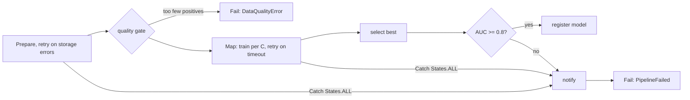

# POC 054: ML pipeline orchestrated by a Step Functions-style state machine (own ASL interpreter; CDK/AWS not used)

**Category:** AWS & Cloud | **Stack:** Own ASL validator/interpreter (Python), scikit-learn tasks, state machine deployed to a local moto; CDK, Terraform and real Step Functions NOT used

## Problem
ML pipelines fail in the transitions: a transient storage error with no backoff, a hyper-parameter job that times out and takes the whole run down, a model that is registered even though it is worse than the gate, or a failure nobody is told about. Step Functions expresses these as Retry, Catch and Choice, but they are rarely tested because there is no local engine. This POC implements an interpreter for a documented subset of Amazon States Language, validates definitions statically, and runs an ML pipeline definition (prepare -> data-quality gate -> tune with Map -> select best -> evaluation gate -> register or notify) through it with real scikit-learn tasks and injected failures.

## Approach

- Interpreter supports Task, Pass, Choice, Wait, Succeed, Fail, Map, Parallel; Retry (backoff arithmetic), Catch with ResultPath, InputPath/Parameters/ResultPath/OutputPath on a JSONPath subset, Choice operators with And/Or/Not/IsPresent. Waits are simulated (accumulated, not slept).
- Error semantics follow the AWS documentation: `States.Runtime` is never caught, `States.ALL` matches everything else, `States.TaskFailed` excludes timeouts; custom errors take the Python exception class name.
- `validate` rejects dangling Next targets, unreachable states, missing terminals, Choice without Default, unsupported features (intrinsic functions, callbacks, distributed Map) and bad Retry settings; the interpreter refuses to start on an invalid definition and on a Task resource that is not registered.
- A step limit stops accidental infinite loops. Six scenarios (happy path, transient errors, persistent failure, Map item timeout, data-quality failure, weak model) are executed with their exact state paths and retry counts recorded.
- Deployment: the definition is created and updated on a local moto Step Functions with boto3. Terraform was tried first: the AWS provider calls `ValidateStateMachineDefinition` at plan time, which the mock does not implement, so IaC could not run against it and was dropped.

## Run it
```bash
make demo PY=python   # needs moto[server] (requirements-infra.txt) and POC 63
make test
```

## Evidence status
| Claim | Status |
|---|---|
| ASL validation and interpretation, retry/catch/choice/map semantics, pipeline scenarios with real scikit-learn tasks | Tested (32 tests) |
| Interpreter fidelity to the real Step Functions service | NOT verified: semantics follow the documentation, never compared with AWS |
| Deployment of the definition | Tested against a LOCAL moto account only; moto does not execute state machines |
| Infrastructure as code (Terraform/CDK) | NOT included (see above) |
| Service integrations (SageMaker, Lambda ARNs), Express workflows, execution history limits, quotas, IAM | Not modelled |

## Results
<!-- RESULTS:START -->

**Results (measured by `python -m step_functions_ml_pipeline.main`; own ASL interpreter running real scikit-learn tasks)**
- definition validation errors: none

- **happy path**: SUCCEEDED; path: `Prepare > QualityGate > Tune > TrainOne > SelectBest > EvaluateGate > Register`; retries: 0 (slept 0s, simulated); registered: {'model': 'churn-lr', 'c': 1.0, 'auc': 0.8414}; notifications: 0
- **transient storage errors (2 failures) are retried with backoff**: SUCCEEDED; path: `Prepare > QualityGate > Tune > TrainOne > SelectBest > EvaluateGate > Register`; retries: 2 (slept 6s, simulated); registered: {'model': 'churn-lr', 'c': 1.0, 'auc': 0.8414}; notifications: 0
- **storage keeps failing -> Catch -> notify**: FAILED (PipelineFailed); path: `Prepare > NotifyFailure > Failed`; retries: 3 (slept 14s, simulated); registered: None; notifications: 1
- **one candidate times out once -> Map item retried**: SUCCEEDED; path: `Prepare > QualityGate > Tune > TrainOne > SelectBest > EvaluateGate > Register`; retries: 1 (slept 1s, simulated); registered: {'model': 'churn-lr', 'c': 1.0, 'auc': 0.8414}; notifications: 0
- **too few positives -> quality gate fails**: FAILED (DataQualityError); path: `Prepare > QualityGate > DataQualityFail`; retries: 0 (slept 0s, simulated); registered: None; notifications: 0
- **weak model (noisy labels) -> evaluation gate -> notify**: FAILED (PipelineFailed); path: `Prepare > QualityGate > Tune > TrainOne > SelectBest > EvaluateGate > NotifyFailure > Failed`; retries: 0 (slept 0s, simulated); registered: None; notifications: 1
- **Deploy to local moto**: {'status': 'deployed to local moto (boto3), not real AWS', 'stored_definition_matches': True, 'type': 'STANDARD', 'logging_level': 'ERROR', 'listed': ['ml-training-pipeline'], 'update_roundtrip': True}

<!-- RESULTS:END -->

## Limitations
- Tasks are Python callables named by the `Resource` field instead of Lambda or SageMaker ARNs; real service integrations have their own request/response shapes.
- Wait states and retry intervals are simulated, so timing behaviour (e.g. TimeoutSeconds, heartbeats) is not exercised.
- Map runs items sequentially; real Map runs concurrently with MaxConcurrency and different failure ordering.
- The JSONPath subset excludes filters, wildcards and intrinsic functions (`States.Format`, `States.Array`, ...), which many production definitions use.
- Whole POC runs in the heavy CI job because deployment needs the moto server.

## Data and security
Synthetic classification data generated by a seeded RNG inside the tasks.
