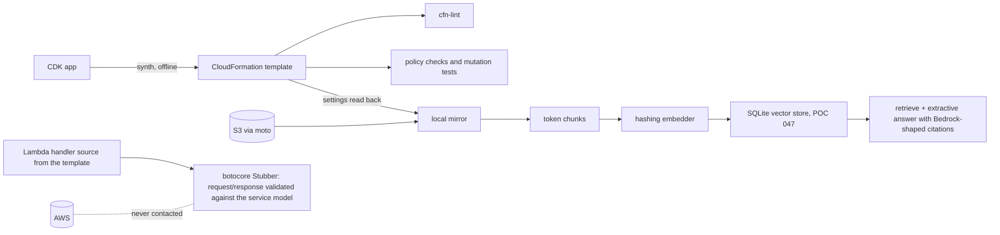

# POC 055: Local variant: Bedrock knowledge-base RAG as CDK - offline synthesis, template checks and a local mirror pipeline (not deployed; no AWS calls)

**Category:** AWS & Cloud | **Stack:** AWS CDK (Python, synthesised offline), cfn-lint, botocore Stubber, moto (S3), POC 047 vector store; Bedrock, OpenSearch Serverless, Titan and Claude NOT run

## Problem
A Bedrock knowledge-base RAG service spans S3, an OpenSearch Serverless vector collection with three security policies, an IAM role Bedrock assumes, the knowledge base and data source, and a query Lambda. Most production failures are configuration errors across those pieces (a trust policy without a confused-deputy condition, wildcard IAM, a vector dimension that does not match the embedding model, chunking outside the allowed range) and a cost surprise from the minimum OpenSearch Serverless capacity. This POC captures the whole stack as CDK, synthesises it offline, checks it, and mirrors the data path locally so the chunking, retrieval and citation behaviour can be tested without an AWS account.

## Original brief and what this local variant covers
- **Original brief:** Bedrock knowledge-base RAG deployed with CDK (CDK, Bedrock, OpenSearch Serverless).
- **Original engineering objective:** Describe a governed Bedrock RAG service as infrastructure-as-code, deploy it, ingest documents, and answer with citations.
- **Covered here (real, tested):** The infrastructure definition and its safety properties (CDK synthesis, IAM/S3/trust checks, vector-dimension and chunking consistency, cost model) plus a local mirror of the retrieval/citation path and API-shape validation against botocore's service model.
- **Not covered / not verified:** Deployment, ingestion jobs, Titan embeddings, Claude generation, OpenSearch Serverless behaviour, IAM evaluation on AWS. Nothing was run on AWS.
- **Status:** local, educational variant; mocks and stand-ins are labelled in the Evidence status table below.

## Approach

- The stack: encrypted, versioned, public-blocked S3 bucket with SSL enforcement; OpenSearch Serverless VECTORSEARCH collection with encryption and network policies and a data-access policy limited to the KB role; KB role with a confused-deputy condition and least-privilege actions; index, knowledge base, fixed-size-chunking data source; query Lambda with reserved concurrency and an explicit log group.
- `settings_from_template` reads chunk size, overlap, top-k and the embedding model back out of the synthesised template, so the local mirror cannot drift from the stack.
- Checks are mutation-tested: each rule is shown to fire when the template is deliberately weakened.
- The Lambda source embedded in the template is executed under a botocore Stubber, which validates request and response parameters against the real `bedrock-agent-runtime` service model, without any network or credentials.
- A modelled cost table shows why the stack is never deployed by this repository: the minimum OpenSearch Serverless capacity dominates (assumed prices).

## Run it
```bash
pip install -r requirements-cdk.txt   # needs Node.js on PATH (CDK/jsii); no AWS account or credentials
make test PY=python
make demo PY=python
```

## Evidence status
| Claim | Status |
|---|---|
| CDK synthesis of the full stack, determinism, resource properties | real (offline) |
| cfn-lint, IAM/S3/trust/chunking checks and their mutation tests | real |
| Lambda handler request shapes, AwsKnowledgeBase request shapes | validated against the botocore service model with Stubber only |
| Local ingest/chunk/retrieve/cite pipeline | real code; S3 mocked with moto; hashing embedder and extractive generator are stand-ins |
| Retrieval quality numbers | measured on a small synthetic knowledge base with the stand-in embedder: say nothing about Titan or Bedrock |
| Monthly cost | modelled from assumed prices |
| Deployment, Bedrock ingestion jobs, Titan embeddings, Claude generation, OpenSearch Serverless behaviour, IAM evaluation on AWS, CDK deploy and destroy | NOT RUN - unverified on AWS |

## Results
<!-- RESULTS:START -->

**Results (POC 055: REAL offline CDK synthesis + checks + local mirror pipeline; S3 MOCKED with moto; nothing deployed or run on AWS)**
Synthesised 15 CloudFormation resources offline (Bedrock::DataSource, Bedrock::KnowledgeBase, IAM::Policy, IAM::Role, Lambda::Function, Logs::LogGroup, OpenSearchServerless::AccessPolicy, OpenSearchServerless::Collection, OpenSearchServerless::CollectionIndex, OpenSearchServerless::SecurityPolicy, S3::Bucket, S3::BucketPolicy). Template checks: **0 findings**; cfn-lint errors: **0**. Settings read back from the template: {'max_tokens': 300, 'overlap_percentage': 20, 'top_k': 5, 'embedding_model': 'amazon.titan-embed-text-v2:0', 'index_name': 'kb-index'}.

#### Local mirror retrieval (60 synthetic documents, 40 questions; hashing embedder and extractive generator are stand-ins)

| config | chunks | hit@1 | hit@5 | citation correct | answer contains gold | chunks embedded |
|---|---|---|---|---|---|---|
| stack default (300 tokens, 20% overlap) | 60 | 0.425 | 0.775 | 0.425 | 0.400 | 60 |
| small chunks (40 tokens, 0% overlap) | 120 | 0.475 | 0.725 | 0.450 | 0.250 | 102 |
| tiny chunks + overlap (15 tokens, 30% overlap) | 267 | 0.550 | 0.800 | 0.550 | 0.175 | 264 |

#### Modelled monthly cost (ASSUMED list prices; why this stack is never deployed by the repository)

| configuration | OpenSearch Serverless USD | Lambda USD | total excl. model tokens USD |
|---|---|---|---|
| standby replicas off | 350.400 | 0.020 | 350.420 |
| standby replicas on | 700.800 | 0.020 | 700.820 |

<!-- RESULTS:END -->

## Limitations
- Nothing here proves the stack deploys or that the knowledge base ingests: CloudFormation validation on AWS, service quotas, model access grants and regional availability are untested.
- L1 constructs are used because Bedrock KB L2 constructs are still alpha; resource properties may change.
- The local mirror differs from Bedrock (tokenizer, embeddings, ranking, generation), so its retrieval numbers are not predictive.
- The index resource type and the data-access principal wiring should be re-checked against a real deploy before use.
- Cost figures use assumed prices.

## Data and security
Synthetic documents only. The CDK app is synthesised with a placeholder account id and region; no credentials are read; S3 is a moto mock with literal "mock" credentials.
