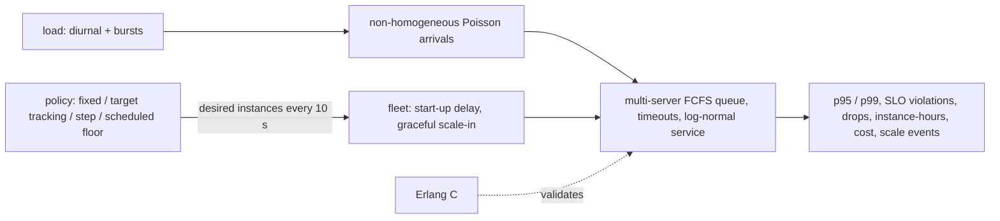

# POC 056: Inference endpoint autoscaling policy study: a queueing simulation validated against Erlang C (SageMaker not used)

**Category:** AWS & Cloud | **Stack:** Python discrete-event simulation (heapq, NumPy), Erlang C validation; SageMaker, Application Auto Scaling and any cloud NOT used

## Problem
Sizing an inference endpoint is a trade between cost and tail latency under spiky traffic with slow instance start-up. Peak-sized fleets are safe and expensive, reactive scaling is cheap and misses bursts, and a time-of-day floor changes the picture again. This POC builds a multi-server queue simulator (worker slots per instance, FCFS, timeouts, 180 s instance start-up billed from launch), validates it against the Erlang C formula, and compares fixed fleets, a target-tracking policy (requests per instance, with cooldowns and a peak-aware scale-in), a utilisation step-scaling policy and a scheduled floor combined with target tracking on a 24-hour diurnal load with three surprise 2.5x bursts.

## Approach

- Validation: simulated mean waiting time of an M/M/4 queue matches Erlang C at rho 0.4, 0.7 and 0.85 (0.015/0.147/0.462 s vs 0.015/0.143/0.460 s).
- Findings on the simulated day (765k requests): a 2-instance fleet fails (51% of requests violate the 1 s SLO); a peak-sized fixed fleet of 6 reaches 0.64% violations at 144 instance-hours; target tracking costs 2.7x less (53 vs 144 instance-hours) but 2.5% violate the SLO and its p99 is 7 s, because bursts outrun the 180 s start-up; a scheduled floor (5 instances 07:30-18:30) plus target tracking gets back to 0.66% violations at 70 h; a burst-proof fleet of 12 costs twice a peak-sized one for no extra latency benefit.
- The 0.64% floor on every well-provisioned policy is the service-time tail itself (log-normal sigma 0.4: some requests need more than 1 s of service), not queueing.
- Target tracking scales out immediately but scales in only to what the recent peak needed after a 300 s cooldown, which is what keeps scale events to 27 over the day (step scaling made 64).

## Run it
```bash
make demo PY=python
make test
```

## Evidence status
| Claim | Status |
|---|---|
| Simulator correctness (Erlang C, accounting invariants, start-up delay, graceful scale-in, billing) and policy logic | Tested (13 tests) |
| Policy comparison | Measured on SIMULATED traffic and service times (assumed distributions, assumed $0.23/instance-hour) |
| SageMaker endpoint behaviour, Application Auto Scaling cooldown semantics, load balancing across instances, cold-start and model-loading times, real cost | NOT verified |
| Load test against a real model server | Not done |

## Results
<!-- RESULTS:START -->

**Results (measured by `python -m endpoint_autoscaling.main`; discrete-event SIMULATION validated against Erlang C; no SageMaker, no cloud; price assumed)**
764,802 requests over 24 h: diurnal load (3 to 25 rps) plus three surprise 10-minute bursts at 2.5x. Instance = 4 workers, mean service 0.4 s (capacity 10 rps), 180 s to start an instance, SLO 1 s, queue timeout 10 s.

#### Simulator vs queueing theory (M/M/4, mean wait)

| load | simulated (s) | Erlang C (s) |
|---|---|---|
| lambda=4.0 rps (rho=0.40) | 0.015 | 0.015 |
| lambda=7.0 rps (rho=0.70) | 0.147 | 0.143 |
| lambda=8.5 rps (rho=0.85) | 0.462 | 0.460 |

#### Policies

| policy | p95 ms | p99 ms | SLO violations % | dropped % | instance-hours | cost USD (assumed $0.23/h) | scale events |
|---|---|---|---|---|---|---|---|
| fixed 2 instances | 10463.200 | 10688.100 | 51.150 | 8.720 | 48.000 | 11.040 | 0 |
| fixed 6 (peak-sized) | 713.200 | 938.100 | 0.640 | 0.000 | 144.000 | 33.120 | 0 |
| fixed 12 (burst-proof) | 713.000 | 937.900 | 0.640 | 0.000 | 288.000 | 66.240 | 0 |
| target tracking (6 rps/instance) | 777.700 | 7338.100 | 2.530 | 0.080 | 52.600 | 12.100 | 27 |
| step scaling (util 30-70%) | 787.400 | 10133.800 | 2.920 | 0.340 | 54.240 | 12.480 | 64 |
| scheduled floor + target tracking | 716.000 | 942.500 | 0.660 | 0.000 | 70.260 | 16.160 | 14 |

<!-- RESULTS:END -->

## Limitations
- Instances are modelled as worker slots in one shared queue; real endpoints balance across instances (random or least-outstanding), which adds variance relative to a pooled queue.
- Arrival rates, service-time distribution, 180 s start-up and the burst shape are assumptions; conclusions about which policy wins depend on them.
- No request batching, GPU memory limits, warm pools or multi-model endpoints.
- A single simulated day and seed; the burst timing is known to the scheduled policy only through its floor, not through the bursts themselves.

## Data and security
Synthetic arrival and service processes from seeded RNGs; no data files.
