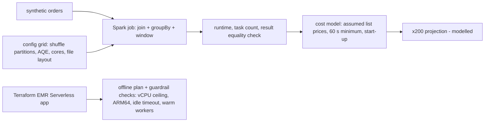

# POC 057: Spark cost/performance tuning study: real local Spark timings with a modelled EMR Serverless price (nothing deployed to AWS)

**Category:** AWS & Cloud | **Stack:** PySpark (local), Python cost model, Terraform plan-only (offline, mock credentials); EMR Serverless NOT used

## Problem
Spark job cost is driven by a few knobs: shuffle partition count, adaptive query execution, parallelism, input file layout, and (on EMR Serverless) pre-initialised capacity, worker architecture and idle timeout. This POC runs one realistic job (broadcast join, group-by, window top-3 over 1.5M synthetic orders) under different configurations on local Spark, verifies every configuration returns identical results, and converts measured runtimes to a modelled EMR Serverless bill (per-vCPU/GB-hour, 60 s minimum per worker, start-up). A Terraform definition of the application is plan-checked offline for cost guardrails.

## Approach

- All configurations are checked to return identical results before any timing is compared.
- Measured: too many shuffle partitions is slowest (400 partitions: 1212 tasks, ~5 s vs 1.9 s at 16); AQE coalescing recovers it (28 tasks, 1.6 s) without hand-tuning.
- The measured jobs last seconds, so the 60 s per-worker billing minimum dominates their modelled cost (all 0.004 USD); the x200 projection scales runtime linearly, which is an assumption.
- Idle pre-initialised capacity is modelled at about 174 USD per month per 4-vCPU worker: only worth it for a latency requirement.
- Terraform plan guardrails flag a 512 vCPU ceiling, x86 workers, a 60 min idle timeout and 5 warm workers.

## Run it
```bash
make test PY=python
make demo PY=python   # needs Java 17+, pyspark, terraform for the plan step
```

## Evidence status
| Claim | Status |
|---|---|
| Spark runtimes, task counts, result equality | real, local[N] on one shared machine; noisy |
| EMR Serverless prices and bills | modelled from assumed list prices; verify against the current price list |
| x200 projection | modelled (linear scaling assumption) |
| Terraform application definition | plan only, offline, literal mock credentials; not applied and not deployed |
| EMR Serverless service behaviour (autoscaling, shuffle on S3, cold start) | not tested |

## Results
<!-- RESULTS:START -->

**Results (measured by `python -m emr_serverless_cost_tuning.main`; REAL local Spark timings, MODELLED EMR Serverless prices and 200x projection; terraform plan offline)**
1,500,000 synthetic orders; job = broadcast join + group-by + window top-3. All configurations returned identical results: **True**. Local timings are noisy (shared machine); read orders of magnitude, not decimals.

| experiment | configuration | runtime s (measured) | tasks | cost USD (this run, modelled) | runtime s projected x200 | projected cost USD (modelled) |
|---|---|---|---|---|---|---|
| shuffle partitions (AQE off) | 1 | 2.853 | 15 | 0.004 | 570.600 | 0.039 |
| shuffle partitions (AQE off) | 4 | 2.136 | 24 | 0.004 | 427.200 | 0.030 |
| shuffle partitions (AQE off) | 16 | 1.878 | 60 | 0.004 | 375.600 | 0.026 |
| shuffle partitions (AQE off) | 64 | 2.838 | 204 | 0.004 | 567.600 | 0.039 |
| shuffle partitions (AQE off) | 400 | 5.096 | 1212 | 0.004 | 1019.200 | 0.070 |
| AQE coalescing | 400 initial, AQE on | 1.646 | 28 | 0.004 | 329.200 | 0.023 |
| parallelism | local[1] | 2.070 | 54 | 0.004 | 414.000 | 0.029 |
| parallelism | local[2] | 1.822 | 56 | 0.004 | 364.400 | 0.026 |
| parallelism | local[4] | 1.546 | 60 | 0.004 | 309.200 | 0.022 |
| input layout | 1 file | 1.733 | 60 | 0.004 | 346.600 | 0.024 |
| input layout | 200 small files | 2.181 | 66 | 0.004 | 436.200 | 0.030 |

Cost model: assumed list prices ($0.052624/vCPU-h, $0.0057785/GB-h, ARM64 20% cheaper), 4 vCPU/16 GB workers, 60 s minimum billing per worker, 15 s start-up. The measured jobs run for seconds, so the 60 s minimum dominates their modelled cost.

#### Idle cost of pre-initialised capacity (modelled, per month)

- 1 pre-initialised 4 vCPU workers: $174.5
- 2 pre-initialised 4 vCPU workers: $349.0
- 5 pre-initialised 4 vCPU workers: $872.5

#### Terraform plan checks (offline)

- **default**: 0 finding(s)
- **no cost ceiling (max 512 vCPU)**: 1 finding(s): maximum capacity 512 vCPU exceeds the 128 vCPU ceiling
- **x86 workers**: 1 finding(s): x86_64 workers: ARM64 (Graviton) is cheaper for Spark if libraries support it
- **long idle timeout**: 1 finding(s): idle timeout 60 min exceeds 15
- **5 warm executors**: 1 finding(s): 5 pre-initialised workers kept warm: about $872.5 per month while idle (justify with a latency requirement)

<!-- RESULTS:END -->

## Limitations
- Local Spark is not EMR: no S3 I/O, no dynamic executor allocation, no network shuffle; conclusions about partitions/AQE transfer, absolute numbers do not.
- Linear x200 projection ignores skew, spill and scheduling effects.
- Prices are assumptions and change by region.
- Timing noise on a shared machine; relative orders of magnitude only.

## Data and security
Synthetic data only. Terraform uses the literal strings "mock" as credentials and never contacts AWS; no resources are created.
