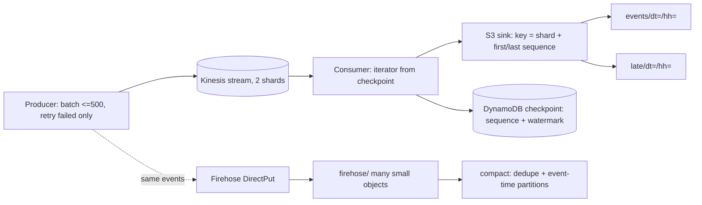

# POC 058: Streaming ingest via Kinesis and Firehose to S3 (local mock; Terraform/LocalStack not used)

**Category:** AWS & Cloud | **Stack:** moto server (via POC 63 harness), boto3; Terraform and LocalStack NOT used

## Problem
Streaming ingest to a lake fails in three ways: producers lose or duplicate records on partial `PutRecords` failures, consumers duplicate or skip data around crashes, and managed delivery leaves many small, duplicated objects. This POC implements a producer that retries only the failed records, a checkpointing consumer whose S3 sink is idempotent (so crash/replay yields effectively-once output), late-event routing by a persisted watermark, poison-record handling, and a compactor that merges Firehose output into one object per event-time hour while dropping duplicate event ids.

## Approach

- The producer sends only records reported failed on the next attempt (resending the whole batch duplicates the successes), backs off, and reports `gave_up` ids; oversize records are rejected before sending.
- The consumer writes the batch to S3 *before* committing the checkpoint; the object key is derived from shard and first/last sequence, so a replay after a crash overwrites the same objects: at-least-once reads, effectively-once output.
- Lateness is judged against a watermark stored with the checkpoint, so replaying a batch classifies records identically. Records the producer had to retry arrive behind the watermark and land under `late/`.
- Unparseable records are skipped and counted so one bad record cannot block a shard; `ExpiredIteratorException` ends the poll and resumes from the checkpoint next time.
- Compaction deletes source objects only after all destination writes succeeded.

## Run it
```bash
make demo PY=python   # needs moto[server] (requirements-infra.txt) and POC 63
make test
```

## Evidence status
| Claim | Status |
|---|---|
| Producer retry/partial failure, consumer crash and replay, watermark routing, poison handling, compaction | Tested against a local moto account (Kinesis, Firehose, S3, DynamoDB) |
| Throughput errors | INJECTED by a wrapper (the mock does not throttle) |
| Real Kinesis semantics: shard limits and hot partitions, resharding, enhanced fan-out, KCL leases, Firehose buffering/format conversion | NOT tested |
| Firehose delivery in the mock writes immediately and per call, unlike real buffering | Known divergence |
| IaC (Terraform/CDK) | Not included |

## Results
<!-- RESULTS:START -->

**Results (measured by `python -m kinesis_firehose_ingest.main`; Kinesis, Firehose, S3, DynamoDB on a LOCAL moto account; failures injected by wrappers)**
- **producer**: {'sent_records': 605, 'retried_records': 100, 'gave_up': 0}
- **crashed_once**: True
- **consumer_after_replay**: {'records': 505, 'batches': 6, 'poison_skipped': 0}
- **sink**: {'objects': 21, 'events': 605, 'unique_event_ids': 605, 'expected': 605, 'late_prefix_events': 50}
- **effectively_once**: True
- **firehose_objects_before_compaction**: 6
- **firehose_compaction**: {'objects_before': 6, 'objects_after': 3, 'events_in': 600, 'events_out': 500, 'duplicates_dropped': 100}
- **firehose_unique_after**: 500
- **poison_skipped**: 1
- **oversize_rejected**: ['big1']
- **missing_stream_error**: ResourceNotFoundException

<!-- RESULTS:END -->

## Limitations
- Single consumer per stream: no lease coordination, so two consumers on one shard would double-process (the idempotent sink limits the damage, the checkpoint would still race).
- Effectively-once relies on deterministic object keys; changing batch size between crash and replay would change the keys and create duplicates (compaction removes them by event_id).
- Compaction reads everything under a prefix into memory; production compaction needs bounded memory and partition-level locking.
- Whole POC runs in the heavy CI job (moto server).

## Data and security
Synthetic events generated by the demo (seeded by index); fictional stream and bucket names.
