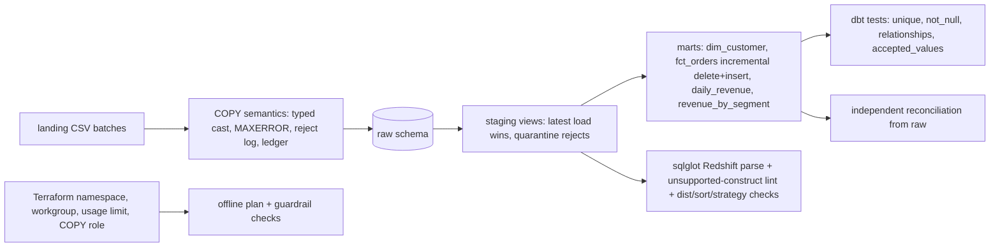

# POC 059: Local variant: Redshift Serverless ELT with dbt - executed on DuckDB with Redshift-dialect and Terraform plan checks (nothing run on Redshift or AWS)

**Category:** AWS & Cloud | **Stack:** dbt-core + DuckDB (executed), sqlglot Redshift dialect (syntax), Terraform plan-only (offline); Redshift, dbt-redshift and COPY from S3 NOT run

## Problem
A Redshift Serverless ELT pipeline fails in predictable ways: COPY loads partial or duplicated data, models use constructs Redshift lacks, dist/sort keys reference columns that do not exist, an incremental model silently diverges from a full refresh, and an unguarded workgroup bills without a ceiling. This POC runs the transformation layer for real (dbt-core on DuckDB with Redshift-portable SQL), reproduces COPY semantics (atomic past MAXERROR, rejects logged, idempotent via a ledger), validates the SQL and dbt configs against the Redshift dialect, and plan-checks the Terraform for the namespace, workgroup, usage limit and COPY role.

## Original brief and what this local variant covers
- **Original brief:** Redshift Serverless ELT with dbt (Terraform, dbt).
- **Original engineering objective:** Load files into Redshift with COPY, transform with dbt (staging, SCD2 dimension, incremental fact, marts, tests), provision the serverless warehouse with cost guardrails.
- **Covered here (real, tested):** The ELT logic and its correctness properties (COPY semantics, point-in-time dimension, incremental == full refresh for any arrival order, quarantine, reconciliation), Redshift-dialect syntax checks and Terraform plan guardrails.
- **Not covered / not verified:** Redshift itself, dbt-redshift, COPY from S3, distribution/sort-key effects, workgroup creation, SQL semantics on Redshift.
- **Status:** local, educational variant; mocks and stand-ins are labelled in the Evidence status table below.

## Approach

- Raw tables are append-only with a load timestamp; staging keeps the latest load per key and routes invalid rows to `rejected_orders` with a reason, so nothing is dropped silently.
- **Business rule (documented decision): point-in-time segmentation.** `fct_orders.segment` and `country` are the customer's values ON THE ORDER DATE, taken from `dim_customer_history` (SCD2 built from dated customer snapshots; consecutive identical snapshots collapse; the earliest known state extends backwards). `dim_customer` is the CURRENT state, and `revenue_by_current_segment` answers the separate question "today's segmentation applied to all history". Rationale: revenue must be attributed to the segment that bought, not to a later reclassification.
- `fct_orders` is incremental (`delete+insert`) and re-processes (a) new or re-loaded orders and (b) every order of a customer whose history changed since the last build, so it equals a full refresh for ANY file arrival order (tested for in-order, customers-late, reversed and random interleavings). Version precedence for re-sent orders is the batch sequence, not arrival time. An earlier version of this POC joined the segment at load time and drifted from a full refresh (42 of 992 rows); that defect is fixed and covered by regression tests.
- Redshift COPY is not idempotent; the ledger (file hash per entity and batch) is what makes replays safe here and is what a production loader needs.
- Redshift syntax is validated with sqlglot (parse plus a short unsupported-construct list); semantic differences from DuckDB are not covered.
- The Terraform is plan-only with mock credentials. Checks cover public access, VPC routing, capacity ceilings, managed admin password, KMS, a hard usage limit, least-privilege COPY role and bucket protection.

## Run it
```bash
pip install -r requirements-dbt.txt   # dbt-core + dbt-duckdb; Terraform optional (plan checks skip without it)
make test PY=python
make demo PY=python
```

## Evidence status
| Claim | Status |
|---|---|
| dbt models, tests and incremental logic | real: dbt-core 1.12 on DuckDB |
| COPY atomicity, MAXERROR, reject log, replay safety | real, reproduced in a local DuckDB loader (not the Redshift implementation) |
| Redshift SQL syntax and unsupported constructs | sqlglot Redshift dialect: syntax only |
| Terraform plan and guardrail checks | real `terraform plan`, offline, mock credentials, never applied |
| Compute cost | modelled from assumed prices |
| dbt-redshift adapter, COPY from S3, dist/sort effect, workgroup creation, IAM/Secrets Manager behaviour, query performance, SQL semantics on Redshift | NOT RUN - unverified on Redshift/AWS |

## Results
<!-- RESULTS:START -->

**Results (POC 059: REAL dbt-core + DuckDB, local COPY semantics, Redshift-dialect syntax checks, offline Terraform plan; NOTHING run on Redshift or AWS)**
Expected injected defects: {'copy_rejects': 3, 'sql_rejects': 5, 'late_updates': 30, 'late_new_orders': 6}. COPY loaded 1233 rows and rejected 3 unparsable ones (MAXERROR 5), logging each reject in `raw.load_errors`.

#### COPY semantics

| check | result |
|---|---|
| MAXERROR 1 on a batch with 3 bad rows | CopyError: orders/b002: 3 rejected rows exceed MAXERROR 1; nothing loaded; orders rows after: 250 |
| replaying every file | 0 loaded, 8 skipped (ledger) |
| rejected cells | orders/b002 amount='12,50'; orders/b002 amount='12,50'; orders/b002 amount='12,50' |

#### dbt build and reconciliation

dbt build: {'success': True, 'nodes': 28, 'by_status': {'success': 10, 'pass': 18}}. Independent recomputation from raw (DuckDB ASOF join, different SQL): valid orders 998 vs fct_orders 998; rejected 5 vs 5; orders with a wrong point-in-time segment: **0**; revenue by segment matches: True; revenue by current segment matches: True -> **consistent**.

#### Business rule: segment AS OF THE ORDER DATE (point-in-time)

`dim_customer_history` keeps every segment/country change (SCD2): 150 customers, 162 history rows, 12 changes. `fct_orders.segment` is the segment valid on the order date; 70 orders belong to customers whose segment has since changed, so `revenue_by_segment` (as of order date) and `revenue_by_current_segment` (today's segmentation) deliberately differ. The earlier version of this POC carried the segment as of LOAD time, which neither rule asks for (42 of 992 rows disagreed with a full refresh).

### Incremental build vs one full refresh, by arrival order (all columns incl. segment and country)

| arrival order | dbt builds | interim builds stopped by data tests | final build passed | equals full refresh | wrong point-in-time segments |
|---|---|---|---|---|---|
| in order | 4 | 0 | True | True | 0 |
| customers one batch late | 5 | 1 | True | True | 0 |
| batches reversed | 4 | 0 | True | True | 0 |
| random interleaving | 4 | 0 | True | True | 0 |
A stopped interim build is the data-quality gate working: orders that arrive before their customers fail the not-null/relationships tests, and the next build repairs them.

#### Redshift dialect checks (syntax only)

| compiled model | findings |
|---|---|
| daily_revenue | none |
| dim_customer | none |
| dim_customer_history | none |
| fct_orders | none |
| revenue_by_current_segment | none |
| revenue_by_segment | none |
| rejected_orders | none |
| stg_customer_snapshots | none |
| stg_orders | none |
| stg_orders_ranked | none |

Redshift dbt config findings (dist/sort/strategy): none. Negative examples: `select try_cast(a as int) from t` -> TRY_CAST does not exist in Redshift; `select a from` -> does not parse as Redshift SQL: Expected table name but got .

COPY statement the production loader would run: `COPY raw.orders FROM 's3://elt-landing-123456789012/b001/orders.csv' IAM_ROLE 'arn:aws:iam::123456789012:role/redshift-copy-role' FORMAT AS CSV IGNOREHEADER 1 MAXERROR 5 TIMEFORMAT 'auto' TRUNCATECOLUMNS`

#### Terraform plan checks (offline, mock credentials, never applied)

| variant | findings |
|---|---|
| default | none |
| publicly accessible | workgroup is publicly accessible |
| oversized base capacity | base capacity 128 RPU exceeds 32 |

#### Modelled monthly compute (ASSUMED $0.375/RPU-hour, 60 s minimum)

| workload | RPU-hours | compute USD |
|---|---|---|
| 8 RPU, 4 runs/day x 5 min | 80.000 | 30.000 |
| 32 RPU, 4 runs/day x 5 min | 320.000 | 120.000 |

<!-- RESULTS:END -->

## Limitations
- DuckDB and Redshift differ in types, NULL handling, function semantics and optimiser; a model that passes here can still fail or behave differently on Redshift.
- The sqlglot unsupported list is short and manual.
- Distribution and sort keys are validated for existence only; their performance effect cannot be measured here.
- Synthetic data with six months of orders; no concurrency, no large-scale behaviour.
- Cost figures use assumed prices.

## Data and security
Synthetic data only. The Terraform uses the literal credentials "mock" and is never applied; no AWS call is made.
