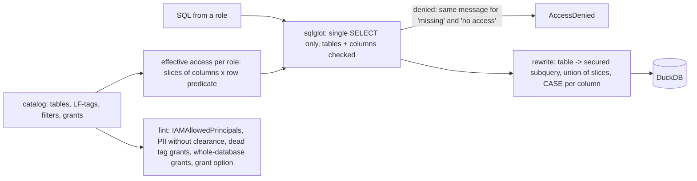

# POC 060: Fine-grained data access with Lake Formation semantics (simulated on DuckDB; no AWS service)

**Category:** Governance & Security | **Stack:** Python permission model, sqlglot, DuckDB; AWS Lake Formation, Athena and Terraform NOT used

## Problem
Table-level IAM is too coarse for a shared lake: analysts should see only their region's rows, data scientists only non-PII columns, and nobody should discover a hidden column by filtering on it. This POC models the Lake Formation permission concepts (LF-tags with inheritance and override, tag-expression grants, named-column grants, data cell filters with row predicates, the legacy `IAMAllowedPrincipals` super group), computes each role's effective access with reasons, and enforces it on DuckDB by rewriting every table reference into a secured subquery. A non-interference property test shows that data a role cannot read cannot change any answer it gets.

## Approach

- Semantics implemented from the Lake Formation documentation: additive permissions (no explicit deny), AND across tag keys / OR across values, tags inherited database -> table -> column with child override, data filters = row predicate + column list, DESCRIBE implied by any access.
- Multiple grants combine cell-wise: a row is visible if any matching grant's predicate holds, and a column's value is NULL unless a grant that matches that row exposes it (tested with an EU-no-email filter plus a US-all-columns filter).
- Enforcement: one SELECT statement only; tables, columns (including inside WHERE, subqueries and CTEs, which closes inference oracles) are checked; `SELECT *` returns only permitted columns; table functions and writes are rejected; alias collisions are refused.
- Non-interference test: the same random queries run on two databases that differ only in cells the role cannot read; for the row-filtered role the answers must be identical, and they are.
- Row filters are validated: only comparisons and boolean logic over known columns (no subqueries or function calls such as `random()`, which a first draft of the validator let through).

## Run it
```bash
make demo PY=python
make test
```

## Evidence status
| Claim | Status |
|---|---|
| Permission model, effective-access computation, query rewriting, attack table, non-interference property, lint | Tested (32 tests, DuckDB) |
| Fidelity to the real Lake Formation service (grant propagation, cross-account sharing, Athena/Redshift Spectrum enforcement, caching) | NOT verified: semantics follow the documentation |
| Terraform / AWS provisioning, Athena queries | NOT used |
| Column masking and row-level security beyond what Lake Formation provides | Out of scope |

## Results
<!-- RESULTS:START -->

**Results (measured by `python -m lakeformation_access_control.main`; Lake Formation semantics SIMULATED on DuckDB, no AWS service)**
#### Visible columns per role

| role | table | columns |
|---|---|---|
| analyst_eu | sales.customers | customer_id, name, region, segment |
| analyst_eu | sales.orders | amount, customer_id, order_id, region |
| data_scientist | sales.customers | customer_id, region, segment |
| data_scientist | sales.orders | amount, customer_id, order_id, region |
| compliance | sales.customers | customer_id, email, name, region, segment |
| compliance | sales.orders | amount, card_last4, customer_id, order_id, region |
| support | sales.customers | customer_id, name, region |
| support | sales.orders | - |
| stranger | sales.customers | - |
| stranger | sales.orders | - |

#### Rows visible per role (customers / orders have 90 / 300 rows)

- analyst_eu: {'sales.customers': 30, 'sales.orders': 100}
- data_scientist: {'sales.customers': 90, 'sales.orders': 300}
- compliance: {'sales.customers': 90, 'sales.orders': 300}
- support: {'sales.customers': 90}

#### Attack attempts

| attempt | outcome |
|---|---|
| select forbidden column | OK: denied (column email is not accessible) |
| forbidden column in WHERE (inference oracle) | OK: denied (column email is not accessible) |
| forbidden column via subquery | OK: denied (column email is not accessible) |
| forbidden column via CTE | OK: denied (column email is not accessible) |
| UNION tries to widen rows (non-EU orders) | OK: returned 30 rows (limit 30) |
| SELECT * returns only permitted columns | OK: returned 90 rows (limit 90) |
| table with no grant | OK: denied (table sales.orders does not exist or access is denied) |
| unknown role | OK: denied (table sales.customers does not exist or access is denied) |
| multi-statement | OK: denied (exactly one SELECT statement is allowed) |
| write attempt | OK: denied (exactly one SELECT statement is allowed) |
| table function reads a file | OK: denied (table functions are not allowed) |

#### Lint findings

- analyst_eu can read PII column sales.customers.name without clearance
- support can read PII column sales.customers.name without clearance

<!-- RESULTS:END -->

## Limitations
- The engine is a simulation: a bug here says nothing about how the real service evaluates grants, and vice versa.
- The SQL checks cover SELECT with joins, CTEs, subqueries, UNION and aggregates in the DuckDB dialect; other dialect constructs may be refused or mis-analysed.
- Union semantics for overlapping filters are this POC's definition of the combined effect, chosen to be explicit and testable.
- Query results are returned in memory with a row cap; there is no audit log, rate limit or timeout.
- A shared alias used for different tables inside one query is refused outright rather than scoped per subquery.

## Data and security
Synthetic customers (90) and orders (300) created inside DuckDB; fictional roles.
