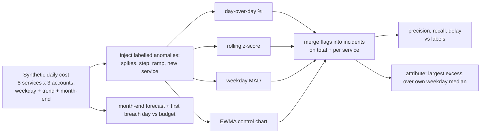

# POC 061: FinOps cloud-cost anomaly detection, attribution and budget forecast

**Category:** AWS & Cloud | **Stack:** numpy, synthetic CUR-like cost data

## Problem
Cloud bills fail slowly and expensively: a forgotten GPU fleet, a retry storm, an upgrade left on.
Teams need to know *that* cost is abnormal, *what* caused it and *whether the month will breach the
budget* (POC 051 creates that budget), without a cloud account to test against. This POC compares
four detectors on labelled synthetic cost data, traces alerts to a service/account, and forecasts
the month end.

## Approach

- Four detectors of increasing sophistication, evaluated identically; the naive day-over-day rule is the baseline to beat (weekday swings make it noisy).
- Each detector also runs on **anomaly-free** data to count false incidents per 180 days, so precision/recall are not the only evidence.
- **Attribution**: the series with the largest excess over its own same-weekday median names the culprit (service, account).
- **Forecast**: month-to-date plus the recent 14-day run-rate; reports the first day the forecast crosses the budget.

## Run it
```bash
make demo && make test   # 15 tests; demo takes a few seconds
```

## Evidence status
| Claim | Status |
|---|---|
| Detector precision/recall/delay, false incidents, attribution, forecast | Measured on seeded **synthetic** data (20 draws) |
| Real AWS CUR / Cost Explorer data, tagging gaps, savings plans/RI amortisation | **Not tested** |

## Results
<!-- RESULTS:START -->

**Results: synthetic cost data, 20 seeded years-of-noise draws (generated by `make demo`)**
180 days x 8 services x 3 accounts (daily USD), weekday seasonality, growth trend, month-end batch bumps and 4% lognormal noise. Seven labelled anomalies: 4 spikes, a persistent step, a slow ramp and a new service. Detectors run on the total and on each service; adjacent flags merge into incidents; an incident is correct if it overlaps a labelled window (+/- 2 days).

| detector | precision | recall | F1 | median delay (days) | false incidents on anomaly-free data (per 180 d) |
|---|---|---|---|---|---|
| day_over_day_30pct | 0.56 | 1.00 | 0.72 | 0.0 | 24.45 |
| rolling_z | 1.00 | 0.89 | 0.94 | 0.0 | 0.00 |
| weekday_mad | 0.83 | 1.00 | 0.90 | 0.0 | 7.90 |
| ewma | 0.97 | 1.00 | 0.98 | 0.0 | 2.45 |

Recall by anomaly type for `weekday_mad`: {'new_service': 1.0, 'ramp': 1.0, 'spike': 1.0, 'step': 1.0}. Slow ramps and persistent steps are the hard cases for any detector that adapts to recent history.

Root-cause attribution: the (service, account) with the largest excess over its own weekday median is the injected one in 100% of spike anomalies.

Budget forecast (month starting day 120, budget = previous month x 1.05 = $27,868; actual $28,878): month-end forecast after day 5/10/20 = [27708.0, 27954.0, 27976.0]; forecast first crosses the budget on day 9.

<!-- RESULTS:END -->

## Limitations
- The generator and detectors share assumptions (weekly seasonality, multiplicative noise); real bills have promotions, reserved-instance true-ups and credits that break them.
- Anomalies are injected at known sizes; subtle drifts below about 20% on a service are not reliably found.
- The same 7-8 anomalies appear in each draw (only noise changes), so rates are not independent evidence about anomaly types.
- Forecast is a run-rate heuristic, not a model; it ignores month-end batch bumps.

## Data and security
Fully synthetic. No cloud credentials or billing exports are used.
