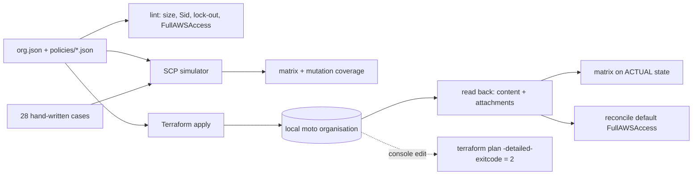

# POC 062: Multi-account guardrails with SCPs and Config rules (simulated evaluation; Terraform on a local mock)

**Category:** AWS & Cloud | **Stack:** Python SCP simulator, Terraform (aws provider 5.82) applied to a local moto organisation, AWS Config rule declarations; OPA NOT used

## Problem
Multi-account AWS estates need preventive guardrails (service control policies) that are reviewable, regression-tested and drift-checked, but SCPs cannot be tested without an organisation. This POC keeps the organisation tree and SCP documents as files, evaluates them with a small simulator that implements SCP semantics (allow needed at every level, explicit deny wins, management account and service-linked roles exempt, negated conditions true on missing keys), lints them for lock-out risks, checks them with a hand-written 28-case regression matrix and per-policy mutation coverage, applies them with Terraform to a local moto organisation, reads the state back, and detects drift.

## Approach

- Policy documents and the OU tree are the single source of truth: both the simulator and Terraform (`jsondecode(file(...))`) read the same files.
- Expected decisions in `cases.json` are written by hand, never produced by the simulator; mutation coverage shows which cases flip when each guardrail is removed, so an untested guardrail is visible.
- Finding on the mock organisation: AWS attaches `FullAWSAccess` to every new OU, so the allow-list SCP on the `regulated` OU is ineffective after `terraform apply` (2 cases fail on the actual state) until the default attachment is detached. `reconcile_defaults` fixes this outside Terraform, and the matrix then passes 28/28 on the read-back state.
- Drift: editing a policy behind Terraform's back makes `terraform plan -detailed-exitcode` return 2; re-applying returns it to 0.
- AWS Config managed rules required by `org.json` are declared in Terraform and verified in state.

## Run it
```bash
make demo PY=python   # needs terraform 1.5+ and moto (heavy job: requirements-infra.txt)
make test
```

## Evidence status
| Claim | Status |
|---|---|
| SCP semantics (allow at every level, deny wins, exemptions, condition operators subset), lint, regression matrix, mutation coverage | Tested (simulator written for this POC; semantics follow AWS documentation) |
| Terraform apply, read-back, drift detection, default-attachment gap | Tested against a LOCAL moto organisation, not real AWS |
| Real AWS Organizations behaviour, IAM Access Analyzer / policy simulator parity, SCP quotas in practice | NOT verified |
| AWS Config rule evaluation and remediation | Not run (rules are declared and applied to the mock only) |
| OPA/Rego policy checks | Not used (checks are Python) |

## Results
<!-- RESULTS:START -->

**Results (measured by `python -m landing_zone_guardrails.main`; SCP semantics SIMULATED, Terraform applied to a LOCAL moto organisation)**
- lint problems: 0 []
- regression matrix: 28/28 expectations hold

#### Which cases each guardrail protects (cases that flip when the policy is removed)

| policy | cases that flip | n |
|---|---|---|
| deny-leave-org | prod-leave-organisation | 1 |
| deny-root-user | member-root-user | 1 |
| protect-security-services | prod-stop-cloudtrail | 1 |
| region-lock | action-case-insensitive, prod-read-wrong-region, regulated-glue-us-east | 3 |
| regulated-allowlist | regulated-ec2-not-allowlisted, regulated-lambda-not-allowlisted | 2 |
| require-s3-encryption | prod-disable-public-access-block, prod-put-without-sse, regulated-put-without-sse | 3 |
| sandbox-cost-guard | sandbox-instance-type-missing-fails-closed, sandbox-large-instance, sandbox-rds-cluster, sandbox-sagemaker-endpoint | 4 |

#### Terraform against local moto

- status: RAN against local moto, not real AWS
- policies_created: ['deny-leave-org', 'deny-root-user', 'protect-security-services', 'region-lock', 'regulated-allowlist', 'require-s3-encryption', 'sandbox-cost-guard']
- content_matches_files: True
- attachments_match_org_json_after_apply: False
- matrix_on_actual_state_after_apply: 26/28
- allowlist_gap_cases_after_apply: ['regulated-ec2-not-allowlisted', 'regulated-lambda-not-allowlisted']
- reconciled_ous: ['regulated']
- attachments_match_org_json_after_reconcile: True
- matrix_on_actual_state_after_reconcile: 28/28
- clean_replan_exit_code: 0
- drift_plan_exit_code_after_console_edit: 2
- plan_exit_code_after_reapply: 0
- config_rules_declared: ['CLOUD_TRAIL_ENABLED', 'ENCRYPTED_VOLUMES', 'S3_BUCKET_PUBLIC_READ_PROHIBITED', 'S3_BUCKET_SERVER_SIDE_ENCRYPTION_ENABLED']
- required_config_rules_present: True

<!-- RESULTS:END -->

## Limitations
- The simulator supports a subset of condition operators and no policy variables; unsupported features raise instead of guessing. It has not been compared with the real AWS evaluation engine.
- moto emulates the Organizations API closely enough for apply/read-back, but it is not AWS: behaviours such as the default FullAWSAccess attachment are as documented by AWS and emulated by moto.
- Nothing in this repository applies the module to a real organisation; the provider block points at a local port with literal `mock` credentials.
- Config rules are only declared; compliance results, aggregation across accounts and auto-remediation are out of scope.
- Whole POC runs in the heavy CI job (Terraform + moto).

## Data and security
Fictional organisation (account ids 111111111111 etc.) defined in org.json; no real accounts.
