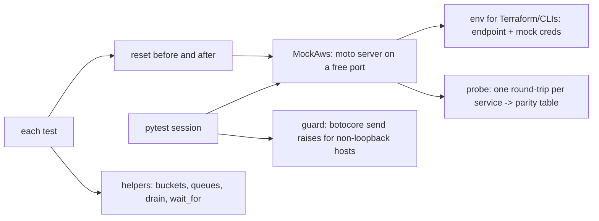

# POC 063: Reusable AWS integration-test harness (moto server; LocalStack/Docker not used)

**Category:** AWS & Cloud | **Stack:** pytest plugin, moto server mode, boto3; LocalStack and Docker NOT used

## Problem
AWS integration tests are either slow and expensive (real AWS), or flaky and leaky (shared mocks, state left over between tests), and a misconfigured client can silently hit a real account. This POC is a small pytest plugin that runs one local AWS mock per session, wipes its state before and after every test, blocks any request to a non-loopback host, gives subprocesses an environment pointing at the mock with real credentials stripped, and measures (rather than claims) which services the mock supports.

## Approach

- Fixtures: `aws` (reset around every test), `bucket`, `queue`; an autouse guard patches botocore's HTTP session so even a client built without an endpoint raises `RealAwsBlocked` instead of reaching the network.
- `MockAws.env()` is meant for subprocesses (Terraform, CLIs, apps): it points `AWS_ENDPOINT_URL` at the mock and removes `AWS_PROFILE`, session tokens and role variables from the child environment only.
- `run_probes` performs a real create/use round-trip per service and records failures verbatim, so the parity table in the results is measured, not asserted.
- The plugin is tested on itself (isolation across consecutive tests) and in a fresh project via `pytester`.

## Run it
```bash
make demo PY=python   # needs moto[server] (requirements-infra.txt)
make test
```

## Evidence status
| Claim | Status |
|---|---|
| Isolation, guard, env stripping, lifecycle, helpers, plugin in a fresh project | Tested (real moto server) |
| Per-service support matrix (16 probes) | Measured on moto 5.2.4 |
| LocalStack, Docker-based emulation, Lambda code execution | Not used. The `lambda_invoke` probe reports what the machine can do: NO without Docker (measured in the sandbox), YES on a GitHub runner that has Docker |
| Fidelity to real AWS (IAM enforcement, eventual consistency, quotas, latency) | NOT verified: a mock is not AWS |

## Results
<!-- RESULTS:START -->

**Results (measured by `python -m aws_mock_harness.main`; moto server, no Docker, no LocalStack)**
- server startup: 0.57 s; reset+create+put per simulated test: 50.4 ms
- state cleared by reset: True; request to real AWS blocked by guard: True

#### What the mock supports (one round-trip probe per service)

| probe | works | detail |
|---|---|---|
| s3 | yes |  |
| sqs | yes |  |
| sns | yes |  |
| dynamodb | yes |  |
| kinesis | yes |  |
| firehose | yes |  |
| events | yes |  |
| secretsmanager | yes |  |
| ssm | yes |  |
| kms | yes |  |
| stepfunctions | yes |  |
| lambda_create | yes |  |
| lambda_invoke | NO | AssertionError:  |
| athena | yes |  |
| glue | yes |  |
| organizations | yes |  |

<!-- RESULTS:END -->

## Limitations
- Passing tests against moto says nothing about IAM permissions, throttling or eventual consistency on real AWS; keep a small real-AWS smoke test elsewhere.
- State reset is global to the server: tests in one session cannot run in parallel against the same `MockAws` (use one session per xdist worker).
- The guard patches botocore's `URLLib3Session.send`; code using other HTTP stacks (e.g. `requests` directly) is not covered.
- Timings come from one shared machine and are indicative only.

## Data and security
No data files; fictional bucket and queue names created in the mock.
