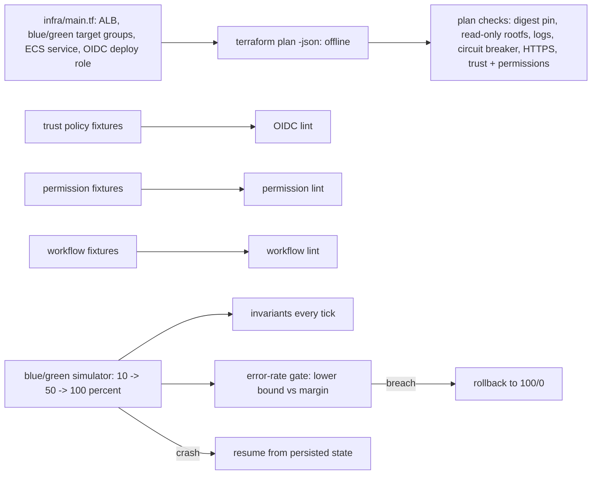

# POC 064: ECS Fargate blue/green deploy with GitHub OIDC: security linting and deployment simulation (nothing deployed)

**Category:** AWS & Cloud | **Stack:** Terraform (offline plan only), Python analysers, GitHub Actions workflow linting; no AWS account, CodeDeploy or real deployment

## Problem
Deploying an inference API to Fargate through GitHub Actions has two failure classes: the pipeline's access (an OIDC trust policy that any repository can assume, `iam:PassRole` on `*`, long-lived keys, tag-pinned actions, injectable workflow steps) and the rollout itself (a bad release serving half the traffic, a crashed controller leaving weights inconsistent). This POC provides analysers for the first class (trust policy, permission policy, workflow, and a policy check over a Terraform plan JSON) and a deterministic blue/green controller simulation with invariants and fail-closed behaviour for the second.

## Approach

- Trust-policy lint requires an `aud` of exactly `sts.amazonaws.com` and a `sub` pinned to repo plus environment or ref; it rejects missing `sub`, owner-wide or trailing wildcards, `pull_request` subjects, `Principal: *`, the wrong action and a provider from another account.
- Permission lint flags wildcard actions, `iam:PassRole` on `*` or without `iam:PassedToService`, resource-scopable actions on `*` and IAM write actions on a deploy role. Workflow lint covers permissions, static keys, SHA pinning, untrusted triggers, a protected environment, concurrency, timeouts and script injection.
- `infra/main.tf` is only planned, offline (5 s, no AWS contact; ARNs are constructed so the permission policy is known at plan time). Unsafe variants (`:latest` image, `repo:owner/*` subject) are planned too and must be caught.
- Blue/green: weights shift 10 -> 50 -> 100 with baking; the gate rolls back only when the *lower* confidence bound of the green-vs-blue error difference exceeds a 1 pp margin; too many failed green task starts trip a circuit breaker before any traffic moves; blue is kept through a drain window; the controller state is JSON-serialisable and a crash/resume run gives the same result as an uninterrupted one.
- Tried and dropped: applying the stack to a local moto server (the ALB took 60 s to become active and the re-plan showed a permanent ECS service diff), so the Terraform stays plan-only.

## Run it
```bash
make demo PY=python   # terraform on PATH for the plan section (heavy job)
make test
```

## Evidence status
| Claim | Status |
|---|---|
| Trust/permission/workflow linters against 32 positive and negative fixtures | Tested |
| Terraform plan policy checks (clean plan = 0 findings, unsafe variants flagged) | Tested with real `terraform plan` run offline |
| Blue/green controller invariants, rollback, circuit breaker, crash/resume | Tested on a SIMULATED world (seeded RNG) |
| Real ECS/ALB behaviour, CodeDeploy, GitHub's OIDC token issuance, real deployments, cost | NOT verified; nothing was applied or deployed |
| Whole POC runs in the heavy CI job (needs terraform) | Heavy |

## Results
<!-- RESULTS:START -->

**Results (measured by `python -m fargate_bluegreen_api.main`; offline Terraform plan, no AWS; deployment SIMULATED)**
#### Linter corpus (findings per fixture; `good_*` must be 0, everything else must be > 0)

**trust**

| fixture | findings |
|---|---|
| bad_any_ref | 1 |
| bad_no_aud | 1 |
| bad_no_conditions | 2 |
| bad_no_sub | 1 |
| bad_other_account_provider | 1 |
| bad_principal_star | 1 |
| bad_pull_request | 1 |
| bad_star | 1 |
| bad_wildcard_owner | 1 |
| bad_wrong_action | 1 |
| bad_wrong_audience | 1 |
| good_branch | 0 |
| good_env | 0 |

**permissions**

| fixture | findings |
|---|---|
| bad_admin | 1 |
| bad_ecr_everywhere | 1 |
| bad_iam_write | 2 |
| bad_passrole_no_condition | 1 |
| bad_passrole_star | 2 |
| bad_service_wildcard | 1 |
| good | 0 |

**workflows**

| fixture | findings |
|---|---|
| bad_no_environment | 1 |
| bad_no_id_token | 1 |
| bad_no_timeout_no_concurrency | 2 |
| bad_pull_request_target | 1 |
| bad_script_injection | 1 |
| bad_static_keys | 3 |
| bad_tag_pins | 2 |
| bad_unneeded_id_token | 1 |
| bad_write_all | 1 |
| good | 0 |

#### Blue/green simulation (20 seeds each)

| scenario | completed | rolled back | mean bad requests served by green |
|---|---|---|---|
| healthy release | 20 | 0 | 3.400 |
| green tasks never start (breaker) | 0 | 20 | 0.000 |
| flaky starts (30%), recovers | 15 | 5 | 2.500 |
| green returns 5xx (5%) | 0 | 20 | 17.800 |
| green mildly worse (0.8pp), inside tolerance | 20 | 0 | 25.100 |
| controller crash mid-rollout | 20 | 0 | 3.400 |

#### Terraform plan policy checks

- status: planned offline (never applied, no AWS contact)
- **clean**: 0 finding(s)
- **unpinned image**: 1 finding(s): task container app: image not pinned by digest
- **trust any repo of the owner**: 1 finding(s): deploy role trust: statement 0: subject pattern 'repo:example-org/*' is too broad (wildcard beyond the ref/environment suffix)
- **trust has no environment**: 1 finding(s): deploy role trust: statement 0: subject pattern 'repo:example-org/inference-api:*' is too broad (wildcard beyond the ref/environment suffix)

<!-- RESULTS:END -->

## Limitations
- The linters encode this POC's rules; they are not a complete IAM analyser and do not evaluate policy semantics (that is what IAM Access Analyzer does).
- The simulator models error rates only: no latency, warm-up, connection draining, sticky sessions or ALB propagation delay.
- ALB weighted-listener shifts are applied by a controller, not by CodeDeploy; a real implementation needs its own permissions and failure handling for the `ModifyListener` call.
- Account id, repository and image digest in the Terraform are placeholders; applying the module to a real account is deliberately not supported.

## Data and security
Synthetic fixtures and simulated traffic only; no real account data.
