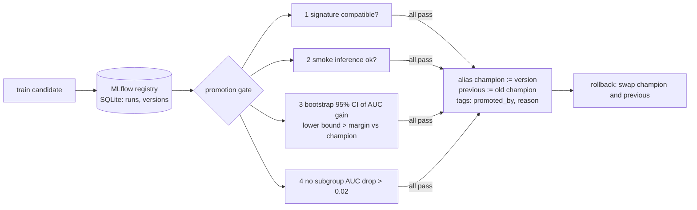

# POC 065: MLflow model registry with a statistical promotion gate, aliases and rollback

**Category:** MLOps & LLMOps | **Stack:** MLflow 3.17 (tracking + registry on SQLite), scikit-learn

## Problem
"The new model has a higher AUC" is not a reason to deploy it: the difference may be noise, the input signature may have changed, or one customer group may have got worse. This POC puts a promotion gate in front of the MLflow model registry and moves a `champion` alias only when the evidence is there, keeping a one-step rollback and an audit trail.

## Approach

- Uses the real MLflow client and registry (SQLite store), not a mock; models are stored as run artifacts and registered as versions.
- Promotion moves an alias (atomic, reversible) rather than a deprecated stage; every promotion/rollback writes `promoted_by`, `promotion_reason`, `rolled_back_by` tags.
- The gate evaluates on a held-out set the candidate never saw; the demo shows a clear win (promoted), a worse model (rejected, with the interval), a signature change, an over-regularised model and a subgroup-only model.
- Re-promoting the current champion cannot erase the rollback target (tested).

## Run it
```bash
pip install -r ../../requirements-mlops.txt
make demo && make test   # 10 tests, ~40 s (each test migrates a fresh SQLite registry)
```

## Evidence status
| Claim | Status |
|---|---|
| Gate decisions, aliases, tags, rollback on a real local MLflow registry | Tested |
| Remote tracking server, S3 artifacts, auth, GitHub Actions trigger, serving integration | **Not tested** |

## Results
<!-- RESULTS:START -->

**Results: real MLflow 3.17 registry on SQLite, synthetic churn data (generated by `make demo`)**
| candidate | promoted | gate reasoning |
|---|---|---|
| v1 baseline (first model) | True | no champion yet: first version passes smoke test |
| v2 trained on 10x more data | True | improvement +0.0286..+0.0368 above margin; no subgroup regression |
| v3 small-data model again (worse than the new champion) | False | subgroup 0 AUC regressed 0.971 -> 0.931; AUC improvement not demonstrated: 95% interval [-0.0368, -0.0286] vs required lower bound 0.002 |
| v4 drops a feature (signature change) | False | signature mismatch: candidate expects 5 features, serving sends 6 |
| v5 over-regularised (C=1e-4) | False | AUC improvement not demonstrated: 95% interval [-0.0006, -0.0000] vs required lower bound 0.002 |
| v6 trained on one subgroup only | False | AUC improvement not demonstrated: 95% interval [-0.0005, +0.0003] vs required lower bound 0.002 |

After the promotions the champion was version 2; `rollback` moved it to version 1 (the previous champion) in one alias update. Audit tags on the promoted version: {'note': 'v2 trained on 10x more data', 'promoted_by': 'ci-bot', 'promotion_reason': 'improvement +0.0286..+0.0368 above margin; no subgroup regression'}.

Gate: signature check, smoke inference, bootstrap 95% interval of the AUC improvement over the champion on a held-out set (lower bound must exceed 0.002), and no protected-subgroup AUC drop above 0.02.

<!-- RESULTS:END -->

## Limitations
- A single held-out set and unpaired bootstrap of AUC; a production gate would add calibration, latency, cost and slice coverage checks.
- Model stored as a pickle artifact for simplicity; use MLflow flavors/signatures with a real serving stack. Never unpickle models from untrusted registries.
- One registry, one reviewer identity string; no approval step (see POC 029 for one).
- The synthetic task is easy; the effect sizes illustrate the mechanism, not a real model comparison.

## Data and security
Synthetic data; local SQLite file in a temp directory.
