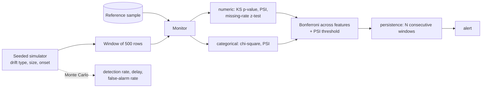

# POC 066: Data and model drift monitoring with measured power and false-alarm rates

**Category:** MLOps & LLMOps | **Stack:** numpy (statistics implemented from scratch and unit-tested)

## Problem
Models degrade silently when input data changes. A monitor that is too sensitive pages people for
noise; one that is too lax misses real shifts. This POC builds a windowed drift monitor (KS, PSI,
chi-square, missing-rate z-test, JS divergence) and, more importantly, *measures* it: false-alarm
rate on stable streams and detection rate/delay for injected drifts of known type and size.

## Approach

- All statistics are implemented with numpy/math and checked against reference values (chi-square survival at known quantiles, KS p-value uniformity under the null, PSI monotonicity and unseen categories).
- **Alert policy**: per-feature significance is Bonferroni-corrected over the number of features, PSI > 0.2 is a second route, and an alert needs 2 consecutive flagged windows. Results compare this with a deliberately twitchy policy to show the false-alarm cost.
- Drift types: mean shift, variance change, categorical mix shift, missing-rate increase, heavy-tail contamination.
- A small logistic-model experiment shows why covariate drift matters (accuracy falls as the input shifts).

## Run it
```bash
make demo   # about 1 minute
make test   # 14 tests
```

## Evidence status
| Claim | Status |
|---|---|
| Statistics correct against known values; false-alarm and detection rates from Monte Carlo (40 streams per cell, seeded) | Measured (synthetic data) |
| Behaviour on real production data, concept drift with delayed labels | Not tested |

## Results
<!-- RESULTS:START -->

**Results: Monte-Carlo on seeded synthetic streams (generated by `make demo`)**
Reference 5,000 rows, windows of 500 rows, 12 windows per stream, drift starts at window 5, 40 independent streams per cell, 6 features (4 numeric, 2 categorical). Alert = a feature flagged (Bonferroni-corrected KS/chi-square or PSI > 0.2 or missing-rate z-test) in 2 consecutive windows.

#### False alarms on stable streams

| policy | streams with any alert | (no drift injected) |
|---|---|---|
| alpha 0.01, persistence 2 (default) | 0.0% | should be near 0 |
| alpha 0.20, persistence 1 (twitchy) | 40.0% | shows the cost of loose settings |

#### Detection by drift type and size (default policy)

| drift | size | detection rate | median delay (windows) |
|---|---|---|---|
| mean_shift | 0.100 | 0% | None |
| mean_shift | 0.300 | 88% | 2.000 |
| mean_shift | 0.600 | 100% | 1.000 |
| variance_change | 0.100 | 0% | None |
| variance_change | 0.300 | 57% | 3.000 |
| variance_change | 0.600 | 100% | 1.000 |
| categorical_shift | 0.050 | 98% | 1.000 |
| categorical_shift | 0.150 | 100% | 1.000 |
| categorical_shift | 0.300 | 100% | 1.000 |
| missing_rate | 0.020 | 100% | 1.000 |
| missing_rate | 0.050 | 100% | 1.000 |
| missing_rate | 0.150 | 100% | 1.000 |
| heavy_tail | 0.020 | 0% | None |
| heavy_tail | 0.050 | 0% | None |
| heavy_tail | 0.150 | 100% | 1.000 |

#### Why it matters: accuracy of a fixed logistic model under covariate shift of feature 0

| shift (std devs) | accuracy |
|---|---|
| 0.000 | 0.923 |
| 0.500 | 0.924 |
| 1.000 | 0.942 |
| 2.000 | 0.975 |

<!-- RESULTS:END -->

## Limitations
- 40 streams per cell gives coarse rates (resolution 2.5%); treat 0% as "none seen", not "impossible".
- Features are simulated independently; real features correlate, and the Bonferroni correction is then conservative.
- Small drifts (mean shift of 0.1 std, 2% heavy-tail contamination) are missed at this window size: the monitor trades sensitivity for few false alarms. Larger windows or a looser policy shift that balance.
- Detects input and missing-rate drift only; label/concept drift needs ground truth and is only illustrated.

## Data and security
Synthetic only, seeded; no network.
