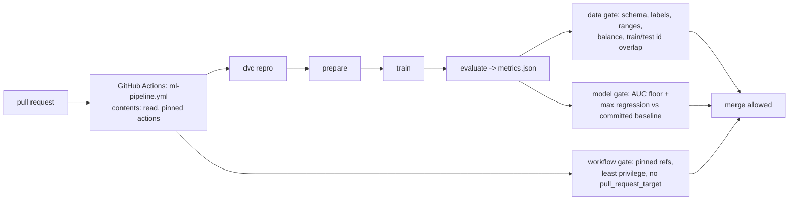

# POC 067: CI/CD for ML: DVC pipeline, data and model gates, and a hardened GitHub Actions workflow

**Category:** MLOps & LLMOps | **Stack:** DVC 3.67, pytest, GitHub Actions

## Problem
ML changes break in ways unit tests miss: a data change that leaks test rows into training, a parameter tweak that quietly drops the model below the quality floor, a re-run that is not reproducible. This POC treats the ML pipeline like software: a DVC pipeline that only reruns what changed, gates that fail the build on bad data or a regressed model, and a workflow that is itself checked for unsafe patterns.

## Approach

- Real DVC pipeline (`dvc.yaml`, `params.yaml`) run in an isolated copy with `dvc init --no-scm`: first run executes 3 stages, second run is fully cached, changing `train.C` reruns only train and evaluate, changing `prepare.n_rows` reruns everything.
- Reproducibility test: `dvc repro --force` regenerates byte-identical data and identical metrics.
- Gates are plain Python returning problem lists and are tested for both pass and fail: injected train/test leakage, non-binary labels, schema change, AUC below floor, regression versus baseline, and a bad model change (only an uninformative feature) caught end to end.
- `workflow_gate` statically checks the real workflow file (least-privilege permissions, pinned action versions, no moving refs, no `pull_request_target`) and is tested with mutated workflows.
- The workflow `.github/workflows/ml-pipeline.yml` is path-filtered to this project and runs the same commands.

## Run it
```bash
pip install -r ../../requirements-dvc.txt
make demo && make test   # demo ~25 s, 11 tests ~40 s
```

## Evidence status
| Claim | Status |
|---|---|
| DVC caching behaviour, reproducibility, gate pass/fail cases, workflow static checks | Tested locally with DVC 3.67.1 |
| The GitHub Actions workflow itself executing the pipeline | Runs in this repository's Actions (see the repository's CI status); not simulated locally |
| Remote DVC storage, cloud training, secrets handling, model registry promotion (see POC 065) | **Not tested** |

## Results
<!-- RESULTS:START -->

**Results: real DVC pipeline runs (generated by `make demo`)**
| step | stage status | test AUC |
|---|---|---|
| 1 first run | prepare: ran, train: ran, evaluate: ran | 0.969 |
| 2 second run, nothing changed | prepare: cached, train: cached, evaluate: cached | 0.969 |
| 3 change train.C | prepare: cached, train: ran, evaluate: ran | 0.969 |
| 4 change prepare.n_rows | prepare: ran, train: ran, evaluate: ran | 0.971 |

Data/model gates pass on the normal model: **True**. With only the uninformative feature (`train.features: [3]`) the quality gate fails with: ['AUC 0.466 below the absolute floor 0.9', 'AUC 0.466 regressed more than 0.01 from baseline 0.950'].

Workflow hygiene findings for `.github/workflows/ml-pipeline.yml`: none.

<!-- RESULTS:END -->

## Limitations
- `--no-scm` DVC does not exercise git-tracked data versions or remotes.
- The synthetic task is easy (AUC about 0.97), so the thresholds illustrate mechanics rather than real quality targets.
- AUC cannot detect all regressions (calibration, subgroups: see POCs 065 and 073).
- Static workflow checks are a small subset of what a linter such as actionlint finds.

## Data and security
Synthetic data; no secrets; the workflow requests read-only permissions.
