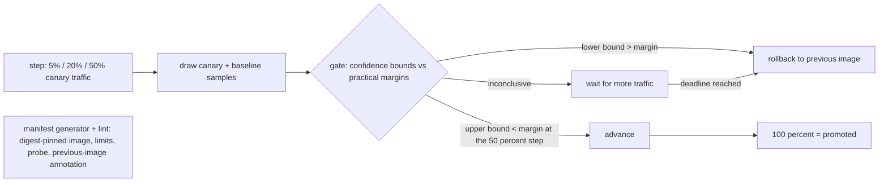

# POC 068: Canary model rollout with automatic rollback (simulated traffic; KServe/kind not used)

**Category:** MLOps & LLMOps | **Stack:** Python, numpy, scipy, PyYAML; BentoML, KServe, kind and any cluster NOT used

## Problem
Shipping a model to 100% of traffic at once makes every regression a full incident. Progressive delivery limits the blast radius, but only if the controller judges the canary statistically: a naive 'error rate is higher, roll back' rule either rolls back on noise or promotes regressions that need more traffic to show. This POC implements a canary controller with traffic steps (5 -> 20 -> 50 -> 100%), a non-inferiority style gate on error rate, p95 latency and delayed-label accuracy, fail-closed deadlines, and generates/lints KServe-style manifests per stage. It is evaluated over many simulated rollouts.

## Approach

- Rollback only when the *lower* confidence bound of a regression exceeds the practical margin (error +0.5pp, p95 x1.2, accuracy -2pp); promotion to 100% requires the *upper* bound to be inside the margin on all three metrics, otherwise wait and finally fail closed.
- Early steps are smoke stages (catch large regressions quickly with little traffic); the 50% step must prove non-inferiority, because subtle regressions need traffic to detect.
- Alpha is split across looks (Bonferroni); p95 uses distribution-free order-statistic confidence intervals, which catch a tail blow-up that a rank test on equal medians misses.
- The first version used point estimates plus a significance test and rolled back 16% of tolerable candidates; confidence-bound gates removed that, at the cost of failing closed when a near-margin candidate cannot be proven in time (reported separately in the results).
- Manifests: `canaryTrafficPercent` limited to approved steps, image must be pinned by sha256 digest, requests/limits and readinessProbe required, rollback target annotation required, no `default` namespace.

## Run it
```bash
make demo PY=python
make test
```

## Evidence status
| Claim | Status |
|---|---|
| Gate logic, controller, scenario results over 200 seeds each, blast radius vs big-bang | Measured on SIMULATED traffic (seeded RNG, no model is served) |
| Manifest generation and policy lint | Tested (YAML structure only; not validated against the KServe CRD) |
| KServe, BentoML, kind, Istio/Knative traffic splitting, real metrics pipelines | NOT used / NOT tested |
| Real-world traffic behaviour: diurnal load, correlated errors, non-iid requests, label delay distributions | Not modelled |

## Results
<!-- RESULTS:START -->

**Results (measured by `python -m canary_model_serving.main`; traffic SIMULATED, 200 seeds per scenario, 600 req/min, looks every 5 min)**
| candidate | rollback rate | of which deadline (fail closed) | median min to decision | median min to rollback | mean excess errors (canary rollout) | excess errors (big-bang, 60 min) |
|---|---|---|---|---|---|---|
| healthy (identical) | 0.005 | 0.005 | 105.000 | 190.000 | 0.000 | 0.000 |
| mild error rise (1.0% -> 1.3%, inside tolerance) | 0.500 | 0.500 | 190.000 | 190.000 | 105.000 | 108.000 |
| latency +35% | 1.000 | 0.000 | 50.000 | 50.000 | 0.000 | 0.000 |
| error rate 1% -> 3% | 1.000 | 0.000 | 50.000 | 50.000 | 41.500 | 720.000 |
| silent accuracy drop 92% -> 87% | 1.000 | 0.000 | 80.000 | 80.000 | 0.000 | 0.000 |
| latency tail blow-up (sigma 0.3 -> 0.7) | 1.000 | 0.000 | 50.000 | 50.000 | 0.000 | 0.000 |

A rollback "by deadline" means the gate could not PROVE the candidate within tolerance at the 50% step within 120 minutes, so it failed closed. Excess errors = errors beyond the baseline's rate on the same requests. A healthy candidate should (almost) never be rolled back; a regressed one should be, early.

<!-- RESULTS:END -->

## Limitations
- Requests are modelled as independent draws; real traffic has seasonality and correlated failures that make intervals too optimistic.
- Bonferroni over a fixed number of looks is conservative per look but is not corrected across the three metrics or the four steps; the measured false-rollback rate on identical candidates is reported, not guaranteed.
- Candidates within a tolerance but near its edge are rolled back by deadline (fail closed) about half the time at these traffic levels; margins and deadlines must be chosen from real traffic.
- Labels are assumed to arrive for 30% of requests at the same time as other metrics; real delays would postpone accuracy-based decisions.
- Excess errors are counted from the configured rates, not from replaying sampled requests.

## Data and security
Entirely synthetic simulation parameters in sim.py; no data files.
