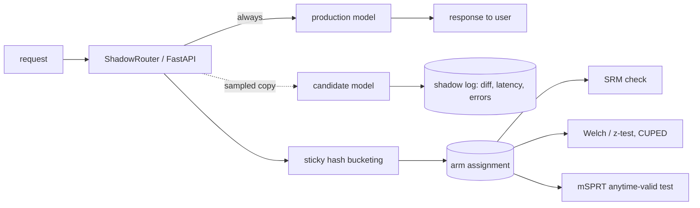

# POC 069: Shadow deployment and A/B testing with anytime-valid statistics

**Category:** MLOps & LLMOps | **Stack:** FastAPI, statsmodels, scipy, numpy

## Problem
Shipping a new model safely takes two steps: run it in shadow to see what it would have done without risk, then A/B test it. Each step has a classic way to go wrong: a crashing shadow that breaks production, a broken bucketing that skews the arms, and "peek until it's significant" that turns 5% false positives into 25%. This POC implements the router and the statistics and measures those failure modes.

## Approach

- **Shadow isolation**: candidate exceptions and slowness are logged, never propagated; tests crash the candidate on purpose and require responses unchanged.
- **Deterministic sticky bucketing** (SHA-256 of salt, experiment, user) is uniform; **SRM** chi-square flags a broken split (a simulated bug dropping ~7% of one arm gives p ~ 1e-33).
- **Peeking study (Monte Carlo)**: with no true effect, stopping at the first p < 0.05 across 20 looks yields about 26% false positives; the mixture-SPRT keeps it near 2%; one look at the end gives 5%. Power is reported for three effect sizes: mSPRT trades some power for validity at every peek.
- **CUPED** variance reduction with a pre-experiment covariate, and a power-based sample-size calculation (statsmodels).
- FastAPI endpoints `/predict` and `/shadow/summary` exercised with the test client.

## Run it
```bash
make demo && make test   # demo ~35 s, 10 tests
```

## Evidence status
| Claim | Status |
|---|---|
| False-positive and power rates by decision rule, SRM, CUPED, shadow isolation, sticky bucketing | Measured / tested on simulated data (seeded Monte Carlo) |
| Real traffic, delayed or non-normal metrics, network-level shadowing, a deployed service | **Not tested** |

## Results
<!-- RESULTS:START -->

**Results: Monte Carlo on simulated metrics (generated by `make demo`)**
#### A/A tests (no true effect), 400 simulated experiments of 4,000 users per arm, 20 interim looks, alpha 0.05

| decision rule | experiments declared significant (false positives) |
|---|---|
| stop at first p < 0.05 while peeking | 26.2% |
| always-valid mSPRT (reject when likelihood ratio >= 1/alpha) | 2.0% |
| one look at the planned end | 5.0% |

#### Power when there is a real effect (200 experiments each; metric sd 1)

| true lift (sd units) | peeking naive | mSPRT (anytime) | single look at end |
|---|---|---|---|
| 0.050 | 73% | 28% | 56% |
| 0.100 | 100% | 96% | 100% |
| 0.200 | 100% | 100% | 100% |

mSPRT is conservative: slightly lower power than a single fixed look, in exchange for being valid at every peek.

#### Other checks

- CUPED with a pre-experiment covariate (strongly correlated with the outcome): variance 7.755 -> 2.231 (71% lower), which shortens the experiment by about that fraction.
- Sample-ratio mismatch: correct bucketing p = 0.270; a bucketing bug that silently drops ~7% of the treatment arm p = 7.0e-34 (flag if p < 0.001).
- Assignment is sticky (same user, same arm): True. Required sample for a 10% -> 11% conversion lift at 80% power: 14,745 users per arm.
- Shadow mode: responses served unchanged while the candidate crashed on 20 of 200 shadowed calls: True.

<!-- RESULTS:END -->

## Limitations
- The mSPRT uses a normal approximation with estimated variance and a fixed mixing prior; for small samples or heavy-tailed metrics the guarantees are approximate.
- Monte Carlo sizes (400 / 200 experiments) give rates with about +/-2 points of noise.
- Shadow timing is in-process and sequential; real shadow traffic would be asynchronous and needs backpressure.

## Data and security
Simulated metrics only.
