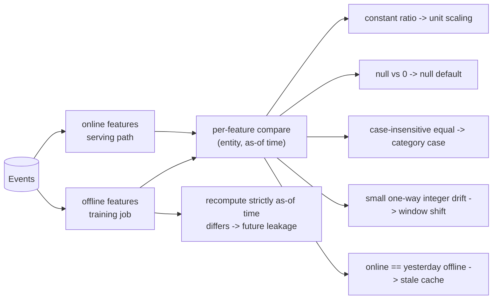

# POC 070: Train/serve skew detector: find and diagnose feature differences between training and serving

**Category:** MLOps & LLMOps | **Stack:** Python, numpy

## Problem
The most common silent ML failure is a feature computed one way in the training pipeline and another way in production: cents vs dollars, a window one day off, nulls turned into zeros, `US` vs `us`, a cached value from yesterday, or training data that peeked at tomorrow. This POC compares offline and online feature values for the same (entity, timestamp) and names the likely cause.

## Approach

- Six bug types are injected one at a time into a synthetic feature pipeline with known ground truth; the detector sees only the two outputs. A clean control must raise no finding, and a three-bug combination must report all three.
- Future leakage cannot be seen by comparing the two paths (serving is right, training is wrong), so it is found by recomputing training features strictly as-of the label time.
- Tolerance handling: values equal within a relative 1e-6 are not skew.

## Run it
```bash
make demo && make test   # 13 tests
```

## Evidence status
| Claim | Status |
|---|---|
| Diagnosis of 6 injected bugs, clean control and a multi-bug case | Tested (deterministic, synthetic) |
| Real feature stores, streaming features, high-cardinality or nested features, real data volumes | **Not tested** |

## Results
<!-- RESULTS:START -->

**Results: deterministic synthetic features (generated by `make demo`)**
6,000 events, 300 users, 1,500 (user, timestamp) queries. The same six features are computed by an offline (training) path and an online (serving) path; one bug at a time is injected into the serving path (or, for `future_leak`, into the training path), then the detector diagnoses it from the two outputs alone.

| injected bug | diagnosed correctly | reported causes | worst feature mismatch |
|---|---|---|---|
| clean (no bug) | yes | - | avg_order_value_30d 0.0% |
| unit_scaling | yes | unit_scaling(x100) | avg_order_value_30d 100.0% |
| window_off_by_one | yes | window_off_by_one | n_orders_7d 29.7% |
| null_default | yes | null_default | last_login_hours 19.8% |
| category_case | yes | category_case | country 26.7% |
| stale_cache | yes | stale_cache | avg_order_value_30d 9.1% |
| future_leak | yes | future_leak, unexplained_numeric_difference, window_off_by_one | avg_order_value_30d 29.5% |

All 6 bugs + the clean control correct: **7/7**. Three simultaneous bugs (unit scaling, null default, category case) all found: **True**.

<!-- RESULTS:END -->

## Limitations
- The diagnoses are heuristics matched to the bug catalogue; a novel kind of skew is reported as `unexplained_numeric_difference`, not explained.
- Features are computed by a Python loop for clarity (about 1,500 queries per run); a real detector would join logged serving features with offline backfills at scale.
- Assumes serving logs the exact feature vector and timestamp used for each prediction.

## Data and security
Synthetic events only.
