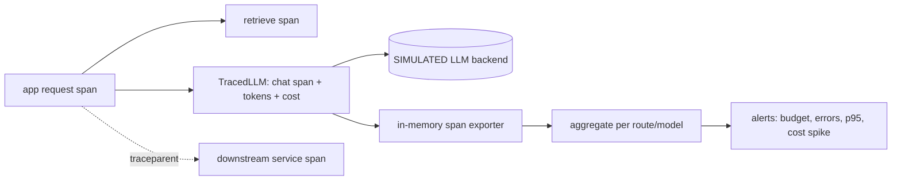

# POC 071: LLM tracing and cost telemetry with OpenTelemetry

**Category:** MLOps & LLMOps | **Stack:** OpenTelemetry SDK 1.45.1 (in-memory exporter; Jaeger/Grafana NOT used)

## Problem
LLM spend and latency are invisible until the bill arrives. This POC wraps any LLM client with OpenTelemetry spans carrying GenAI-style attributes, token counts and computed cost, then aggregates finished spans into per-route cost/latency/error metrics with budget, error-rate, latency and cost-spike alerts. Prompt text is never recorded unless opted in, and then redacted.

## Approach

- `TracedLLM` wraps any client with a `generate` method; exceptions are recorded on the span and re-raised.
- Private `TracerProvider` (global provider untouched) with an in-memory exporter, so tests and demo need no collector.
- Cost = tokens x illustrative per-1k prices; unknown models fail loudly rather than costing zero.
- Content capture is off by default; opt-in text is redacted (emails, long digit runs) and truncated.
- W3C traceparent inject/extract demonstrated across a simulated service hop.

## Run it
```bash
make demo PY=python
make test
```

## Evidence status
| Claim | Status |
|---|---|
| Span attributes, error recording, redaction, cost arithmetic, aggregation and alerts | Tested (real OpenTelemetry SDK) |
| Trace parenting and traceparent propagation | Tested (real, in-process) |
| LLM backend, token counts, latencies, failures | SIMULATED (seeded RNG); prices illustrative, not a vendor list |
| Jaeger/Grafana/OTLP export, sampling, metrics SDK, multi-process propagation over HTTP | Not used / not tested |

## Results
<!-- RESULTS:START -->

**Results (measured by `python -m llm_tracing_otel.main`; backend SIMULATED, prices illustrative)**
1200 spans, 400 LLM spans, LLM spans with a request parent: 400/400

| route|model | calls | error rate | cost USD | cost/call | p50 ms | p95 ms |
|---|---|---|---|---|---|---|
| faq|small-model | 155 | 3.9% | 0.0363 | 0.00024 | 133 | 157 |
| legacy-bloated|large-model | 34 | 5.9% | 0.4621 | 0.01444 | 1493 | 1607 |
| report|large-model | 89 | 3.4% | 0.2826 | 0.00329 | 595 | 735 |
| search|small-model | 122 | 3.3% | 0.0452 | 0.00038 | 246 | 270 |

#### Alerts

- budget exceeded: $0.8262 > $0.5000
- legacy-bloated|large-model: cost/call 0.01444 is 7.9x the median route

- traceparent propagation keeps one trace across a service hop: True
- prompt text captured by default: False

<!-- RESULTS:END -->

## Limitations
- Aggregation reads in-memory spans; production would export via OTLP to a collector and compute metrics there.
- GenAI semantic conventions are still experimental; attribute names may change between releases.
- Latency attribute comes from the (simulated) response, not wall-clock span duration.
- Redaction is regex-based (emails, 6+ digit runs); it will miss names and other identifiers.

## Data and security
Simulated requests from a seeded RNG; no external data.
