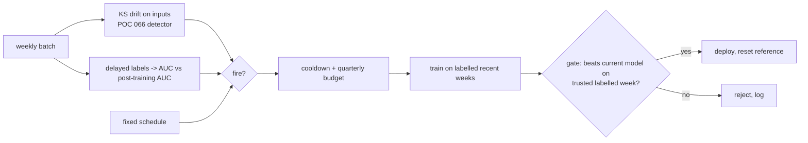

# POC 072: Automated retraining triggers: schedule vs drift vs performance, measured on simulated deployments

**Category:** MLOps & LLMOps | **Stack:** scikit-learn, drift detectors (POC 066), promotion gate (POC 065)

## Problem
"Retrain when it drifts" sounds obvious, but drift on inputs does not mean the model got worse, label delay hides decay, and unbounded triggers burn compute and can deploy garbage. This POC simulates a year of weekly data with gradual rotation, a sudden concept flip and a covariate shift, and compares retraining policies on quality *and* cost.

## Approach

- Four policies plus 'never retrain' over 12 simulated deployments: fixed 8-week schedule, input-drift trigger, delayed-label performance trigger, and drift OR performance with cooldown, quarterly budget and a promotion gate.
- Labels arrive two weeks late and training uses only labelled weeks, as in real systems. Drift detection uses the KS detector from POC 066.
- A label-pipeline outage scenario (training labels become random from week 26, validation labels trusted) shows the value of the gate: ungated retraining collapses to ~0.68 mean AUC; gated stays ~0.87 and rejects ~5 bad candidates a year.
- Honest result: in this world a plain fixed schedule has the best mean AUC; the combined policy comes within ~0.005 AUC with ~30% fewer training runs. The simulation shows trade-offs, not that triggers beat schedules.
- The promotion gate of POC 065 is exercised against a real MLflow registry in one test; the loop itself uses an in-memory gate for speed. Prefect/Airflow orchestration is not included.

## Run it
```bash
pip install -r ../../requirements-mlops.txt
make demo && make test   # demo ~30 s; 13 tests, ~30 s
```

## Evidence status
| Claim | Status |
|---|---|
| Policy comparison, cooldown/budget enforcement, label-delay behaviour, gate under label outage | Measured on simulated data (12 seeds per policy) |
| Real drift/performance monitoring, orchestrator (Airflow/Prefect), real training cost, concept drift in production | **Not tested** |

## Results
<!-- RESULTS:START -->

**Results: 12 simulated 52-week deployments per policy (generated by `make demo`)**
Weekly batches of 1,500 rows, 5 features; gradual rotation of the true rule, a sudden concept flip at week 20 and an input shift at week 35. Labels arrive 2 weeks late. 'Mean AUC' is the average weekly serving AUC after the initial 4-week training; 'worst week' is the lowest weekly AUC; retrains are counted per deployment (a gate-rejected attempt still counts as a training run).

| policy | mean weekly AUC | worst week AUC | training runs / year | gate rejections / year |
|---|---|---|---|---|
| never retrain | 0.828 | 0.722 | 0.0 | 0.0 |
| fixed every 8 weeks | 0.932 | 0.768 | 6.0 | 0.0 |
| drift-triggered (KS on inputs) | 0.890 | 0.725 | 3.1 | 0.0 |
| performance-triggered (labels lag 2 wk) | 0.911 | 0.723 | 1.3 | 0.0 |
| drift OR performance, cooldown + budget + gate | 0.926 | 0.727 | 4.2 | 0.0 |

Reading: never retraining loses 0.103 mean AUC against a fixed schedule. The fixed schedule has the best mean AUC (0.932) but the most training runs (6.0). The combined policy reaches 0.926 with 4.2 runs, i.e. 0.005 AUC below the schedule for 29% fewer runs. The drift trigger alone cannot see the concept flip (inputs did not move); the performance trigger sees it only after the 2-week label delay. Label-pipeline outage from week 26 (training labels become random, validation labels stay trusted): a scheduled retrain without a gate averages 0.682 AUC; with the gate it averages 0.868 and rejects 5.1 bad candidates per year.

The worst-week AUC barely differs between policies because every policy needs time to notice a sudden flip: this simulation does not show that triggering is *better* than a schedule, only the cost/quality trade-off.

<!-- RESULTS:END -->

## Limitations
- One synthetic world with hand-placed drift events; rankings of policies would change with different drift patterns.
- Twelve seeds give average figures with visible noise; no confidence intervals are reported.
- Cost is counted as training runs, not dollars or engineer time.
- Thresholds (0.92 of baseline AUC, KS alpha) were chosen once, not tuned.

## Data and security
Synthetic data only.
