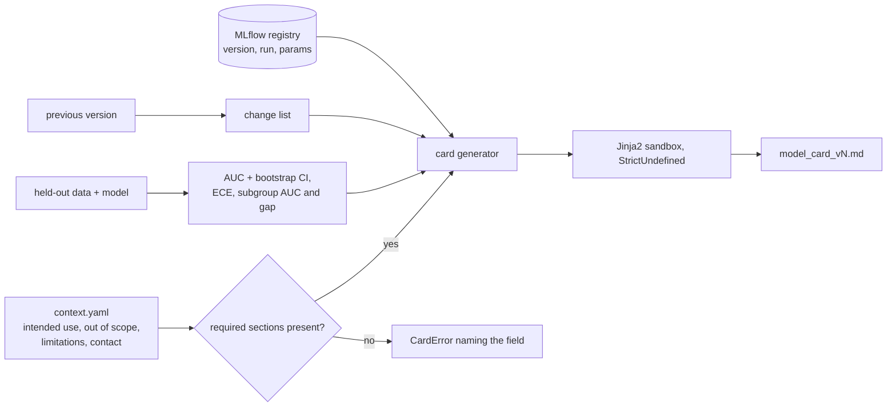

# POC 073: Model card generator: facts from MLflow, judgement from reviewed text, refuse if incomplete

**Category:** MLOps & LLMOps | **Stack:** MLflow registry (POC 065), Jinja2 sandbox, scikit-learn

## Problem
Model cards are supposed to document what a model is for and where it fails, but hand-written cards go stale and generated ones tend to hide gaps. This POC generates the card from the registry (parameters, run id), computed evaluation (AUC with bootstrap interval, calibration error, subgroup performance and gaps) and a reviewed context file, and refuses to produce a card when required sections are empty.

## Approach

- Facts are never typed: parameters and run id come from MLflow, metrics from evaluating the registered model.
- Required judgement sections (`intended_use`, `out_of_scope`, `training_data`, `limitations`, `contact`) must be present, or generation fails with the missing names.
- User-supplied text is passed as data to a sandboxed Jinja environment with `StrictUndefined`: template syntax inside the context is rendered literally (tested), unknown variables raise instead of silently blanking.
- Subgroup gap above a review threshold is flagged in the card; a version-to-version change list is generated from parameters and AUC.

## Run it
```bash
pip install -r ../../requirements-mlops.txt
make demo && make test   # 14 tests
```

## Evidence status
| Claim | Status |
|---|---|
| Card content, completeness checks, sandboxing, metric correctness (known ECE values), change list | Tested |
| Whether the card is *good* (accuracy of limitations, fairness beyond one binary group attribute), regulatory templates | **Not tested**; the content of `context.yaml` is the human's responsibility |

## Results
<!-- RESULTS:START -->

**Results: deterministic (generated by `make demo`)**
Two versions registered in a real MLflow registry; a card was generated for each. A card with an empty `limitations` section was refused: **True**.

The generated card for version 2 (52 lines) is committed at `results/model_card_v2.md`; it contains the facts from MLflow (parameters, run id), metrics with bootstrap intervals, subgroup AUCs and a version-to-version change list.

<!-- RESULTS:END -->

## Limitations
- Only one binary subgroup attribute and AUC/ECE metrics; extend `slices` for your sensitive attributes and metrics.
- The card shows what was measured on one held-out set; it is not a safety case.
- Generation date is passed in for reproducibility; a real pipeline should stamp it.

## Data and security
Synthetic data; fictional contact address.
