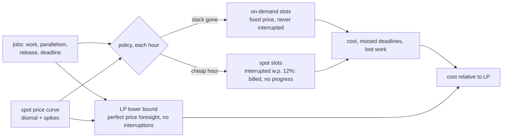

# POC 074: Batch inference scheduler: deadlines, spot prices and interruptions against an LP lower bound

**Category:** MLOps & LLMOps | **Stack:** Python, scipy (HiGHS LP), numpy

## Problem
Nightly scoring jobs can run any time before their deadline, and cloud capacity is much cheaper at some hours (and on interruptible spot instances). Running everything at once on on-demand capacity is safe but expensive; running everything on spot is cheap until a deadline is missed. This POC builds the scheduler policies, simulates prices and interruptions, and judges them against the cheapest schedule that could exist.

## Approach

- Four policies: FIFO and EDF on on-demand, FIFO on spot only, and an EDF cost-aware policy that runs urgent jobs on on-demand (with a safety margin for interruptions) and everything else only in hours cheaper than the 40th percentile of its remaining window.
- The LP (scipy HiGHS) gives the minimum cost when prices are known in advance and spot never fails: an unreachable benchmark that makes the policies' optimality gap meaningful. Tests solve small cases by hand.
- Over 40 random workloads the cost-aware policy meets every deadline at roughly 2.3x the LP bound, about 40% cheaper than EDF on-demand (3.9x); plain spot is cheaper (1.8x) but 57% of workloads miss a deadline.
- Invariants tested: capacity never exceeded, on-demand never loses work, the LP bounds the interruption-free spot cost from below, results are reproducible.

## Run it
```bash
make demo && make test   # 12 tests, a few seconds
```

## Evidence status
| Claim | Status |
|---|---|
| Policy cost/deadline comparison, LP lower bound, invariants | Measured on simulated prices, jobs and interruptions |
| Real cloud prices, real interruption behaviour, queue systems (SQS/Kubernetes), preemption notice handling | **Not tested** |

## Results
<!-- RESULTS:START -->

**Results: 40 simulated workloads of 12 jobs (generated by `make demo`)**
48 hourly slots, capacity 8 slots, on-demand price 3.0/slot-hour, diurnal spot price 0.3-2.9 with random spikes, 12% chance a spot slot-hour is interrupted (progress lost, still billed). Cost is shown relative to the LP lower bound (prices known in advance, no interruptions: unreachable in practice). Workloads where even the LP is infeasible were skipped.

| policy | cost vs LP bound | missed deadlines per workload | workloads with any miss | slot-hours lost to interruptions |
|---|---|---|---|---|
| fifo_on_demand | 3.95x | 0.42 | 35% | 0.0 |
| edf_on_demand | 3.95x | 0.00 | 0% | 0.0 |
| fifo_spot | 1.79x | 0.80 | 57% | 18.4 |
| edf_cost_aware | 2.25x | 0.00 | 0% | 10.3 |

EDF on-demand meets every deadline here but pays 3.95x the LP bound; the cost-aware policy also meets every deadline at 2.25x (43% cheaper). Plain spot is cheapest per hour (1.79x) but loses work to interruptions and 57% of workloads miss a deadline. FIFO on-demand ignores deadlines and also misses some. All prices and interruption rates are simulated.

<!-- RESULTS:END -->

## Limitations
- Hourly time steps, identical slot sizes, interruptions i.i.d. with a fixed probability; real spot markets correlate interruptions with price spikes.
- The 40th-percentile and 0.6 margin heuristics are hand-set, not optimised.
- Jobs are perfectly divisible slot-hours with hourly checkpoints; real jobs have start-up costs and non-linear scaling.

## Data and security
Simulated data only.
