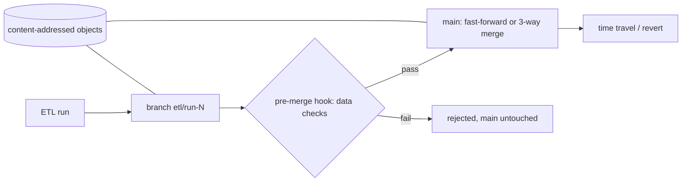

# POC 075: Data versioning with branching (own lakeFS/DVC-style store)

**Category:** MLOps & LLMOps | **Stack:** Python stdlib (content-addressed store); lakeFS, DVC and MinIO NOT used

## Problem
Data pipelines overwrite files in place, so a bad run corrupts production data and nobody can reproduce yesterday's table. This POC implements a small git-like store for data files: atomic multi-file commits, cheap branches, 3-way merge with conflict detection, a pre-merge validation hook, revert, time travel, integrity verification and garbage collection.

## Approach

- Objects are stored by SHA-256 (identical files stored once); commits are canonical JSON hashed to their id; refs are replaced atomically.
- Merge is path-level 3-way: both sides changing the same path differently (including delete vs modify) raises `MergeConflict`; a hook can veto before any ref moves.
- Paths are validated (no `..`, absolute, backslash or NUL) and branch names restricted.
- `verify` recomputes hashes to detect tampering; `gc` removes objects unreachable from any branch.

## Run it
```bash
make demo PY=python
make test
```

## Evidence status
| Claim | Status |
|---|---|
| Branch, commit, merge (FF and 3-way), conflicts, hook veto, revert, gc, tamper detection | Tested (real, local filesystem) |
| lakeFS, DVC, MinIO/S3, Parquet-level or row-level merge | Not used / not implemented |
| Concurrent writers, large files, performance at scale | Not tested |

## Results
<!-- RESULTS:START -->

**Results (measured by `python -m branching_data_store.main`)**
- bad_run_merged: False
- main_unchanged_after_rejection: True
- fast_forward: True
- time_travel_old_version_readable: True
- three_way_merge_parents: 2
- conflict_detected: True
- revert_restores_previous: True
- later_work_kept_after_revert: True
- gc_removed_unreachable: 1
- objects_stored: 10
- unique_file_versions: 10
- verify_clean: True
- tamper_detected: True

<!-- RESULTS:END -->

## Limitations
- Single process, no locking: two processes committing at once can lose a ref update.
- Merge granularity is whole files; no row-level or Parquet-aware merge.
- Whole objects are read into memory; not suitable for multi-GB files.
- History is not signed; `verify` detects accidental corruption and naive edits but an attacker who rewrites commits and refs consistently is not detected.
- Not interoperable with lakeFS or DVC formats.

## Data and security
Synthetic order CSVs generated in the demo; no external data.
