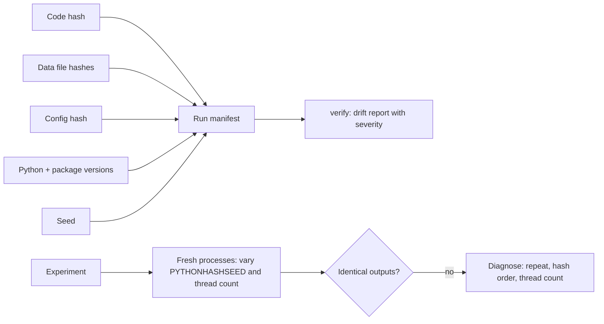

# POC 076: Experiment reproducibility kit

**Category:** MLOps & LLMOps | **Stack:** Python, hashlib, subprocess (fresh interpreters), importlib.metadata; uv and DVC not run here

## Problem
"It works on my machine" for experiments: the same code and seed give different numbers on another run, another machine or another day. A reproducibility kit records what a run depended on, checks whether a new run should match an old one, and finds the reason when it does not.

## Approach

- A manifest id hashes Python and package versions, seed, config, data files and code. `verify` rebuilds it and reports drift ranked high (data, code, config, seed), medium (packages, Python, environment variables) or low (platform, CPU architecture); high drift fails with exit code 1.
- The `check` harness runs an experiment in fresh interpreters while varying PYTHONHASHSEED and thread settings, because those are the factors seeds do not cover. `diagnose` first repeats the run with everything fixed; only if that is stable does it vary one factor at a time (a first version blamed every factor for an unseeded run, because factors cannot be separated while the run is not even repeatable).
- Eight experiments, four of them deliberately flawed: unseeded RNG, set iteration order feeding a floating-point sum, thread completion order feeding a sum, and a wall-clock id in the result. Each flawed one has a fixed twin that must pass.
- The seeding helper covers random, NumPy's legacy global state and PyTorch if installed, and states what it cannot do (PYTHONHASHSEED must be set before the interpreter starts).

## Run it
```bash
make install
make test
make demo
```

## Evidence status
| Claim | Status |
|---|---|
| Manifest, drift detection, fresh-process reproducibility checks and diagnosis | Real: tested in this repository's environment |
| uv lock files, DVC data versioning, containers | NOT run: uv was not installed; the kit hashes what is installed instead of resolving a lock file |
| GPU nondeterminism (cuDNN, atomic adds), distributed training | Not tested: no GPU available |
| Cross-machine reproducibility (different CPUs and BLAS builds) | Not tested: only recorded as low-severity manifest fields |

## Results
<!-- RESULTS:START -->

**Results: reproducibility checks (each experiment run in fresh processes, varying PYTHONHASHSEED and thread count; diagnosis repeats each run and varies one factor)**
| experiment | identical across 4 runs | distinct outputs | diagnosed cause |
|---|---|---|---|
| seeded | yes | 1 | - |
| linear | yes | 1 | - |
| unseeded | NO | 4 | run-to-run randomness with everything fixed (unseeded RNG, clock, thread race) |
| hash_order | NO | 2 | PYTHONHASHSEED (set/dict-of-str iteration order) |
| hash_order_fixed | yes | 1 | - |
| thread_race | NO | 3 | run-to-run randomness with everything fixed (unseeded RNG, clock, thread race) |
| thread_fixed | yes | 1 | - |
| clock_id | NO | 4 | run-to-run randomness with everything fixed (unseeded RNG, clock, thread race) |

Manifest drift detection:

| change made | drift reported |
|---|---|
| nothing changed | none |
| data file edited | high:data |
| config edited | high:config_hash |
| seed changed | high:seed |
| package version differs | medium:packages |

Manifest id of the baseline: e2a2e621925b1c90. Tracked packages: {'numpy': '2.5.4', 'scikit-learn': '1.9.1', 'pandas': '3.0.6', 'scipy': '1.18.1'}.

<!-- RESULTS:END -->

## Limitations
- Identical output across six hash seeds and thread counts on one machine does not prove cross-machine identity; BLAS and CPU differences can change last digits.
- Thread-race diagnosis depends on the race actually occurring in the repeats; a rare race can look reproducible. More repeats reduce but never remove that risk.
- The manifest covers a chosen list of packages; an untracked dependency can still drift.
- Package versions come from installed metadata, not from a resolved lock file, so it detects drift but does not rebuild an environment.
- Each check spawns Python processes, so tests and demo take about 70 seconds; the POC is therefore in the heavy workflow, not the fast one.

## Data and security
No personal data. Child processes run only the experiments in this package with a JSON config; there is no shell interpolation of inputs.
