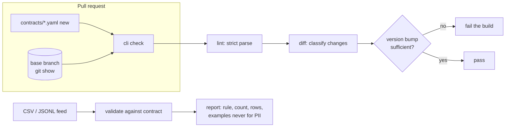

# POC 077: Data contracts as a CI gate

**Category:** Governance & Security | **Stack:** Python, YAML, GitHub Actions

## Problem
Pipelines break when a producer silently changes a feed: a column disappears, a type changes, bad
rows slip through. A data contract makes the agreement explicit and machine-checkable. This POC
(1) validates delivered data against a contract, (2) classifies every change between two contract
versions and requires the matching semantic-version bump, and (3) runs that check on pull requests.

## Evidence status
| Item | Status |
|---|---|
| Validator finds injected defects | **Measured, exact**: 8 defect types with known counts are found with matching counts (table below) |
| Evolution classification (23 change types, quality thresholds, version policy) | **Tested** with 70 tests, including a throwaway git repository |
| `check` command against a real git base ref | **Tested locally** (temporary repo) |
| The GitHub Actions workflow `data-contracts.yml` | **Written, not yet exercised**: it triggers on pull requests, and none exists yet |
| Real producers/consumers, large files, streaming | **Not tested** (files are loaded in memory) |

## Architecture


## Contract format (excerpt of `contracts/orders_feed.yaml`)
```yaml
contract: orders_feed
version: 1.0.0
columns:
  - {name: order_id, type: integer, required: true, unique: true}
  - {name: status, type: string, required: true, enum: [completed, shipped, cancelled, returned]}
  - {name: email, type: string, pii: true, pattern: '^[^@\s]+@[^@\s]+\.[A-Za-z]{2,}$'}
quality:
  min_rows: 100
  freshness: {column: order_date, max_age_days: 7}
  rules:
    - {type: column_compare, left: ship_date, op: ">=", right: order_date}
```
Inspired by open data-contract specifications; **not ODCS-compliant**. Unknown keys are errors.

## Evolution policy (what each change costs)
| Required bump | Changes |
|---|---|
| **MAJOR** | column removed; type changed; `required`/`unique` added; `pii` flag changed; new required column; constraint added or narrowed (min up, max down, enum values removed, pattern changed); stricter row/null/freshness thresholds; new error-severity rule; format or id change |
| **MINOR** | new optional column; enum values added; min down / max up; `required`/`unique` relaxed; looser thresholds; warn-level rule added; rule removed |
| **PATCH** | description or owner only |

Relaxing `required`/`unique` is MINOR here although consumers lose a guarantee; adjust
`_column_changes` if your team disagrees. A rename appears as removal + addition (MAJOR) with a
`possible_rename` hint.

## CI integration
- `.github/workflows/data-contracts.yml` runs `cli check --base-ref origin/<base>` on pull requests
  that touch `contracts/`. It lints every contract, compares changed ones with the base branch,
  rejects insufficient version bumps and deleted contracts.
- The main `ci.yml` runs this POC's tests and demo on every push.

## Run it
```bash
pip install -r ../../requirements-dev.txt
make demo      # generate feeds, validate, check detection, classify examples -> results/
make test
export PYTHONPATH=.:../../libs
python3 -m data_contracts_ci_gate.cli validate contracts/orders_feed.yaml data.csv --as-of 2025-01-01
python3 -m data_contracts_ci_gate.cli diff contracts/orders_feed.yaml contracts/examples/orders_feed.v2.0.0_breaking.yaml
python3 -m data_contracts_ci_gate.cli check --repo ../.. --contracts-dir pocs/077-data-contracts-ci-gate/contracts --base-ref origin/main
```
Exit codes: 0 pass, 1 violations, 2 usage/file error.

## Results
<!-- RESULTS:START -->

**Results: deterministic measurements (generated by `make demo`; do not edit)**
- Synthetic feeds derived from a seeded warehouse (400 rows); freshness evaluated as of 2024-12-31.

#### Validation outcomes per feed

| feed | rows | passed | error rules | warnings |
|---|---|---|---|---|
| orders_clean | 400 | True | 0 | 0 |
| orders_defective | 400 | False | 9 | 0 |
| orders_missing_column | 400 | False | 1 | 0 |
| orders_extra_column | 400 | True | 0 | 1 |
| orders_stale | 362 | False | 1 | 0 |

#### Detection check: injected defects vs reported violations

Each defect was injected on its own rows with a known count. A row is `yes` only when the validator reports exactly that many violations under the expected rule.

| injected defect | injected | expected rule | reported | exact match |
|---|---|---|---|---|
| null_customer_id | 5 | column.required:customer_id | 5 | yes |
| negative_amount | 4 | column.min:amount | 4 | yes |
| bad_status | 6 | column.enum:status | 6 | yes |
| duplicate_order_id | 3 | column.unique:order_id | 3 | yes |
| bad_email | 4 | column.pattern:email | 4 | yes |
| ship_before_order | 3 | quality.column_compare:ship_date>=order_date | 3 | yes |
| non_numeric_amount | 2 | column.type:amount | 2 | yes |
| amount_too_large | 2 | column.max:amount | 2 | yes |

#### Defective feed: full report

`orders_feed` v1.0.0: 400 rows, **FAILED** (9 error rule(s))

| severity | rule | column | count | first rows | examples |
|---|---|---|---|---|---|
| error | column.enum | status | 6 | 15, 153, 181 | pending, pending, pending |
| error | column.max | amount | 2 | 99, 281 | 10000000, 10000000 |
| error | column.min | amount | 4 | 174, 275, 316 | -41.87, -298.8, -936.61 |
| error | column.pattern | email | 4 | 3, 20, 69 | - |
| error | column.required | customer_id | 5 | 10, 66, 146 | - |
| error | column.type | amount | 2 | 57, 353 | 12,50, 12,50 |
| error | column.unique | order_id | 3 | 186, 351, 383 | 185, 350, 382 |
| error | quality.column_compare | ship_date>=order_date | 3 | 11, 258, 259 | - |
| error | quality.max_null_rate | customer_id | 1 | - | - |

#### Missing-column and stale feeds

`orders_feed` v1.0.0: 400 rows, **FAILED** (1 error rule(s))

| severity | rule | column | count | first rows | examples |
|---|---|---|---|---|---|
| error | schema.missing_column | amount | 1 | - | - |

`orders_feed` v1.0.0: 362 rows, **FAILED** (1 error rule(s))

| severity | rule | column | count | first rows | examples |
|---|---|---|---|---|---|
| error | quality.freshness | order_date | 1 | - | - |

#### Schema evolution checks against the current contract

### orders_feed.v1.1.0_compatible

1.0.0 -> 1.1.0: required bump **minor**, actual **minor** => OK

| level | change | target | detail |
|---|---|---|---|
| minor | column_added | currency | optional string |
| minor | constraint_loosened | amount.max | max 1000000 -> 5000000 |
| minor | constraint_loosened | quality.freshness | max_age_days 7 -> 14 |

### orders_feed.v2.0.0_breaking

1.0.0 -> 2.0.0: required bump **major**, actual **major** => OK

| level | change | target | detail |
|---|---|---|---|
| breaking | column_removed | email | column removed |
| breaking | required_changed | ship_date | required False -> True |

### orders_feed.v1.0.1_bad_bump

1.0.0 -> 1.0.1: required bump **major**, actual **patch** => REJECTED: changes require a MAJOR bump but version went 1.0.0 -> 1.0.1 (patch)

| level | change | target | detail |
|---|---|---|---|
| breaking | column_removed | email | column removed |

<!-- RESULTS:END -->

## Limitations
- Row-level checks only on files that fit in memory; no SQL warehouse, streaming or parquet adapter.
- The rule set is deliberately small (no cross-dataset referential checks, no custom expressions).
- Semantic classification is a policy, not a proof of compatibility; it cannot know how consumers
  actually use a field.
- Defect-detection exactness is measured on injected defects the author designed, not on real data.
- The pull-request workflow has not run on a real PR yet.

## Data and security
Synthetic data only. PII-flagged values are never written to reports. YAML is loaded with
`safe_load`.
