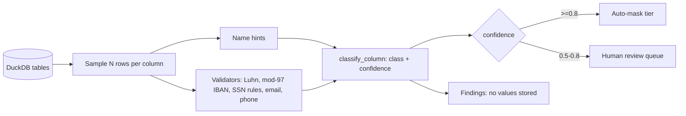

# POC 078: PII scanner and classifier

**Category:** Governance & Security | **Stack:** Python, DuckDB (Presidio not used)

## Problem
Warehouses accumulate columns nobody labelled. Before masking or deleting, a team needs to know which columns hold personal data, without the scanner itself copying that data into reports.

## Approach

- Combines column-name hints with validator-backed value matching on a row sample; per-class minimum match shares (cards need a majority because ~10% of random 16-digit numbers pass Luhn).
- Name-only signals (person names, addresses) get confidence 0.5, below the auto-mask tier, so a human reviews them.
- Phone is suppressed unless the name hints at it or the share is very high, so 10-digit order refs and tracking numbers are not flagged.
- Free-text columns are counted for embedded PII (counts only); findings never contain values; identifiers are quoted to resist hostile table names.
- Reuses the detectors from POC 034 rather than duplicating them.

## Run it
```bash
make install
make test
make demo
```

## Evidence status
| Claim | Status |
|---|---|
| Classification on a synthetic 5-table warehouse (22 columns, traps included) | Real: precision/recall measured, see Results |
| Sampling sweep 20/100/500 rows | Real |
| Presidio / NER models | Not used; no ML-based name detection (untested) |
| Real-world data | Not tested; synthetic data only |

## Results
<!-- RESULTS:START -->

**Results: 5 synthetic tables, 22 columns, 800 rows each (generated by `make demo`)**
Columns include true PII (name, email, phone, DOB, card, IBAN, SSN) and traps: 10-digit order references and tracking numbers that look like phone numbers, a free-text ticket body that sometimes embeds contact details, an unlabeled `misc.col_a` full of emails, a `legacy_phone` column holding hex ids, and 16-digit `account_number` values (about 1 in 10 random 16-digit numbers passes the Luhn check, so cards require a majority of sampled values to match), an `hr.contact` column that is really email. Classification uses the column name, validator-backed value matching (Luhn for cards, mod-97 for IBANs, SSN rules) and a sample of rows; a column enters the review queue at confidence >= 0.5 and would be auto-masked at >= 0.8.

| rows sampled per column | precision | recall | scan seconds | columns misclassified |
|---|---|---|---|---|
| 20 | 1.000 | 1.000 | 0.10 | 0 |
| 100 | 1.000 | 1.000 | 0.06 | 0 |
| 500 | 1.000 | 1.000 | 0.14 | 0 |

At confidence >= 0.8 (auto-mask tier): precision 1.0, recall 0.889. Misclassified at 0.5 with 500-row samples: none.

Free-text column `tickets.body`: embedded PII found in rows by class {'email': 75, 'phone': 75} (counts only, values never stored). Masking examples: {'email': 'p***@mail.example', 'credit_card': '************1111', 'phone': '*******4567'}.

Name-only signals (person names and addresses have no checksum) get confidence 0.5, below the auto-mask tier, so a human reviews them: that is why recall at 0.8 is lower than at 0.5.

<!-- RESULTS:END -->

## Limitations
- Person names and addresses are found only through column-name hints, not by content; a column named `col_x` full of names is missed.
- Perfect scores are on a synthetic warehouse built with the traps in mind; real data will be worse.
- Random 16-digit numbers can still collide with Luhn; the majority-share rule reduces but does not eliminate this.
- Only English-style formats (US SSN, E.164-ish phone); no non-Latin text.
- Samples may miss rare PII in sparse columns; raise the sample size for high-risk tables.

## Data and security
All data is synthetic and generated locally with a seed. The scanner stores classes and confidences only, never sampled values; masking helpers show what a downstream step would apply.
