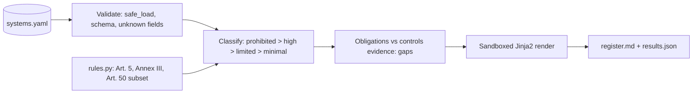

# POC 080: AI risk register generator (EU AI Act triage)

**Category:** Governance & Security | **Stack:** Python, Jinja2 (sandboxed), PyYAML

## Problem
Teams deploying AI need a register that says which systems are prohibited, high-risk or subject to transparency duties, and which required controls lack evidence. Spreadsheets drift; a YAML inventory plus deterministic rules produces a reviewable register on every change.

## Approach

- Every tier is produced by a named rule (an Article 5 practice, an Annex III area or an Article 50 duty) and the register cites it.
- Highest tier wins; a prohibited system is told to stop and escalate, not given a checklist.
- Obligations are matched against `controls` evidence in the inventory; unknown controls are listed but never credited.
- Inventory text is treated as data: YAML via `safe_load`, unknown fields rejected, Jinja2 `SandboxedEnvironment` with `StrictUndefined`, table-breaking characters escaped.

## Run it
```bash
make install
make test
make demo
```

## Evidence status
| Claim | Status |
|---|---|
| Classification, gap analysis, rendering on a 7-system synthetic inventory | Real: runs locally |
| Fidelity to the EU AI Act text | Simplified subset only; not reviewed by a lawyer (untested) |
| Legal advice or conformity assessment | Not provided |
| Real company inventory | Not tested; fictional systems |

## Results
<!-- RESULTS:START -->

**Results: AI risk register for a synthetic 7-system inventory**
Summary: {'systems': 7, 'by_tier': {'prohibited': 1, 'high': 2, 'limited': 2, 'minimal': 2}, 'open_gaps': 5}. Full register: `results/register.md`.

| id | system | tier | missing evidence |
|---|---|---|---|
| SYS-01 | Credit scoring model | high | - |
| SYS-02 | CV screening assistant | high | risk_management, data_governance, human_oversight, accuracy_monitoring |
| SYS-03 | Support chatbot | limited | - |
| SYS-04 | Marketing copy generator | minimal | - |
| SYS-05 | Invoice anomaly detector | minimal | - |
| SYS-06 | Emotion tracking in call centre | prohibited | - |
| SYS-07 | Deepfake voice for ads | limited | content_labelling |

Tiers come from a deliberately small rule set (3 prohibited practices, 6 Annex III areas, transparency duties); a human must confirm every tier.

<!-- RESULTS:END -->

## Limitations
- Rules cover only 3 prohibited practices, 6 Annex III areas and transparency; general-purpose AI model obligations, exemptions and Annex III conditions (e.g. the 'significant risk' filter) are not modelled.
- Domain tags are supplied by the inventory author; the tool does not infer what a system does.
- A control key being present is treated as evidence; no artefact is checked.
- Law and guidance change; the rule table must be reviewed by counsel before any real use.

## Data and security
The inventory is fictional and synthetic. Inventory fields are untrusted input: safe YAML parsing, field allow-list, sandboxed templating and output escaping.
