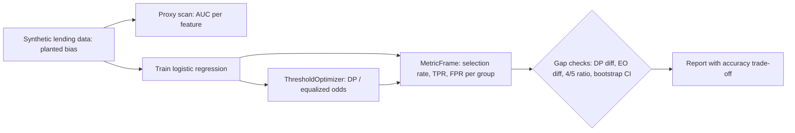

# POC 081: Model bias and fairness audit

**Category:** Governance & Security | **Stack:** Python, fairlearn, scikit-learn

## Problem
A lending model trained on historically biased approvals can reproduce that bias through proxy features even when the protected attribute is not an input. Reviewers need group-level metrics, evidence about proxies, and the cost of mitigation, not a single accuracy number.

## Approach

- Data generator plants a known mechanism: equal true ability across groups, a proxy feature correlated with group, and historical labels that under-approve group B. Ground truth is therefore known.
- Audit uses fairlearn's `MetricFrame` and difference metrics, the four-fifths ratio, and a bootstrap CI so small samples are not over-read.
- A one-feature proxy scan shows which inputs leak the protected attribute.
- Mitigation is post-processing with fairlearn's `ThresholdOptimizer`; accuracy is reported against the biased labels, and the conflict between demographic parity and equalized odds is shown rather than hidden.

## Run it
```bash
make install
make test
make demo
```

## Evidence status
| Claim | Status |
|---|---|
| Metrics, proxy scan, bootstrap CI, mitigation on planted-bias data | Real: fairlearn 0.15 and scikit-learn run locally |
| Audit of a real lender's model or data | Not tested; synthetic only |
| Legal compliance (four-fifths rule, EU/US law) | Not claimed; screening heuristic only |
| Intersectional groups, more than two groups | Not covered |

## Results
<!-- RESULTS:START -->

**Results: lending model fairness audit (synthetic, planted bias)**
Historical approval rate by group (the labels the model learns from): {'A': 0.5326, 'B': 0.2224}. True share of qualified applicants by group (known from the generator): {'A': 0.4938, 'B': 0.5062}. Proxy scan (one-feature AUC for predicting group, 0.5 = no leak): {'income': 0.5081, 'debt_ratio': 0.5096, 'postcode_risk': 0.9238}. Baseline demographic-parity gap 95% bootstrap CI: (0.1647, 0.2422).

| variant | accuracy | dp diff | eq. odds diff | impact ratio | passes 4/5 |
|---|---|---|---|---|---|
| baseline model | 0.703 | 0.209 | 0.099 | 0.531 | NO |
| without proxy feature | 0.677 | 0.027 | 0.164 | 0.926 | yes |
| threshold-optimised for demographic parity | 0.667 | 0.026 | 0.177 | 0.914 | yes |
| threshold-optimised for equalized odds | 0.688 | 0.090 | 0.045 | 0.782 | NO |

Accuracy is measured against the *biased* historical labels, so a fairer model is expected to score lower on it; that gap is the visible cost of the intervention, not a defect.

<!-- RESULTS:END -->

## Limitations
- Two groups and a linear model only; no intersectional analysis.
- Accuracy is measured against labels that are themselves biased, so it understates the quality of a fairer model.
- Post-processing uses the protected attribute at decision time, which may be unlawful in some jurisdictions; this POC does not give legal advice.
- The four-fifths ratio is a screening heuristic, not a legal test; fairness criteria conflict and cannot all be satisfied at once.
- Results depend on the planted generator parameters; real data will have messier proxies.

## Data and security
All data is synthetic, seeded and generated locally; no personal data. The audit reads only aggregates of predictions and labels.
