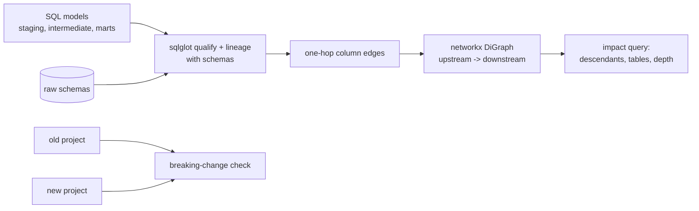

# POC 082: Column-level lineage and change-impact analysis from SQL

**Category:** Governance & Security | **Stack:** sqlglot, networkx

## Problem
Before changing a column you need to know which tables, dashboards and PII flows depend on it, and a rename should fail in review, not in the morning report. This POC parses a project's SQL models into column-level lineage, answers "what is downstream of this column?" and flags changes that would break readers.

## Approach

- Models are resolved in topological order so each can use upstream models' output columns (including `SELECT *` expansion); unknown tables raise `LineageError` instead of being guessed.
- Handles aliases, joins, CTEs, window functions (partition/order columns count as sources), derived expressions, subqueries and `UNION ALL`; `COUNT(*)` correctly has no column source.
- Scored against 22 hand-labelled output columns of a 10-model project; the labels include derived and window columns, not only renames.
- `breaking_change` compares two project versions and reports models that stop compiling or read columns that disappeared; a rename of an unread leaf column is correctly not breaking.

## Run it
```bash
make demo && make test   # 14 tests
```

## Evidence status
| Claim | Status |
|---|---|
| Column lineage vs hand labels, impact sets, breaking-change detection, long-chain scaling (60 models) | Tested / measured on a small hand-built project |
| Real dbt projects, macros/Jinja, dialect-specific functions, lineage through UDFs or dynamic SQL | **Not tested** |

## Results
<!-- RESULTS:START -->

**Results: sample 10-model project (generated by `make demo`)**
Column lineage extracted with sqlglot for 10 models (47 column edges, 0.2 s). Scored on 22 hand-labelled output columns (one hop, including aliases, joins, CTEs, window functions, subqueries and derived expressions): precision **1.0**, recall **1.0**. No mismatches.

#### Impact queries

| change | downstream columns | downstream tables | max depth |
|---|---|---|---|
| raw.orders.amount | 5 | marts.dim_customer, marts.exec_dashboard, marts.fct_orders, marts.revenue_by_segment, staging.stg_orders | 5 |
| raw.customers.email | 2 | marts.email_domains, staging.stg_customers | 2 |
| raw.products.unit_cost | 5 | intermediate.int_order_margin, marts.category_margin, marts.exec_dashboard, marts.fct_orders, staging.stg_items | 3 |
| staging.stg_items | 8 | intermediate.int_order_margin, marts.category_margin, marts.exec_dashboard, marts.fct_orders | 2 |

#### Breaking-change detection

Renaming `stg_orders.amount_usd` to `amount` is flagged: ['project no longer compiles: OptimizeError: Unknown column: amount_usd'].

Renaming a leaf column nobody reads (`email_domains.customers`) flagged: nothing.

<!-- RESULTS:END -->

## Limitations
- sqlglot's lineage is static: Jinja templating, `SELECT *` from unmanaged sources and dynamic SQL are out of reach.
- Lineage is column-to-column data flow; it does not model row-level filters or join-key influence on aggregates (a `WHERE` column is not a source of the output value).
- Ten models is a demonstration, not a scale test; only a 60-model synthetic chain was timed for structure, not published as a benchmark.

## Data and security
Synthetic SQL only; no database is contacted.
