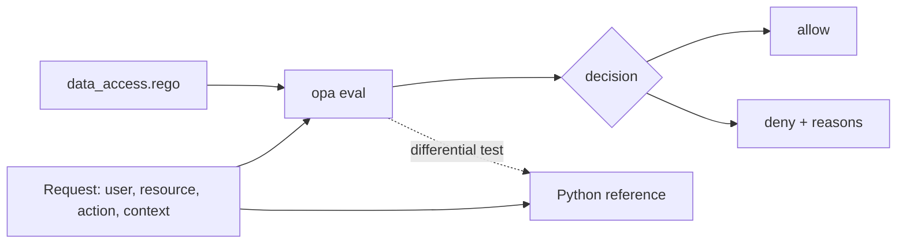

# POC 083: Data access policy-as-code with OPA

**Category:** Governance & Security | **Stack:** OPA/Rego (real binary), Python, pytest

## Problem
Access rules scattered across application code drift and cannot be reviewed. A Rego policy gives one reviewable, testable source for who may read, write or grant on which data, with a reason attached to every denial.

## Approach

- RBAC: roles map to allowed actions. ABAC: clearance vs classification, region residency, PII purpose limitation, MFA for confidential data, department ownership for writes.
- Default deny; any explicit deny reason beats an allow, and every denial lists its reasons.
- Checks are written as positive helpers and negated, because a comparison on a missing attribute is undefined in Rego and would silently skip a deny. A first draft failed open on a missing `purpose`; the missing-attribute test and the fix are kept in the repo.
- Evidence: 16 named scenarios, a seeded differential test of Rego against an independent Python implementation, a missing-attribute sweep, `opa test`, `opa check --strict`, `opa fmt`, and a mutation test that proves the suite notices a deleted rule.

## Run it
```bash
make install   # plus the opa binary on PATH or OPA_BIN
make test
make demo
```

## Evidence status
| Claim | Status |
|---|---|
| Policy evaluation by OPA v1.2.0 binary | Real: run locally and in the heavy workflow |
| Rego unit tests, strict check, formatting | Real |
| Rego vs Python differential test (random requests) | Real |
| Enforcement in a live service, OPA server, bundles, decision logs | Not built or tested |
| Real identity provider attributes | Not tested; request attributes are synthetic |

## Results
<!-- RESULTS:START -->

**Results: RBAC+ABAC data access policy evaluated by real OPA 1.2.0**
16/16 named scenarios match expectations. Differential test: 1500 seeded random requests (33 allowed), Rego vs independent Python reference: 0 mismatches. Missing-attribute check (each attribute removed from an otherwise-allowed request): attributes that still allowed access = none.

| scenario | decision | reasons | vs expected |
|---|---|---|---|
| analyst reads internal data | allow | - | ok |
| analyst cannot write | deny | no_role_grants_action | ok |
| engineer writes own dept | allow | - | ok |
| engineer writes other dept | deny | write_outside_own_department | ok |
| steward grants own dept | allow | - | ok |
| PII without approved purpose | deny | pii_requires_purpose | ok |
| PII with approved purpose | allow | - | ok |
| restricted data above clearance | deny | clearance_too_low | ok |
| confidential without MFA | deny | mfa_required | ok |
| cross-region read denied | deny | region_mismatch | ok |
| cross-region read with approval | allow | - | ok |
| inactive (departed) user | deny | user_inactive | ok |
| auditor reads | allow | - | ok |
| auditor + engineer role cannot write (auditor wins) | deny | auditors_are_read_only | ok |
| unknown classification | deny | clearance_too_low, unknown_classification | ok |
| no roles at all | deny | no_role_grants_action | ok |

<!-- RESULTS:END -->

## Limitations
- Evaluated through `opa eval` per call; no OPA server, bundle distribution or performance testing.
- The attribute set is invented; mapping real IdP groups and data catalogue tags is not covered.
- The Python reference was written by the same author, so shared misunderstandings of the intended policy would not be caught.
- Requires the opa binary; marked heavy so fast CI does not need it. If it is absent the tests skip, and the POC must be treated as unverified.

## Data and security
Requests, users and datasets are synthetic. OPA is invoked without a shell, with input on stdin and a timeout. The CI download is pinned to a sha256.
