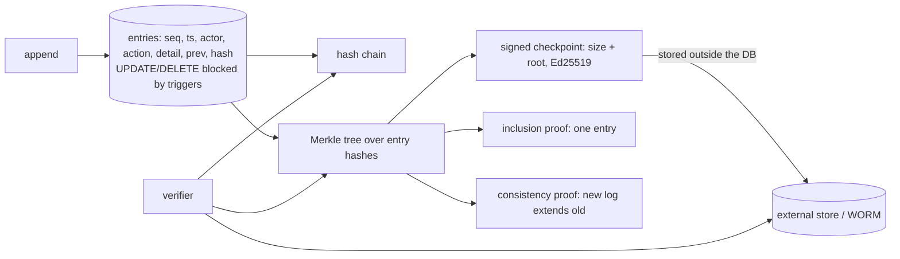

# POC 084: Tamper-evident audit log: hash chain, Merkle proofs and signed checkpoints

**Category:** Governance & Security | **Stack:** Python, SQLite, Ed25519 (cryptography)

## Problem
An audit log that an administrator can quietly edit is not an audit log. A hash chain catches careless edits, but an attacker with database access simply re-computes the chain. This POC shows exactly which attacks each layer stops: triggers, a hash chain, a Merkle tree with inclusion/consistency proofs, and a signed checkpoint stored outside the database.

## Approach

- Seven attacks assume the attacker has raw DB access and has dropped the triggers: field edit, edit + re-hash, delete + re-number, tail truncation, swap, forged insert + re-hash, wholesale replacement. The report shows which are caught by the chain alone and which by chain + external signed checkpoint.
- The Merkle tree follows the RFC 6962 (certificate transparency) construction with leaf/node domain separation; all inclusion and consistency proofs for sizes 1-39 are verified exhaustively, and proof sizes are logarithmic.
- The checkpoint's signature binds size and root; verification fails for a changed size, root, key or signature.
- Key finding: the chain alone misses every attack that re-hashes; truncation and replacement are only visible against a checkpoint the writer cannot alter.

## Run it
```bash
make demo && make test   # 25 tests
```

## Evidence status
| Claim | Status |
|---|---|
| Detection matrix for 7 attacks, Merkle proofs (exhaustive small sizes), signature checks | Tested (deterministic) |
| Append rate | Reported for context from one in-memory run; not a benchmark |
| Real key custody (HSM/KMS), external anchoring service, concurrent writers | **Not tested**; the signing key is generated in-process |

## Results
<!-- RESULTS:START -->

**Results: deterministic (generated by `make demo`)**
Untampered 100-entry log verifies: **True**. Each attack below assumes the attacker has raw write access to the database and can drop the append-only triggers.

| attack | hash chain alone | chain + signed checkpoint held outside the DB |
|---|---|---|
| edit a field (no re-hash) | detected | detected |
| edit a field and re-hash the rest of the chain | missed | detected |
| delete a middle entry and re-number + re-hash | missed | detected |
| delete the last 10 entries | missed | detected |
| swap two entries (no re-hash) | detected | detected |
| insert a forged entry and re-hash | missed | detected |
| replace the whole log with a fresh valid chain | missed | detected |

A competent attacker who re-hashes the chain defeats the chain alone; only an externally held, signed Merkle checkpoint (size + root) exposes rewriting, truncation and wholesale replacement. The checkpoint has to be stored somewhere the log's writer cannot modify (another system, WORM storage, a transparency service).

#### Merkle proofs (RFC 6962 construction)

| log size | inclusion proof hashes | consistency proof hashes (to size/2) |
|---|---|---|
| 8 | 3 | 1 |
| 100 | 7 | 7 |
| 1000 | 10 | 9 |

All inclusion proofs for sizes 1-39 and all consistency proofs between every pair of sizes verified: 1560/1560. Append rate on this machine: about 42,756 entries/s (in-memory SQLite, one writer; not a benchmark).

<!-- RESULTS:END -->

## Limitations
- The security of the design rests on storing checkpoints and the public key outside the writer's control; this repo cannot demonstrate that operationally.
- Single-writer SQLite; concurrent appends would need serialisation to keep the chain linear.
- Log contents are not encrypted; redact PII before logging (see POCs 023 and 034).

## Data and security
Synthetic events; a throwaway signing key per run.
