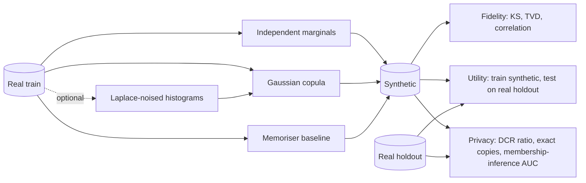

# POC 085: Synthetic data generation with privacy metrics

**Category:** Governance & Security | **Stack:** Python, NumPy, SciPy, scikit-learn (own Gaussian copula; SDV not used)

## Problem
Teams want to share realistic data without sharing people. Synthetic data can still leak: a generator that memorises rows looks fine on distribution plots. This POC measures fidelity, downstream utility and privacy together, so a leaky generator cannot pass on fidelity alone.

## Approach

- Three generators written from scratch: independent marginals (no correlations), a Gaussian copula (keeps dependence) and a deliberately leaky memoriser (real rows plus tiny jitter) as the negative control.
- Privacy is measured against a real holdout: a distance-to-closest-record ratio and a distance-based membership-inference attack, so a generator is judged against how close strangers are, not against zero.
- The memoriser has zero exact copies because of the jitter, yet is caught by the DCR ratio and the attack: a duplicate check alone is not a privacy test.
- An epsilon sweep builds the copula marginals from Laplace-noised histograms (epsilon-DP for the marginals only).

## Run it
```bash
make install
make test
make demo
```

## Evidence status
| Claim | Status |
|---|---|
| Fidelity, utility and privacy metrics on synthetic customer data | Real: runs locally |
| End-to-end differential privacy | Not claimed: only marginals are noised, the correlation matrix is not |
| SDV, CTGAN or other libraries | Not used |
| Real or regulated data, formal anonymisation sign-off | Not tested; a distance attack is a weak, not a worst-case, adversary |

## Results
<!-- RESULTS:START -->

**Results: synthetic data fidelity, utility and privacy (2000 real training rows, 1000 holdout)**
Train-on-real test-on-holdout AUC (ceiling): 0.6409. TSTR = train on synthetic, test on real holdout. DCR ratio = median distance to the nearest synthetic row for training members divided by the same for non-members (about 1 is fine, well below 1 means members are closer than strangers). MIA AUC is a distance-based membership attack (0.5 = no signal).

| synthesizer | KS mean | TVD mean | corr diff | TSTR AUC | DCR ratio | exact copies | MIA AUC |
|---|---|---|---|---|---|---|---|
| independent | 0.023 | 0.023 | 0.269 | 0.528 | 0.952 | 0.000 | 0.538 |
| copula | 0.022 | 0.013 | 0.027 | 0.596 | 0.984 | 0.000 | 0.506 |
| memoriser | 0.024 | 0.012 | 0.013 | 0.632 | 0.049 | 0.000 | 0.816 |
| copula (eps=0.1 marginals) | 0.052 | 0.026 | 0.037 | 0.626 | 0.975 | 0.000 | 0.518 |
| copula (eps=1.0 marginals) | 0.021 | 0.014 | 0.033 | 0.631 | 0.984 | 0.000 | 0.510 |
| copula (eps=10.0 marginals) | 0.021 | 0.013 | 0.033 | 0.631 | 0.988 | 0.000 | 0.506 |

Epsilon applies to the marginal histograms only; the copula correlation matrix is not privatised, so these runs are NOT end-to-end differentially private.

<!-- RESULTS:END -->

## Limitations
- Single dataset, 6 columns, one seed in the demo; differences between close AUC values (for example the epsilon rows) are within noise and should not be ranked.
- The membership attack is the simplest one; passing it does not mean other attacks (attribute inference, linkage, shadow models) fail.
- The label signal in the data is weak (real-to-real AUC about 0.64), which limits how much utility differences can show.
- No categorical correlation beyond what the copula's latent normal scores capture; numeric binning uses 40 equal-width bins.
- Privacy numbers do not constitute a legal anonymisation claim.

## Data and security
The source table is generated locally from a seed and contains no real people. Nothing is downloaded and no model is called.
