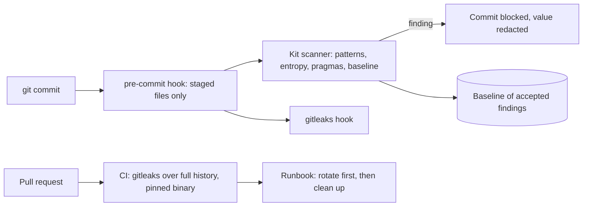

# POC 086: Secrets scanning kit: pre-commit, CI and a dependency-free scanner

**Category:** Governance & Security | **Stack:** Python, gitleaks v8.30.0 (real, pinned), git hooks, pre-commit config

## Problem
Credentials end up in repositories through .env files, test fixtures and copy-pasted snippets. A kit has to stop them at commit time, again in CI over the full history, and tell developers what to do when one gets through, without drowning them in false positives.

## Approach

- Kit contents: a pre-commit config (gitleaks plus a local hook), a gitleaks config that extends the defaults with an internal token rule and a narrow allowlist, a CI workflow that installs a pinned gitleaks release with a verified sha256 and scans full history, and an incident runbook that puts rotation before history rewriting.
- The dependency-free scanner covers common token formats, key blocks, JWTs, passwords in connection URLs and generic high-entropy assignments; it honours `# pragma: allowlist secret` and `gitleaks:allow`, supports a baseline so existing findings do not block new work, skips binary and oversized files, and never prints a full secret (only a 4-character prefix and a hash fingerprint).
- A benchmark generates secrets and look-alike negatives at run time (so the repository contains no secret-shaped literals) and compares the kit scanner with real gitleaks, on a tuning corpus and on hold-out formats.
- Hook behaviour is tested with real `git commit` calls in temporary repositories: blocked, redacted output, allowlisted pass, staged-only scanning.

## Run it
```bash
make install
make test
make demo   # set GITLEAKS_BIN or put gitleaks on PATH to include the comparison
```

## Evidence status
| Claim | Status |
|---|---|
| Kit scanner, hook, baseline, redaction | Real: tested including real git commits |
| gitleaks comparison | Real: gitleaks 8.30.0 binary (checksum verified); numbers appear in Results when the binary is present |
| pre-commit framework run end to end (fetching the gitleaks hook repo) | NOT run: the config is validated for structure only |
| Scanning real repositories or history at scale | Not tested |

## Results
<!-- RESULTS:START -->

**Results: 13 planted secrets (tuning corpus), 7 hold-out secrets in formats not used for tuning, 12 look-alike negatives; all generated at run time**
| tool | recall (tuning corpus) | recall (hold-out formats) | hold-out missed | false-positive rate | tuning-corpus missed | seconds |
|---|---|---|---|---|---|---|
| kit scanner | 1.000 | 0.429 | azure-connection-string, bearer-header, private-key-body, split-token | 0.000 | - | 0.004 |
| gitleaks 8.30.0 | 0.923 | 0.714 | private-key-body, split-token | 0.000 | db-url-password | 0.920 |

Both tools see the same files. gitleaks rows appear only when the binary is installed (pinned release in CI). The kit scanner was developed against the tuning corpus, so its score there is optimistic; the hold-out column is the fairer comparison. gitleaks was not tuned on either. Corpora this small are a smoke test, not a benchmark.

<!-- RESULTS:END -->

## Limitations
- The kit scanner was developed against the tuning corpus, so its 100% there is optimistic. On hold-out formats it misses an Azure connection string, a bearer header, a bare key body and a token split over two strings; gitleaks misses the last two and, on the tuning corpus, a database URL password.
- Corpora of 13, 7 and 12 files are a smoke test: one miss moves recall by 8 to 14 points.
- Entropy and keyword heuristics trade recall for false positives; tune them on your own repositories.
- A hook can be skipped with `--no-verify`; CI and server-side protection are the backstop.
- Removing a secret from history does not un-leak it: rotation comes first (see the runbook).

## Data and security
All secrets are generated randomly at run time and exist only in temporary directories. Findings are printed redacted. The CI download of gitleaks is pinned to a version and a sha256.
