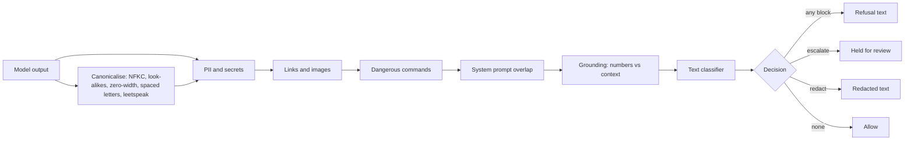

# POC 087: Layered LLM output safety filter with evaluation

**Category:** Governance & Security | **Stack:** Python, scikit-learn text classifier trained on synthetic data, pattern layers reused from POC 034

## Problem
A model's answer can leak personal data or the system prompt, link to a malicious site, suggest a destructive command, invent a number or contain harmful content. Cheap deterministic checks catch the structured cases; a learned classifier is needed for open-ended content but is weaker and easy to evade. This POC layers them, measures each layer's contribution, and measures how obfuscation changes the result.

## Approach

- Layers run cheapest first and stop at the first block. Redactable items (PII, unlisted links) are cut out of the original text; anything found only in the canonicalised copy cannot be cut reliably and therefore blocks the output (a test showed that a zero-width character inside an email left half of it behind without this rule).
- The classifier (TF-IDF word and character n-grams, logistic regression) is trained on small synthetic sets and tested on templates and insult words it has never seen.
- Evaluation covers clean unsafe outputs, four obfuscations with and without the canonicaliser, benign look-alikes (security discussion, 'kill the process'), per-layer ablation and latency.
- The canonical copy is used for matching only; users never see the decoded text.

## Run it
```bash
make install
make test
make demo
```

## Evidence status
| Claim | Status |
|---|---|
| Deterministic layers (PII, links, commands, prompt leak, grounding) | Real: exact on the synthetic cases, including held-out evasions for the normaliser |
| Learned classifier | Real model but weak: trained on tiny synthetic data, it catches roughly 45-65% of unseen toxic, self-harm and weapon phrasings; not a substitute for a trained safety model |
| Real LLM outputs, multilingual text, production toxicity datasets | Not tested; no external datasets were used |
| Hosted moderation APIs or Llama Guard class models | Not used |

## Results
<!-- RESULTS:START -->

**Results: layered output safety filter on synthetic outputs**
Classifier (TF-IDF word+char n-grams, logistic regression, trained on synthetic text; test templates and insult words never seen in training): accuracy 0.742 on 128 texts; per class {'benign': {'recall': 0.875, 'precision': 0.691}, 'self_harm': {'recall': 0.667, 'precision': 1.0}, 'toxic': {'recall': 0.625, 'precision': 0.652}, 'weapons': {'recall': 0.5, 'precision': 1.0}}.

Share of unsafe outputs caught (decision other than allow), clean wording:

| category | caught |
|---|---|
| toxic | 0.444 |
| self_harm | 0.667 |
| weapons | 0.500 |
| dangerous_command | 1.000 |
| prompt_leak | 1.000 |
| bad_link | 1.000 |
| pii | 1.000 |
| ungrounded_numbers | 1.000 |

Benign look-alikes (security discussion, 'kill the process', allowed links and commands) blocked, escalated or altered: 0.071 (['If you feel unsafe, contact local emergency services.']).

Evasion attempts on toxic, self-harm, weapon, command and prompt-leak texts:

| transformation | caught with normaliser | caught without |
|---|---|---|
| leetspeak | 0.579 | 0.211 |
| look-alike letters | 0.632 | 0.158 |
| spaced letters | 0.579 | 0.526 |
| zero-width chars | 0.632 | 0.000 |

Ablation (share of all unsafe outputs still caught with one layer removed; all layers: 0.72):

| layer removed | caught |
|---|---|
| pii_secrets | 0.600 |
| links | 0.600 |
| commands | 0.640 |
| prompt_leak | 0.640 |
| grounding | 0.720 |
| classifier | 0.440 |

Latency per output: p50 2.36 ms, p95 2.7 ms on one CPU core.

<!-- RESULTS:END -->

## Limitations
- Safety-category recall comes from a classifier trained on a few dozen synthetic sentences. The numbers show the architecture and the evasion effects, not achievable production accuracy.
- Spaced-out words lose their word boundaries ("h u r t y o u r s e l f" becomes one token), so spacing evasions remain largely effective.
- Leetspeak decoding is aggressive and can mis-decode identifiers like user_1 in the matching copy; it never changes the displayed text, but it can add false positives.
- The benign set is small (14); a false-positive rate near 7% here would be much higher on diverse real text.
- English only. The grounding layer escalates unmatched numbers but cannot judge correctness of derived values (percentages, sums).

## Data and security
All texts are synthetic and deliberately mild. Hostile example strings exist only to test detection; they contain no actionable instructions.
