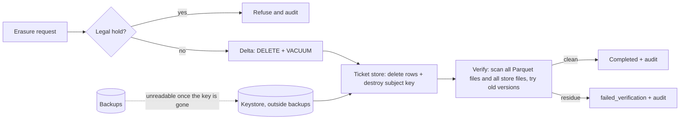

# POC 088: GDPR erasure and retention pipeline for a lake and a vector store

**Category:** Governance & Security | **Stack:** Python, Delta Lake (delta-rs), file-backed vector store with per-subject encryption, cryptography (Fernet); pgvector not used

## Problem
A deletion request is not met by a DELETE statement. In a lakehouse the rows live on in old Parquet files and old table versions until they are vacuumed; in a vector store the personal text and its embedding sit in indexes, caches and backups. A pipeline has to erase everywhere, prove it, survive a crash halfway, respect legal holds and keep an audit trail that does not itself contain the personal data.

## Approach

- Lake: erase by DELETE followed by VACUUM with zero retention, then check every Parquet file under the table directory (including files no longer referenced) and try to read every older table version. A DELETE-only control shows the subject still present in 7 files and 7 table versions.
- Vector store: tickets (text and embedding) are encrypted with a per-subject key held in a keystore kept outside the data and backup directories. Erasure deletes the rows and destroys the key, so copies in backups become unreadable (crypto-shredding).
- Orchestration is idempotent and resumable (a crash after the lake step does not repeat it), records a due date 30 days from receipt, refuses subjects under legal hold, and writes a hash-chained audit log that holds only a salted pseudonym and counts.
- A retention job deletes expired events (honouring holds) and vacuums. A planted unregistered cache file with the subject's email shows verification failing instead of reporting success.

## Run it
```bash
make install
make test
make demo
```

## Evidence status
| Claim | Status |
|---|---|
| Delta Lake delete, vacuum, residue scan and time-travel check | Real: delta-rs 1.6 on local files |
| Crypto-shredding of the ticket store and its backup copy | Real, with Fernet keys held outside the backup |
| pgvector, a real vector database, cloud object-store lifecycle and versioning, managed backups | Not used or tested |
| Legal review of the process (what counts as erasure, exemptions, data processors) | Not done; this is engineering, not legal advice |

## Results
<!-- RESULTS:START -->

**Results: erasure across Delta Lake and an encrypted vector store (synthetic people)**
| check | result |
|---|---|
| subject rows in lake / tickets before | 20 / 2 |
| old table versions that expose the subject before | [0, 1, 2, 3, 4, 5, 6] |
| DELETE only (no VACUUM): rows visible, files still containing the subject, old versions exposing | 0, 7, [0, 1, 2, 3, 4, 5, 6] |
| full erasure after a simulated crash and resume: status | completed |
| residue hits / readable old versions / rows left / tickets left | 0 / [] / 0 / 0 |
| second identical request | already_completed |
| other subjects untouched, search still works | {'other_events_kept': True, 'other_tickets_kept': True, 'search_still_works': True} |
| ticket backup: tickets still decryptable / plaintext hits | 0 / 0 |
| lake backup still contains the subject (unencrypted) | True |
| legal hold request | refused_legal_hold |
| retention (90 days, one subject on hold): rows deleted, expired rows left | 426, 0 |
| audit hash chain valid / overdue requests on 2025-08-01 | True / [] |

<!-- RESULTS:END -->

## Limitations
- The lake backup in the demo still contains the subject because that table is not encrypted per subject; only rotation or re-encryption of backups would remove it. The ticket store avoids this with crypto-shredding.
- Only registered locations are erased. Verification scans those locations; copies elsewhere (exports, notebooks, logs, third parties) need a data map, and the planted-cache test shows failure is detected only inside scanned directories.
- Embeddings derived from personal text are treated as personal data and encrypted or deleted; embeddings in an external index or an LLM provider's logs are out of scope.
- VACUUM with zero retention is only safe when no reader or writer needs older versions; production would coordinate it.
- Single process, local filesystem: no distributed locking or object-store eventual consistency.

## Data and security
All people are synthetic (example.com). The audit log and request state contain only an HMAC pseudonym of the subject id, counts and dates. Subject ids are validated before they reach a delete predicate.
