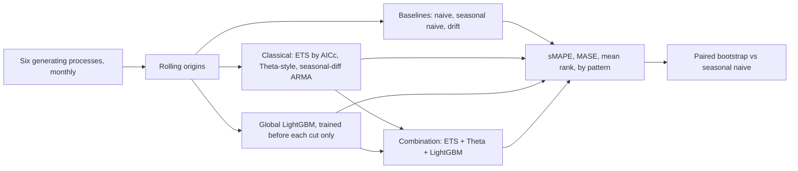

# POC 089: Forecasting benchmark: classical vs machine learning vs foundation models

**Category:** ML & Analytics | **Stack:** Python, statsmodels (Holt-Winters ETS, ARIMA), LightGBM global model; statsforecast not used; foundation models not run

## Problem
Teams choose a forecasting model from a leaderboard and then find it loses to seasonal naive on their data. A fair benchmark uses rolling origins, a scale-free error measure, strong simple baselines, a global-versus-local comparison and an interval on the difference to the baseline, and it is honest about what was not run.

## Approach

- Synthetic series from known processes (trend+seasonal, stable seasonal, changing seasonality, level shift, random walk, intermittent) so wins and losses can be explained.
- Two rolling origins per series; the global LightGBM model is retrained for each origin on data before the cut only (a test poisons the data after the cut and checks the forecast is unchanged).
- MASE (scaled by in-sample seasonal-naive error) and sMAPE are both reported, with mean rank and a paired bootstrap interval of the best model against seasonal naive.
- A first LightGBM version diverged on intermittent series because the lag ratios exploded when the recent mean was zero; the fix (offset scale, clipped ratios) is in the code and covered by the all-patterns finite-forecast test.

## Run it
```bash
make install
make test
make demo
```

## Evidence status
| Claim | Status |
|---|---|
| Baselines, ETS, Theta-style, differenced ARMA, global LightGBM, combination | Real: run on 48 series with 2 origins |
| Results on real business data (M4/M5-like) | Not tested; the synthetic series favour the effects they were built to contain |
| statsforecast, hierarchicalforecast, neural models | Not used: statsforecast would force pandas 2 and conflict with other POCs' pins |
| Foundation models (Chronos, TimesFM, Moirai) | NOT run: no weights or network; only a status line in the results. Any claim about them would be untested |

## Results
<!-- RESULTS:START -->

**Results: 48 synthetic monthly series x 2 rolling origins, horizon 12**
MASE is scaled by the in-sample seasonal-naive error (lower is better; 1.0 equals seasonal naive in-sample). The global LightGBM model is trained only on data before each cut. Foundation models: not run (no weights or network).

| model | sMAPE % | MASE | mean rank | trend_seasonal | stable_seasonal | changing_seasonality | level_shift | random_walk | intermittent |
|---|---|---|---|---|---|---|---|---|---|
| ETS (AICc) | 31.970 | 0.905 | 2.670 | 0.440 | 0.740 | 1.090 | 1.420 | 0.760 | 0.990 |
| combo: ETS+Theta+LightGBM | 32.260 | 1.016 | 3.540 | 0.530 | 0.820 | 1.440 | 1.540 | 0.810 | 0.960 |
| Theta (simplified) | 33.110 | 1.090 | 3.810 | 0.760 | 0.750 | 1.840 | 1.480 | 0.810 | 0.910 |
| seasonal-diff ARMA | 23.960 | 1.165 | 4.270 | 0.520 | 1.020 | 1.000 | 2.330 | 1.040 | 1.080 |
| seasonal naive | 18.940 | 1.245 | 4.750 | 1.040 | 1.020 | 1.050 | 2.180 | 1.120 | 1.060 |
| LightGBM global | 33.370 | 1.272 | 4.930 | 0.600 | 1.280 | 1.750 | 2.010 | 0.980 | 1.010 |
| naive | 27.280 | 2.383 | 5.790 | 1.440 | 3.940 | 4.880 | 1.960 | 0.770 | 1.300 |
| drift | 27.750 | 2.456 | 6.240 | 1.350 | 4.080 | 5.050 | 2.040 | 0.860 | 1.350 |

Best by MASE: ETS (AICc). Paired bootstrap 95% interval for its MASE minus seasonal naive's: [-0.444, -0.243] (negative = better).

<!-- RESULTS:END -->

## Limitations
- 48 short monthly series and 2 origins: rankings between close models are not reliable; only large gaps (for example ETS versus naive) are.
- The Theta-style model is a simplified implementation, not the reference Theta, and the ARMA variant is a seasonal difference plus ARIMA(1,0,1), not a full seasonal auto-ARIMA.
- sMAPE and MASE disagree about the best model because intermittent series contain zeros; seasonal naive looks best on sMAPE. Report both, and use a metric suited to intermittent demand there.
- No prediction intervals, no exogenous features, no hyperparameter search for LightGBM.
- Forecast runtime figures are single-core wall time on this machine.

## Data and security
All series are generated from a seed. No external data or models are downloaded.
