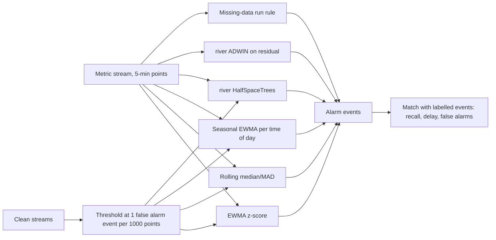

# POC 090: Streaming anomaly detection on metrics

**Category:** ML & Analytics | **Stack:** Python, river 0.26 (HalfSpaceTrees, ADWIN), own EWMA / seasonal / MAD detectors

## Problem
Operational metrics have daily rhythm, noise and gaps. A static threshold either pages constantly or misses real incidents. Online detectors must learn the rhythm in one pass with bounded memory, be calibrated to a false-alarm budget, and be judged by events found and how fast, not by point-wise accuracy.

## Approach

- Synthetic streams with daily and half-daily seasonality, noise and five labelled anomaly kinds: spike, level shift, variance burst, missing-data gap, and a seasonal break where the pattern flattens while values stay in range.
- Thresholds are fixed on separate anomaly-free streams to a budget of one false-alarm event per 1000 points, then frozen; evaluation streams use different seeds.
- Evaluation is event-based: an event is found if an alarm overlaps it (with a small tolerance after its end); the report gives event recall by kind, false alarms per 1000 points and median detection delay.
- Detectors keep bounded state and process one point at a time; the river model state can be snapshotted and restored (tested), with the usual warning never to unpickle untrusted snapshots.

## Run it
```bash
make install   # river is pinned in requirements.txt
make test
make demo
```

## Evidence status
| Claim | Status |
|---|---|
| Detector comparison on labelled synthetic streams | Real: river and the other detectors run locally, deterministic |
| Calibration discipline | Real: thresholds set on separate clean streams; generalisation to other clean streams is tested |
| Real production metrics, concurrent streams, alert routing | Not tested |
| Neural or foundation-model anomaly detectors | Not used |

## Results
<!-- RESULTS:START -->

**Results: 6 detectors on 5 synthetic streams (5-minute points, daily seasonality; 70 injected events in total)**
Every threshold was set on separate anomaly-free streams to give at most 1.0 false alarm event per 1000 points; no threshold was tuned on the evaluation streams. An event counts as found if an alarm overlaps it (24 points of tolerance after its end).

| detector | event recall | false alarms / 1000 pts | median delay (points) | spike | level_shift | variance | dropout | seasonal_break | points/s |
|---|---|---|---|---|---|---|---|---|---|
| EWMA z-score | 0.586 | 0.690 | 1 | 0.800 | 0.800 | 0.930 | 0.070 | 0.200 | 2224351 |
| Rolling median/MAD | 0.500 | 0.830 | 9 | 0.470 | 0.800 | 0.800 | 0.130 | 0.200 | 24535 |
| Seasonal EWMA | 0.786 | 0.280 | 0 | 1.000 | 1.000 | 1.000 | 0.000 | 1.000 | 968485 |
| river HalfSpaceTrees | 0.643 | 0.490 | 0 | 0.730 | 0.930 | 1.000 | 0.070 | 0.400 | 10708 |
| river ADWIN (drift) | 0.329 | 0.900 | 25 | 0.000 | 1.000 | 0.130 | 0.000 | 0.600 | 1076559 |
| Missing-data run rule | 0.214 | 0.000 | 2 | 0.000 | 0.000 | 0.000 | 1.000 | 0.000 | 6223324 |

<!-- RESULTS:END -->

## Limitations
- Synthetic data with clean, regular seasonality favours the seasonal detector; real metrics have drifting seasonality, holidays and correlated series.
- No single detector covers every kind: the best (seasonal EWMA) finds about 80% of events but never sees missing data, which a simple run rule catches fully. Together they cover all five kinds here.
- ADWIN detects level shifts but is slow and noisy for point anomalies; HalfSpaceTrees needs feature engineering (deviation from a baseline, first difference, time of day) to be competitive.
- Only 42 events across 3 evaluation streams in the test run (more in the demo): per-kind recall figures move in steps of 7 to 33 points.
- Throughput numbers (single core, Python) vary by machine; HalfSpaceTrees is the slow one.

## Data and security
All data is synthetic; no network access. River models are pickled only for the local snapshot test.
