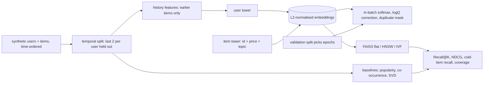

# POC 092: Two-tower recommender with offline evaluation (NumPy, FAISS; PyTorch not used)

**Category:** ML & Analytics | **Stack:** NumPy with hand-written backpropagation, FAISS 1.13 (flat/HNSW/IVF), scikit-learn baselines; PyTorch NOT used

## Problem
Retrieval models are easy to build and easy to evaluate wrongly: leaking future interactions into history features, recommending items the user already has, rewarding popularity, and measuring only warm items. This POC trains a two-tower retrieval model (user tower from history and segment, item tower from id, price bucket and topic) with an in-batch sampled-softmax loss and logQ popularity correction, evaluates it with a temporal leave-last-out split against popularity, item-item co-occurrence and SVD baselines (including cold-start items, popularity bias and coverage), and measures FAISS approximate-search recall against exact search.

## Approach

- Backpropagation is written by hand (embedding-bag pooling, ReLU MLP towers, L2-normalisation, softmax with temperature) and verified against finite differences on every parameter group.
- No leakage: training histories contain only items before the target, test items are never in the user's history and seen items are excluded from recommendations; cold items never appear in training.
- Epochs are chosen on a validation split (each user's last training item) and not on the test items: validation recall peaked at 2 epochs, after which the id embeddings overfit this small data set.
- Result (see below): after selection the two-tower model is close to item-item co-occurrence on warm items (it does not beat it) and is the only model that retrieves cold items (via the topic content feature); co-occurrence scores them zero. Popularity is dominated by head items and has tiny coverage.
- FAISS: exact inner-product search is the reference; HNSW (efSearch 64) reaches ~0.99 recall, IVF with 4 probes ~0.86, at sub-0.01 ms per query on 800 items (latency is indicative only).

## Run it
```bash
make demo PY=python
make test
```

## Evidence status
| Claim | Status |
|---|---|
| Gradient correctness, leakage guards, metrics, baselines, ANN recall | Tested (11 tests) |
| Model comparison on synthetic data | Measured (single seed; synthetic latent-topic data where co-occurrence is structurally strong) |
| Real-world recommendation quality, online A/B performance, large catalogues, GPU training | NOT verified |
| PyTorch / TensorFlow Recommenders | Not used |

## Results
<!-- RESULTS:START -->

**Results (measured by `python -m two_tower_recommender.main`; synthetic data, temporal leave-last-2-out, NumPy two-tower, FAISS 1.13)**
1500 users, 800 items, 36902 training interactions; two-tower training loss 5.502 -> 5.193 over 2 epochs (chosen on a validation split; validation recall@50 by epoch: {1: 0.3653, 2: 0.4207, 3: 0.4127, 4: 0.416, 5: 0.41, 6: 0.4087, 7: 0.4067, 8: 0.4}).

| model | recall@10 | recall@50 | NDCG@10 | mean popularity rank of top-10 (0=most popular) | coverage@10 | recall@50 on cold items |
|---|---|---|---|---|---|---|
| popularity | 0.100 | 0.268 | 0.066 | 0.009 | 0.028 | 0.000 |
| item-item co-occurrence | 0.175 | 0.416 | 0.114 | 0.031 | 0.281 | 0.000 |
| SVD (32 factors) | 0.144 | 0.359 | 0.097 | 0.098 | 0.395 | 0.000 |
| two-tower | 0.166 | 0.398 | 0.111 | 0.053 | 0.285 | 0.277 |

#### ANN retrieval (k=50) vs exact inner-product search

| index | recall vs exact | ms / query |
|---|---|---|
| flat_exact | 1.000 | 0.014 |
| hnsw_ef16 | 0.756 | 0.004 |
| hnsw_ef64 | 1.000 | 0.007 |
| ivf_nprobe1 | 0.334 | 0.006 |
| ivf_nprobe4 | 0.866 | 0.007 |

<!-- RESULTS:END -->

## Limitations
- Synthetic data with a latent-topic structure favours neighbourhood methods; real interaction data can reverse the ranking, and this is a single seed without confidence intervals.
- Hand-written NumPy training is slow and has no regularisation beyond early stopping; the mini-batch size and negative sampling scheme (in-batch only) are basic.
- 800 items make FAISS latency numbers meaningless for production sizing; only the recall-vs-exact comparison transfers.
- Item content features are three small categoricals; there is no text or image tower, and user features are limited to history and a segment id.

## Data and security
Synthetic users, items and interactions from a seeded NumPy RNG; no external data.
