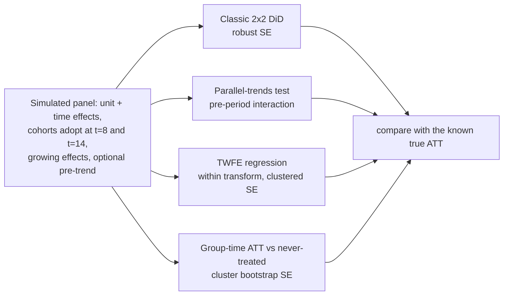

# POC 093: Causal difference-in-differences: classic 2x2, parallel-trends test and the staggered-adoption trap

**Category:** ML & Analytics | **Stack:** numpy, statsmodels, scipy

## Problem
A policy or feature rolls out to some units and not others; did it work? Difference-in-differences compares before/after changes across groups, but it fails quietly when trends were not parallel, and the standard two-way fixed effects (TWFE) regression is biased when units adopt at different times and effects grow. This POC simulates panels with known true effects to show when each estimator works and when it does not.

## Approach

- Known ground truth: each unit-period's true effect is simulated, so bias is measured, not argued.
- TWFE is implemented with the within transformation (verified equal to the full dummy-variable regression) and unit-clustered CR1 standard errors.
- The group-time estimator (Callaway-Sant'Anna style, never-treated comparison) averages ATT(g,t) over post-treatment cells; standard errors come from a unit-level bootstrap.
- Measured over 150 replications: TWFE is unbiased for a constant effect but biased by -1.1 (true 4.4) and -2.1 (true 7.1) when effects grow after adoption; the group-time estimator has ~0 bias in all three. The 2x2 interval covers ~97%. The parallel-trends test rejects ~7% when trends are parallel and 100% when treated units drift 0.15/period faster; ignoring that drift biases the estimate by +0.6.

## Run it
```bash
make demo && make test   # demo ~6 s, 10 tests
```

## Evidence status
| Claim | Status |
|---|---|
| Bias/coverage/power numbers | Measured on simulated panels (150 replications; seeded) |
| Real observational data, anticipation effects, covariates, unbalanced panels, not-yet-treated controls | **Not tested** |

## Results
<!-- RESULTS:START -->

**Results: simulated panels, 150 replications per row (generated by `make demo`)**
Panel: 300 units x 20 periods, unit and time effects, two adoption cohorts (periods 8 and 14) and about a third never treated. 'Truth' = the average true effect over treated unit-periods.

| effect pattern | true ATT | TWFE estimate | TWFE bias | group-time (never-treated controls) estimate | bias |
|---|---|---|---|---|---|
| homogeneous, static effect (dynamic=0) | 2.000 | 2.000 | 0.000 | 2.000 | 0.000 |
| heterogeneous + growing effect (dynamic=0.6) | 4.360 | 3.230 | -1.130 | 4.360 | 0.000 |
| strongly growing effect (dynamic=1.2) | 7.060 | 4.920 | -2.140 | 7.060 | 0.000 |

With a constant effect both agree. When effects grow after adoption, TWFE reuses already-treated units as controls and is biased; the group-time estimator stays close to the truth.

#### Classic 2x2 DiD: 95% confidence interval coverage of the true effect: **97%** (nominal 95%, 150 replications; robust SEs).

#### Parallel-trends test (pre-period group-by-time interaction): rejects in **7%** of panels where trends are parallel (should be near 5%) and **100%** where treated units drift 0.15 per period faster. Ignoring that violation biases the 2x2 estimate by +0.62 on a true effect of 2.0.

Cluster-bootstrap SE of the overall group-time ATT on one panel (60 resamples): 0.130.

<!-- RESULTS:END -->

## Limitations
- The simulator matches the estimators' assumptions closely (additive effects, no anticipation); real data rarely do.
- Never-treated units must exist and be comparable; if they are not, the group-time estimator has no valid control.
- The pre-trend test only checks a linear differential trend and has low power for small violations; passing it does not prove parallel trends.
- No covariate adjustment, clustering level choices, or multiple-outcome corrections.

## Data and security
Simulated data only.
