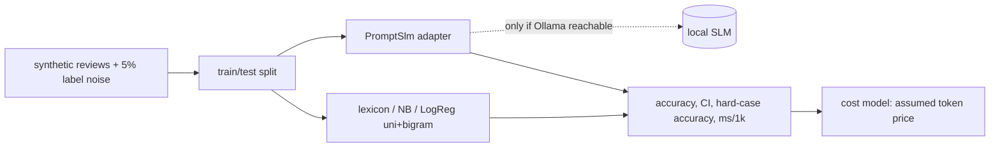

# POC 094: Sentiment: SLM vs classical baseline cost/accuracy

**Category:** ML & Analytics | **Stack:** scikit-learn (measured); local SLM via llm_client/Ollama (NOT run here)

## Problem
Teams reach for an LLM for sentiment before checking what a TF-IDF classifier does. This POC compares a lexicon, Naive Bayes and logistic regression (unigram/bigram) on synthetic reviews with a deliberately hard subset (negation, contrast), reports accuracy with bootstrap CIs, easy-vs-hard accuracy and CPU time, and ships a strict-parsing zero-shot SLM adapter that runs only when a local Ollama server is reachable.

## Approach

- Hard cases (negation, contrast, with word-order dependent polarity) are flagged so models can be compared where they actually differ.
- Bootstrap 95% CIs on accuracy; separate noise RNG stream so label noise never shifts the generated text.
- `PromptSlm` parses the first word strictly, counts unparsable answers and maps them to `neutral` (visible in `unparsable`).
- Cost of the SLM arm is MODELLED from an assumed token price, not measured.

## Run it
```bash
make demo PY=python
make test
```

## Evidence status
| Claim | Status |
|---|---|
| Classical models: accuracy, hard-case accuracy, timing | Measured (synthetic data) |
| SLM adapter parsing and prompt construction | Tested with a stub client |
| SLM accuracy and latency | NOT RUN (no Ollama here); unverified |
| SLM cost per 1k reviews | MODELLED from assumed price |
| Real review data, sarcasm, multilingual text | Not used |

## Results
<!-- RESULTS:START -->

**Results (measured by `python -m sentiment_slm_vs_classical.main`; synthetic reviews, 5% label noise)**
| model | accuracy | 95% CI | macro-F1 | acc easy | acc hard | ms / 1k reviews |
|---|---|---|---|---|---|---|
| lexicon | 0.615 | 0.578-0.647 | 0.599 | 0.903 | 0.209 | 4.600 |
| naive_bayes_unigram | 0.847 | 0.818-0.875 | 0.844 | 0.909 | 0.759 | 12.800 |
| logreg_unigram | 0.903 | 0.88-0.925 | 0.903 | 0.954 | 0.831 | 10.600 |
| logreg_bigram | 0.945 | 0.928-0.962 | 0.935 | 0.954 | 0.932 | 15.000 |

- SLM arm: **NOT RUN** no local Ollama reachable (LLMError); SLM arm unverified
- Modelled SLM cost: $0.035 per 1k reviews (assumed $0.0005/1k tokens x 70 tokens); classical models cost ~nothing at inference.

<!-- RESULTS:END -->

## Limitations
- Reviews are templated from small phrase pools, so TF-IDF models are tested in-distribution and their scores are optimistic compared with real reviews.
- No claim is made about how an SLM compares: that arm is unverified until run against a local model.
- Timing is single-run wall-clock on a shared CI-like machine; use relative order only.
- Cost figures are assumptions, not vendor prices.

## Data and security
Synthetic templated reviews from a seeded RNG; no external data.
