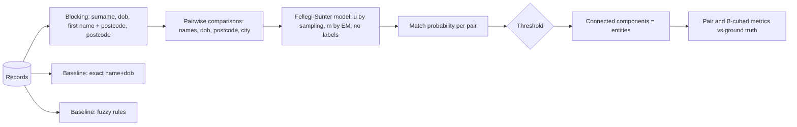

# POC 095: Entity resolution and deduplication with Splink

**Category:** ML & Analytics | **Stack:** Python, Splink 5 on DuckDB (real), rule-based baselines

## Problem
The same customer appears under spelling variants, swapped name fields, missing dates of birth and mistyped postcodes. Exact joins miss most of these duplicates; comparing every pair of records is quadratic. Probabilistic linkage with blocking finds most duplicates cheaply and gives a match probability to threshold, but chaining pairs into entities can wrongly merge different people.

## Approach

- Synthetic people with known entity ids: 40% of entities have 1 to 3 noisy duplicates (typos, swapped names, wrong month, missing dob, postcode or city).
- Splink (real, DuckDB backend) is trained without labels: u-probabilities by random sampling, m-probabilities by expectation-maximisation on two blocking rules. Pairs come from four blocking rules.
- Output is evaluated at several probability thresholds against the exact and fuzzy baselines, with pair precision/recall and B-cubed F1 on the resulting clusters.
- A scaling probe shows candidate pairs growing far more slowly than n squared.

## Run it
```bash
make install   # splink is pinned in requirements.txt
make test
make demo
```

## Evidence status
| Claim | Status |
|---|---|
| Splink training, prediction, thresholds, clustering metrics | Real: Splink 5.0.0 on DuckDB |
| Data | Synthetic: noise types are the author's and are easier than real data (no phonetic variants, nicknames, transliteration, shared household addresses) |
| Large-scale performance (millions of records) | Not tested: the probe stops at a few thousand records |
| Human review of borderline pairs and unmerge workflow | Not built |

## Results
<!-- RESULTS:START -->

**Results: 5366 synthetic person records, 3000 true entities, 3919 true duplicate pairs**
Splink (probabilistic, DuckDB) trained without labels: u-probabilities from random sampling, m-probabilities by EM. Blocking scored 3,681 candidate pairs instead of 14,394,295 possible (blocking pair recall 0.892). Training and prediction took 6.1 s.

| method | pair precision | pair recall | pair F1 | B-cubed F1 | clusters | pairs linked |
|---|---|---|---|---|---|---|
| Splink @ 0.5 | 0.997 | 0.829 | 0.905 | 0.973 | 3193 | 3257 |
| Splink @ 0.8 | 0.999 | 0.800 | 0.889 | 0.967 | 3257 | 3137 |
| Splink @ 0.95 | 1.000 | 0.777 | 0.875 | 0.963 | 3290 | 3046 |
| Splink @ 0.99 | 1.000 | 0.714 | 0.833 | 0.944 | 3429 | 2799 |
| exact name+dob | 1.000 | 0.289 | 0.448 | 0.816 | 4462 | 1131 |
| fuzzy rules | 1.000 | 0.701 | 0.824 | 0.943 | 3446 | 2746 |

Scaling of blocking:

| records | all possible pairs | pairs scored after blocking | seconds |
|---|---|---|---|
| 1422 | 1,010,331 | 966 | 3.400 |
| 2862 | 4,094,091 | 2,012 | 5.900 |
| 5730 | 16,413,585 | 4,064 | 5.800 |

Clusters are connected components of the linked pairs; B-cubed scores the resulting entities, which punishes chains that merge different people.

<!-- RESULTS:END -->

## Limitations
- Blocking recall (about 0.89) is the ceiling for recall: duplicates that share no blocking key are never compared. Adding rules raises recall and cost.
- Connected components can chain A~B and B~C into one entity although A and C never matched; a unit test shows this and the B-cubed score reflects it.
- Splink warns when some comparison levels have too few random samples for u-values; the sample size here is modest.
- Thresholds were chosen by looking at the same data used for evaluation; a real project needs labelled review samples and cost-aware thresholds.
- Names are synthetic (a small pool), so common-name collisions are more frequent than in real populations.

## Data and security
All records are synthetic. Splink runs in-process on DuckDB; no data leaves the machine.
