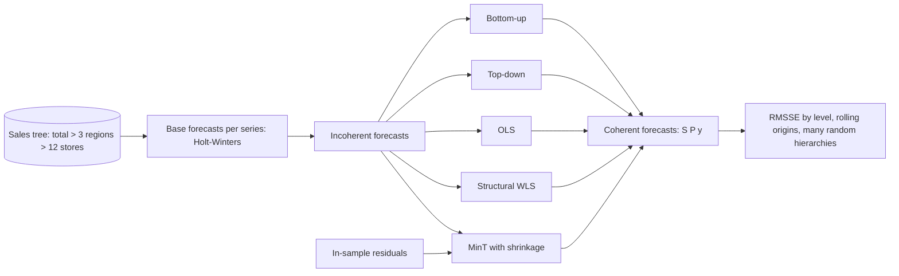

# POC 096: Hierarchical forecast reconciliation

**Category:** ML & Analytics | **Stack:** Python, statsmodels Holt-Winters, own reconciliation (bottom-up, top-down, OLS, WLS, MinT-shrink); hierarchicalforecast not used

## Problem
Store forecasts, regional forecasts and the company total are produced separately and do not add up, so planners see conflicting numbers. Reconciliation adjusts all levels so they sum correctly; the useful question is whether it also improves accuracy, and the honest answer is: a little, sometimes.

## Approach

- Reconciliation is written from the linear-algebra definition y~ = S P y^ and each P is checked: bottom-up, OLS, WLS and MinT satisfy P S = I (unbiasedness); top-down is coherent but not unbiased.
- MinT uses the Schaefer-Strimmer shrinkage estimate of the residual covariance (towards its diagonal), computed from in-sample one-step residuals.
- Evaluation: 16 series (1 total, 3 regions, 12 stores) with seasonality, trend and shared regional shocks; rolling origins; RMSSE by level; coherence gap; then repeated over several random hierarchies with a bootstrap interval for the change versus base forecasts.
- Reconciled forecasts are clipped at zero after reconciliation, and the coherence gap is measured after clipping.

## Run it
```bash
make install
make test
make demo
```

## Evidence status
| Claim | Status |
|---|---|
| Reconciliation maths, coherence, unbiasedness checks | Real: tested algebraically and numerically |
| Accuracy comparison on synthetic hierarchies | Real, but synthetic: gains depend on the shared-shock structure in the generator |
| hierarchicalforecast / statsforecast packages | Not used: they would pin pandas 2 and conflict with other POCs |
| Real retail or product-category (grouped) hierarchies, probabilistic reconciliation | Not tested |

## Results
<!-- RESULTS:START -->

**Results: 16 series (12 stores) x 6 rolling origins, horizon 8**
Base forecasts are damped-trend seasonal Holt-Winters fitted to every series separately. RMSSE is scaled by the in-sample one-step naive error (lower is better). Coherence gap = largest violation of 'parent equals sum of children' (0 means coherent).

| method | total | region | store | mean over levels | max coherence gap |
|---|---|---|---|---|---|
| base (incoherent) | 0.764 | 0.754 | 0.652 | 0.723 | 1.4e+01 |
| bottom-up | 0.782 | 0.752 | 0.652 | 0.729 | 0.0e+00 |
| top-down | 0.764 | 1.254 | 1.323 | 1.114 | 2.3e-13 |
| OLS | 0.758 | 0.755 | 0.654 | 0.722 | 6.8e-13 |
| WLS (structural) | 0.760 | 0.751 | 0.652 | 0.721 | 9.1e-13 |
| MinT (shrink) | 0.768 | 0.750 | 0.649 | 0.722 | 4.5e-13 |

Across 6 different random hierarchies (60 observations, 3 origins), change in mean RMSSE versus the base forecasts (negative = better):

| method | mean change % | 95% bootstrap CI | better than base in |
|---|---|---|---|
| bottom-up | -0.500 | [-2.73, 1.21] | 4/6 |
| top-down | 35.770 | [31.94, 40.77] | 0/6 |
| OLS | 0.060 | [-0.2, 0.33] | 3/6 |
| WLS (structural) | -0.390 | [-1.32, 0.26] | 3/6 |
| MinT (shrink) | -0.820 | [-2.38, 0.15] | 4/6 |

Best reconciled method on the first table: WLS (structural) (-0.3% versus the incoherent base forecasts on the mean RMSSE).

<!-- RESULTS:END -->

## Limitations
- Gains are small and statistically unclear: across 6 random hierarchies the mean change in RMSSE versus the base forecasts is between about -0.8% (MinT) and +0.1% (OLS), and every bootstrap interval except top-down's includes zero (an 8-hierarchy trial during development gave -0.5% to -1.7% with intervals excluding zero, so the sign of the effect is robust but its size is small). Top-down is clearly worse (about +36%). The main benefit is coherent numbers, not accuracy.
- Results vary by random draw (the interval for each method is in the table); with long, clean histories reconciliation can slightly hurt.
- Clipping at zero after reconciliation can break exact coherence in general. On this data it never triggered (the measured gap stays near 1e-12), but a production system should use a non-negative reconciliation (constrained least squares).
- Only a pure tree; grouped hierarchies (store x category) need a general summing matrix, which the code supports but the demo does not exercise.
- Base models are Holt-Winters only; reconciliation gains are larger when base forecasts are poor and differ in quality across levels.

## Data and security
All series are generated from a seed. No external data.
