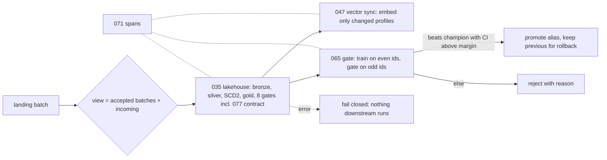

# POC 097: Reference AI data platform: lakehouse, contract gate, incremental vector index, model-promotion gate and tracing wired end to end (file-batch change source; no Debezium)

**Category:** Capstone | **Stack:** Python, DuckDB, MLflow (SQLite), OpenTelemetry (in-memory), SQLite vector index; composes POCs 035, 047, 065, 071, 077; POC 039 (Debezium CDC) NOT used

## Problem
Individually correct components still fail at the seams: a tampered batch must not leak into the index or the model registry, a replay must change nothing anywhere, and a model must only be promoted when it demonstrably beats the champion on data it never trained on. This reference runs landing batches through a medallion lakehouse with a data-contract gate (035/077), keeps a customer vector index in sync with the minimum embedding work (047), retrains an order return-risk model per window and gates it through an MLflow registry (065), and traces every stage with OpenTelemetry spans (071).

## Approach

- A batch is staged into a view of previously accepted batches; it is only added to the accepted set after every stage succeeds, so a rejected batch cannot contaminate later runs.
- Vector documents are customer profiles that change only with the SCD2 dimension, so after the first batch only a small share of chunks is re-embedded.
- The model step runs once per new batch (idempotency keyed on the immutable batch id), trains on half of the newest window and gates on the unseen half; a candidate with a missing feature is rejected before scoring.
- Return-risk LABELS are simulated from a documented rule on real gold features, because the synthetic orders carry no learnable signal (cross-validated AUC about 0.5 against stored status); the rule flips two effects from the fourth batch, producing concept drift that the champion cannot know about and the gate must recognise.

## Run it
```bash
make test PY=python
make demo PY=python   # needs mlflow, duckdb, opentelemetry-sdk (requirements.txt, requirements-mlops.txt, requirements-logs.txt)
```

## Evidence status
| Claim | Status |
|---|---|
| Lakehouse load, quarantine, SCD2, gates incl. data contract | real (DuckDB), reusing POC 035/077 |
| Vector index incremental sync, replay no-op, self-retrieval | real; hashing embedder is a stand-in for a model |
| Registry gate and promotion decisions | real MLflow (SQLite); statistical gate from POC 065 |
| Model labels | SIMULATED from a documented rule |
| Change source | file batches from POC 035; Debezium/CDC (POC 039) not used |
| Spans | real OpenTelemetry SDK, in-memory exporter; no collector or backend |
| Cloud deployment, scale, concurrency, scheduler/orchestrator | not tested |

## Results
<!-- RESULTS:START -->

**Results (POC 097: real DuckDB/MLflow/OTel/vector-index components wired together; change source is file batches, labels are rule-simulated; nothing on AWS)**
200 customers indexed; champion model version after four batches: **v3** (4 versions registered). Incremental embedding: 228 chunks vs about 800 if the index were rebuilt after every batch.

#### Batch by batch

| batch | status | lakehouse gates passed | chunks embedded | chunks unchanged | model decisions |
|---|---|---|---|---|---|
| b001 | ok | 8/8 | 169 | 0 | - |
| b002 | ok | 8/8 | 34 | 163 | v1 (regular): PROMOTED (no champion yet: first version passes smoke test) |
| b003 | ok | 8/8 | 12 | 187 | v2 (regular): rejected (subgroup 1 AUC regressed 0.606 -> 0.575) |
| b004 | ok | 8/8 | 13 | 187 | v3 (regular): PROMOTED (improvement +0.2440..+0.5253 above margin; no subgroup regression); v4 (missing feature): rejected (signature mismatch: candidate expects 5 features, serving sends 6) |

#### Replaying every batch (idempotency)

| check | result |
|---|---|
| all_ok | True |
| ingested | 0 |
| embedded | 0 |
| models_trained | 0 |
| lake_hash_unchanged | True |
| model_versions_unchanged | True |

#### Tampered batch (same id, different bytes)

| check | result |
|---|---|
| status | failed |
| error | BatchConflict: orders/b002 already ingested with different content |
| state_unchanged | True |

Self-retrieval (each customer's profile text finds its own document at rank 1): 100.0%.


#### Trace

| span | count |
|---|---|
| lakehouse.run | 9 |
| model.gate | 8 |
| platform.batch | 9 |
| vector.sync | 8 |

Batches whose root span carries an error attribute: 1.

<!-- RESULTS:END -->

## Limitations
- Single process, single writer; no scheduler, no concurrent runs, no recovery from a crash mid-run beyond what the underlying components provide.
- Only about 200 customers and 1,500 orders; promotion decisions are statistically weak at this size and depend on the seed.
- Model quality is not a finding: labels are rule-generated.
- No CDC: deletes and ordering guarantees of a real change stream are not exercised.

## Data and security
Synthetic data only; MLflow artifacts and all state live under a temporary directory; no network or credentials.
