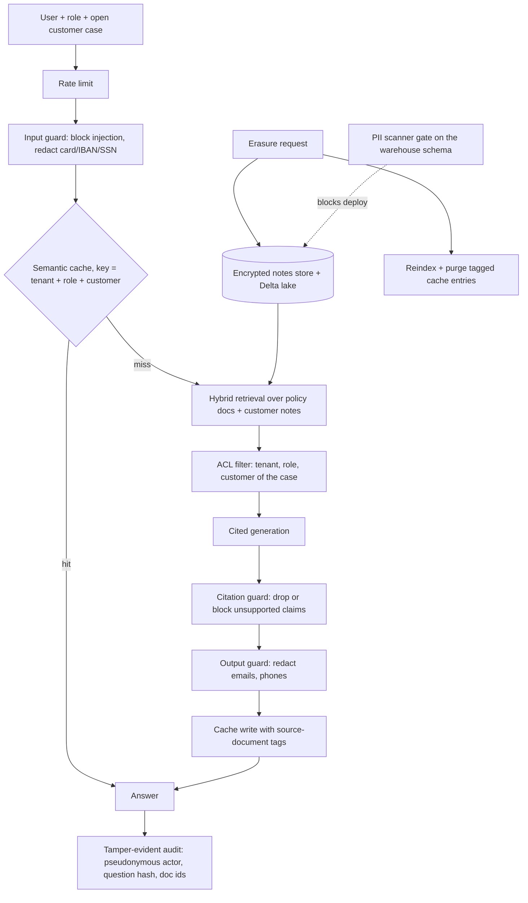

# POC 098: Reference architecture: enterprise RAG service with governance

**Category:** Capstone | **Stack:** Python; composes POCs 001 (hybrid retrieval), 002 (citation guard), 006 (semantic cache), 034 (guardrails), 078 (PII scanner), 084 (audit log), 088 (GDPR erasure)

## Problem
Individual controls (guardrails, cache, citation checks, erasure, audit) each work in isolation; the failures happen where they meet. This reference service wires them into one request path and exercises the seams: what the cache stores, who may see which documents, and what erasure has to reach.

## Approach

- Request path: per-user rate limit and input guard (POC 034), semantic cache (006) in front of retrieval, hybrid BM25+LSA retrieval (retrieval_kit, as evaluated in 001), cited extractive generation, the citation guard (002), the output guard (034), cache write tagged with the source documents, and a signed hash-chained audit entry (084) holding only pseudonyms, document ids and a question hash.
- Customer notes live in the encrypted ticket store of POC 088 and are indexed from there. Access is least-privilege: employees see only public documents; support agents see notes only for the customer of the open case.
- Governance flows: a PII gate (078) fails a deploy when the schema gains a PII column nobody declared; erasure runs the POC 088 pipeline (Delta lake and ticket store, with verification) and then reindexes and purges every cached answer derived from the erased documents.
- Three integration bugs were found by the scenarios and fixed: the cache key must carry the whole authorisation scope (tenant alone replayed an employee's answer to a support agent and would have replayed one customer's notes to another); erasure must invalidate derived cache entries (a control run shows the stale answer still served); and retrieving the global top results and then filtering by ACL starved the support agent of the customer's own notes (fixed with a multi-source context).

## Run it
```bash
make install
make test
make demo
```

## Evidence status
| Claim | Status |
|---|---|
| Composition of POCs 002, 006, 034, 078, 084, 088 and retrieval_kit | Real: their code is imported and exercised end to end by 15 tests and 14 scenarios |
| Generation | Extractive stub with citations, NOT an LLM; answer quality and LLM prompt-injection robustness are not measured |
| Retrieval quality | BM25 + LSA over a tiny synthetic corpus (about 48 documents + 40 notes); POC 001 holds the retrieval evaluation |
| Deployment (API server, auth, durable stores), multi-process cache, production monitoring | Not built |

## Results
<!-- RESULTS:START -->

**Results: end-to-end scenarios on the reference RAG service (extractive generator, no LLM; synthetic data)**
| scenario | outcome |
|---|---|
| grounded answer with citations, second user served from cache | answered, cites ['doc-driftwood-deployment', 'doc-beacon-access'], cache hit True |
| prompt injection in the question | blocked_input |
| card number in the question | answered; card in cache: False; in audit: False |
| other tenant gets a cache hit from tenant 1 | False |
| customer notes seen by: employee / support agent without a case / support agent with the case / support agent for ANOTHER customer's notes | False / False / True / False |
| cache reuse across customers (second customer's cache hit) | False |
| unknown role | forbidden |
| hallucinating generator | answered; unsupported sentence removed: True |
| rate limit: request number that was refused | 20 |
| erasure WITHOUT cache purge: stale answer still served | True |
| erasure with cache purge: pipeline status, docs removed, cache entries purged | completed, 2, 1 |
| after erasure: identifiers still visible in index or cache | [] |
| after erasure: same question | answered; subject in answer: False |
| other subjects unaffected; audit rows; audit holds name or email | True; 2; False |
| PII gate on the declared catalogue | True |
| PII gate after an unannounced phone column | False, flagged [('customer_notes', 'backup_phone', 'phone')] |

Stage latencies for one uncached request (ms): {'admit': 0.03, 'input_guard': 0.08, 'cache_lookup': 0.02, 'retrieve': 0.56, 'generate': 0.32, 'citation_guard': 0.3, 'output_guard': 0.11, 'cache_store': 0.16}.

<!-- RESULTS:END -->

## Limitations
- It is a wiring diagram that runs, not a product: no HTTP service, authentication, persistent cache or distributed rate limiting.
- ACL filtering is done after ranking the whole index; at scale it must be pushed into the vector index as a metadata pre-filter.
- Erasure reaches the stores, the in-memory index and the cache; copies in backups, logs, third-party model providers or user exports are out of scope (see POC 088 limitations).
- The audit log stores a question hash, not the text, so it cannot answer which question was asked; this is a privacy choice.
- Reference compositions 097 and 099 are NOT built because they depend on POCs 039 and 015, which cannot run in this environment.

## Data and security
All people, documents and tickets are synthetic. Questions are redacted before they reach retrieval, cache or audit.
