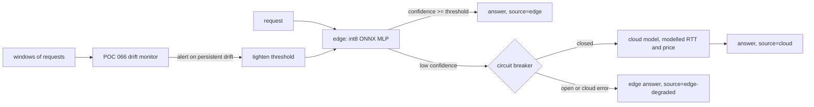

# POC 099: Edge-to-cloud hybrid serving reference: int8 ONNX edge model, confidence escalation, drift monitor, circuit breaker (cloud modelled; no language model)

**Category:** Capstone | **Stack:** Python, ONNX Runtime (int8), scikit-learn, composes POCs 017 and 066; POC 005 (router idea) and POC 015 (QLoRA) NOT used

## Problem
Edge devices can answer most requests cheaply and privately, but the hard ones need a bigger hosted model, the cloud link fails, and the traffic mix drifts. This reference wires an int8 ONNX edge model (POC 017 export/engine) to a more accurate cloud model behind a confidence-threshold router, calibrates the threshold on validation data, falls back to the edge answer when the cloud is down (with a circuit breaker), and uses the drift monitor from POC 066 to detect a traffic-mix shift towards hard cases and optionally tighten the threshold.

## Approach

- The edge model is a deliberately small MLP (16,8) exported with POC 017 and int8-quantised; the "cloud" model is gradient boosting trained on 4x the data. Both are classical models on a synthetic tabular task, standing in for an SLM and a hosted LLM.
- The threshold is the smallest confidence cut-off whose validation accuracy is within one point of cloud-only; the sweep shows the accuracy/cloud-share trade-off.
- Cloud failures return the edge answer flagged `edge-degraded`; the breaker opens after 3 failures and probes after a cool-down. Invalid input is rejected (POC 017 validation), never silently routed.
- Findings are in Results; notably the drift controller buys little accuracy for a large rise in cloud spend, because the static confidence threshold already escalates more when inputs get harder.

## Run it
```bash
make test PY=python
make demo PY=python   # needs onnxruntime, skl2onnx (requirements.txt)
```

## Evidence status
| Claim | Status |
|---|---|
| Edge model: int8 ONNX inference, accuracy, measured median latency | real; latency noisy and not asserted |
| Router, circuit breaker, drift monitor integration | real, unit-tested with fakes and end to end |
| Cloud model accuracy | real model, but a gradient-boosting stand-in for a hosted model |
| Cloud latency (120 ms RTT, 400 ms timeout) and price (0.0004 USD/call) | modelled assumptions |
| Language models, on-device hardware, real network, QLoRA fine-tuned SLM (POC 015) | not used / untested |

## Results
<!-- RESULTS:START -->

**Results (POC 099: REAL int8 ONNX edge model + REAL drift monitor/router; cloud latency and price MODELLED; no language model)**
Edge accuracy 0.841, cloud accuracy 0.8913 on 3,000 validation requests; calibrated threshold (within 1 point of cloud-only): **0.75**. Measured edge median latency: 0.04 ms (noisy, not asserted). Cloud RTT 120 ms, timeout 400 ms and 0.0004 USD per call are ASSUMED.

#### Policies on a clean stream

| policy | accuracy | cloud share | mean latency ms (modelled) | p95 ms | USD per 1k |
|---|---|---|---|---|---|
| edge only | 0.851 | 0.00 | 0.04 | 0.0 | 0.000 |
| hybrid (threshold 0.75) | 0.880 | 0.32 | 38.28 | 120.0 | 0.127 |
| cloud only | 0.881 | 1.00 | 120.04 | 120.0 | 0.400 |

#### Cloud outage (requests 300-699 of 1,500)

| router | accuracy | cloud share | degraded (edge fallback) share | mean latency ms (modelled) | p95 ms |
|---|---|---|---|---|---|
| with circuit breaker | 0.873 | 0.22 | 0.09 | 30.4 | 121.0 |
| without circuit breaker | 0.873 | 0.23 | 0.09 | 63.3 | 401.0 |

#### Traffic-mix drift towards hard cases (onset after window 4)

| scenario | accuracy after onset | cloud share after onset | windows to first alert | false-alert windows before onset |
|---|---|---|---|---|
| 50% hard cases, static threshold | 0.859 | 0.363 | 2 | 0 |
| 50% hard cases, controlled | 0.866 | 0.785 | 2 | 0 |
| 100% hard cases, static threshold | 0.828 | 0.420 | 2 | 0 |
| 100% hard cases, controlled | 0.836 | 0.829 | 2 | 0 |

<!-- RESULTS:END -->

## Limitations
- Tabular synthetic task; conclusions about confidence-based escalation may not transfer to generative models, whose confidence is harder to calibrate.
- Cloud latency/price are assumptions; outage and drift are injected, not observed.
- Edge latency is measured on the host CPU, not on a device.
- POC 015 (QLoRA) is blocked (no GPU/HF), so the edge model is not a fine-tuned SLM.
- Single seed per scenario; differences of about one accuracy point are within noise.

## Data and security
Synthetic data only; no network calls; no credentials.
