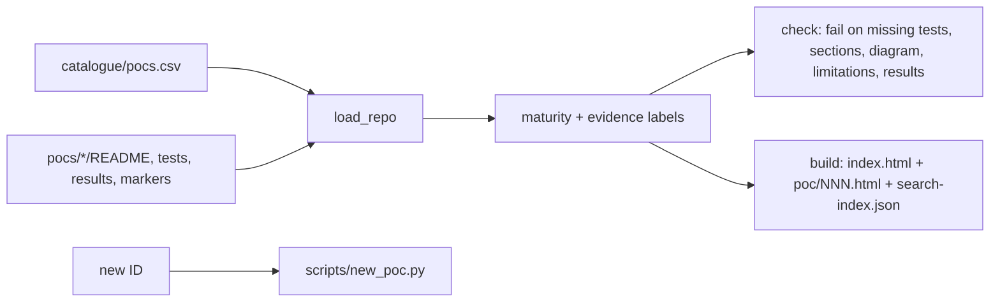

# POC 100: Auto-generated portfolio site and POC scaffolding CLI

**Category:** Capstone | **Stack:** Python, markdown-it-py (HTML disabled); MkDocs and GitHub Pages NOT used

## Problem
A 100-project portfolio is unusable if reviewers cannot search it and cannot tell which claims are verified. This POC reads the catalogue and every POC's README, derives a maturity level and the declared simulated/mock/modelled/unverified labels, enforces README/test/result hygiene across the repository (a CI-able `check`), and generates a self-contained searchable static site plus a JSON search index. A `new` command scaffolds the next POC from the catalogue.

## Approach

- Maturity: planned (no evidence) < scaffold < tested (has tests) < verified (tests + results + Mermaid diagram + all required sections + at least one stated limitation).
- Labels are read from each README's *Evidence status* table (simulated, mock, modelled, unverified), so the site shows what a project does not prove.
- READMEs are rendered with HTML disabled and unsafe link schemes blocked; catalogue text is escaped and the embedded JSON cannot close its script tag; the site makes no external requests.
- `check` is also run as a test against this repository, so catalogue/README drift fails fast CI.

## Run it
```bash
python -m poc_portfolio_site.cli --root ../.. check
python -m poc_portfolio_site.cli --root ../.. build --out /tmp/site --flagships 1,5,35
make demo PY=python
```

## Evidence status
| Claim | Status |
|---|---|
| Maturity/label derivation, README checks, site generation, XSS-style escaping, CLI | Tested (fixture repositories + this repository) |
| Whole-repository consistency check passes on this repository | Tested (part of the test suite) |
| MkDocs theme, GitHub Pages deployment, Mermaid rendering in the browser | Not used / not tested (diagrams are shown as source in the generated site) |

## Results
<!-- RESULTS:START -->

**Results (measured by `python -m poc_portfolio_site.main` against this repository)**
- site pages generated: 76 (75 POC pages + index) for 100 catalogue entries
- maturity: {'verified': 75, 'planned': 25}
- POCs whose evidence table declares simulated/mock/modelled/unverified parts: {'simulated': 13, 'mock': 5, 'modelled': 2, 'unverified': 61}
- repo consistency problems: 0

<!-- RESULTS:END -->

## Limitations
- Maturity is a repository-hygiene signal, not proof the code is correct: the labels come from what each README declares.
- Mermaid diagrams are not rendered in the generated pages (no JS dependency added); GitHub renders them in the READMEs.
- Search is a simple client-side substring filter over title, stack and slug.
- Publishing the site (GitHub Pages) needs repository settings that this POC does not change; build output is ignored by git.

## Data and security
Reads this repository's catalogue and READMEs; no external data.
